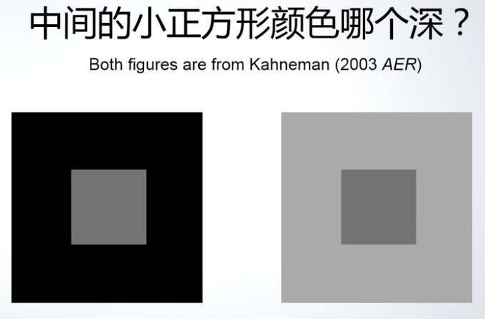
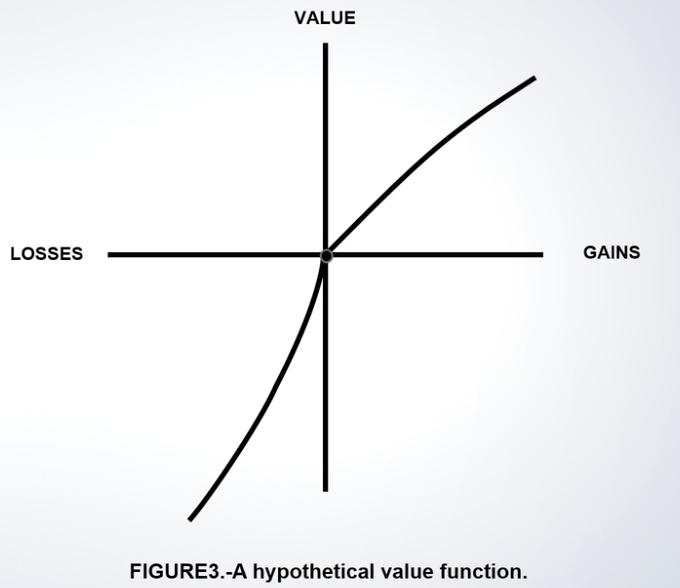
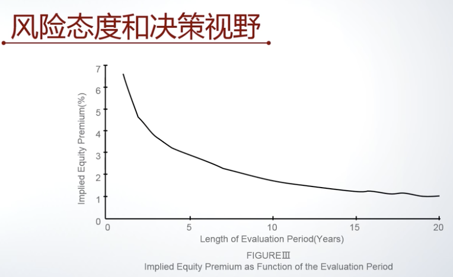

经济学遇上心理学，多一个角度看世界。
——孟涓涓教授(北京大学光华管理学院)

笔记内容对应的[视频地址](https://www.bilibili.com/video/BV1xJ411z7Ln)

# 一 行为经济学简介

## 行为经济学研究的范围

以往的宏观经济学和微观经济学都有一个"理性人"假设，而行为经济学认为人的行为是受心理影响的，并不是完全理性，行为经济学的研究对象就是这种不理性的程度。

## 行为经济学的发展

1. 亚当.斯密时代
   - 1759 《道德情操论》
   - 1776 《国富论》亚当.斯密
2. 新古典经济学时代
   - 20 世纪，理性人假设、经济学数学化
3. 2008 年金融危机转折

## 理性与非理性行为

| 新古典经济学理性人假设(狭义) | 行为经济学假设(行为偏误)                                     |
| ---------------------------- | ------------------------------------------------------------ |
| 只在乎自己绝对的收益         | 参照点比较与损失厌恶、社会性比较                             |
| 计划一致性                   | 执行偏离计划(自我控制问题、过度消费、拖沓)                   |
| 只在乎自己的利益             | 复杂的社会性偏好(利他、公平、信任、互惠、报复、愧疚、诚实等) |
| 对概率事件准确判断           | 概率判断偏误(赌徒谬误、热手谬误、过度自信)                   |

## 分析方法

- 效用函数
- 实验室实验
- 田野实验(field experiment)
- 大数据分析
- 理论模型，确定系数

# 二 参照点和损失厌恶

## 损失厌恶

一单位的损失对人们的伤害往往甚于一单位得到给人们制造的喜悦。

事例：幼儿园小朋友 巧克力 不哭

由于眼睛的对比反应，看起来右边的小正方形深一些，其实两个小正方形是一样的。

## 前景理论

- 人们会把自己的结果和某个参照点对比
  - 这个参照点是人的预期值
- 人们害怕损失甚于喜欢得到——损失厌恶

## 损失厌恶的影响

- 产生过度风险厌恶
- 不愿意在有损失的时候交易
- 产生设定目标的行为

- 彩票游戏：
  50%的概率赚 11 块；50%的概率损失 10 块；
  如果你拒绝这个游戏，说明有过度的风险厌恶

- 股权溢价之谜
  1889-1978 年美国股市平均历史收益率为 6.98%，无风险资产历史收益率为 0.9%
  股权溢价 = 6.98% - 0.9% = 6.08%
  股市风险程度和合理的个人风险厌恶程度无法解释该现象

随着决策视野扩大，风险承受能力也越强

- 风险态度和参照点的位置
  - 离参照点近：极度风险厌恶
  - 在参考点下面很多：风险厌恶程度降低(平损效应 break even effect)
  - 在参考点上面很多：风险厌恶程度降低(庄家资金效应 house money effect)

- 损失厌恶会导致人们不愿意在有损失的时候交易，从而导致决策失误和财富减少。

### 禀赋效应

- 咖啡杯实验(实验室实验)：
  给 A 组每人一个咖啡杯，B 组没有咖啡杯，让他们进行交易。
  A 组给出的价格是 5.25，B 组给的价格是 2.75。
  A 组认为失去咖啡杯是损失，所以定价更高；B 组是得到，效应低，所以定价低。
  **损失厌恶系数** = 5.25/2.75 = 1.9
  这个系数在各种场景下基本都在 2 左右

- 有经验的交易者禀赋效应会减弱
- 禀赋效应与参照点有关，本来就打算卖的东西损失厌恶会低

### 处置效应

在资产卖出决策中所产生的由于损失而不愿意交易的现象

- 相同的房子，买入价格不同，高价买入的人的出价要比低价买入的人的出价高 25%~35%，所以高价买入的人的房子在市场上会挂更长时间，甚至最终可能退出交易。
- 自住房的处置效应表现的更严重

- 股票也有相同的现象，过去买入股票的价格影响了买卖股票的决策，而实际上应该考虑的是未来的情况，完全不应该考虑过去买入的价格。

### 目标行为与劳动供给

如果临时增加某一天的每小时收入，那么这一天你愿意工作更短还是更久？

- 替代效应
  用之后闲暇时间来休息，现在工作更长

- 收入效应
  目标就是一生总收入，今天干的更多对总收入影响有限，所以工作时间更短就下班

新古典经济学认为：
当小时工资临时增长时，理性人的做法是工作更长时间。因为对一生的财富影响很小，所以收入效应的影响比较弱，所以最终替代效应占主要地位。

案例：纽约出租车司机劳动供给，当天工资越高，出租车司机工作时间更短。随着司机经验的增加，会减少这种效应。
解释：司机们把一天的收入目标作为参照点，如果不能达到会有损失厌恶，如果提前达到就回家了。
结果：这种选择使得他们单位劳动的收入变低了，因为在小时工资高时工作时间更短了。

田野实验：
工人分为两组：A 生产达到 400 件就奖励 80；B 默认有 80，但是如果低于 400 件就扣除 80。
结果：B 组比 A 组生产率提高 1%。如果按小组整体件数，生产率差异会更大，人们更不愿意小组遭受损失。

John List，田野实验的开创者，帮助企业、政府优化组织效率

# 三 当下享乐偏好(present bias)

- 跨期选择，涉及到今天和未来的决策
  - 时间偏好，这种选择背后的偏好

问题一：
假设你今天有一份**1000元**的收入，你可以在今天和半年后分配这部分收入。你可以选择一部分钱放在**半年后**拿到，且这部分钱会有**2%**的红利。

- 请问你会选择多少钱在**半年**后拿到？

问题二：
假设你**半年后**有一份**1000元**的收入，你可以在半年后和一年后分配这部分收入。你可以选择一部分钱放在**一年后**拿到，且这部分钱会有**2%**的红利。

- 请问你会选择多少钱在**一年**后拿到？

- 实验室试验时，会真实的在时间点给钱，并且控制了相同的信任等干扰因素。

新古典经济学认为：
由于两个问题跨期是一致的，所以分配后面拿到的数额是相同的。

当下享乐偏好：
行为经济学研究发现人们时间偏好是跨期不一致的，即呈现当下享乐偏误。因为问题一涉及当下，所以相比问题二会分配给半年后更少的份额，人们会显得格外没有耐心。

时间偏好模型(只作示例)：

- 新古典经济学，指数折现模型(exponential discounting)
  - U(C1,...,Ct)=...时间距离相等则效用相等
- 行为经济学，拟双曲贴现模型(Quasi-hyperbolic discounting)
  - ...添加了折现系数β，时间越靠后，效用越低

当下享乐偏好的影响：
||新古典经济学假设(指数折现模型)|行为经济学假设(当下享乐偏好)|
|---|---|---|
|储蓄消费决策|适当消费、储蓄|过度消费、储蓄不足|
|计划与执行|计划与执行一致|执行偏离计划|
|自我限制|无自我限制需求|有自我限制需求(意识到当下享乐偏误的人)

### 非平滑消费

场景：发了工资后，消费是平滑的，还是逐步下降(直到下一个发薪日)的

- 新古典经济学认为，理性人的消费模式应该是"平滑消费"，因为消费的边际效用递减，消费的越多、额外的效用越少。所以应该年轻时借钱、中年时储蓄、老年时使用储蓄。
- 当下享乐偏误，首先它让你存不下钱，影响了资产增长或养老；其次，它让你消费的总效用受到了损失；最后，它可能让你产生健康问题(发薪日大吃大喝)

调研数据，美国穷人食品券领取后每日购买的卡路里数量，和"逐步下降"相吻合。

- 如何确定这个现象一定和当下享乐偏误有关？(区别于普通推测，严谨的调研必须排除所有其它可能性)
  - 可能是集中购物引起的？
    - 卡路里数和家庭购物频率无关，排除这个可能性
  - 可能是家庭内部竞争引起的？(担心吃不到食物，所以着急着吃)
    - 分析家庭人口数量和曲线关系，发现没有关联
  - 可能是外部压力？(怕邻居来借，尽快吃完)
    - 研究发现这种情况很少
  - 通过其它调研，发现当下享乐偏好较大的人下降曲线会更陡，说明相关

### 计划与实施不一致

案例：波士顿地区健身房有两种套餐：

1. 每次 10 美元
2. 月票 85 美元(到期自动续约)
   - 每月去 9 次就划算
3. 年票 850 美元(到期不自动续约)
   - 一年去 90 次回本

结果：80%买了年票或月票的人，都无法回本。买月票的人比买年票的更糟糕，忘记去停止续约。

当下享乐偏误解释：

- 为什么和计划不一致？
  - 因为购买时高估了当下/近期的效用，低估了执行成本(当下不需要付出成本)
- 为什么自动续约的月票停不下来?
  - 懒得去健身、甚至懒得去停止续约
- 潜意识里希望用购买月票/年票的沉没成本来约束自己，但是最终多数没能成功约束

### 自我限制需求

根据是否能意识到自己的当下享乐偏误分为两类人：幼稚决策者(不能意识到)；成熟决策者(能意识到)。

- 成熟决策者的自我限制机制
  - 内在机制
    - 心理账户现象，由诺奖得住Richard Thaler教授提出
  - 外在机制

问题：
假设上司要求你在两个月内完成两个项目。你可以给自己的每个项目设置截止日期，并上报给上司作为硬性约束。请问你会选择下面哪种截止日期的设置方式？
A 两个截止日期都放在两个月后
B 一个截止日期放在一个月后，另一个放在两个月后

MIT 商学院 EMBA 们很多选了 B 这个看起来自我约束(牺牲了灵活性)的设置方式

- 菲律宾田野实验：引入自我限制性储蓄产品。
  - 开户前可以确定目标：储蓄数或者到期日。
  - 在目标达到前不可以取钱。

1. 首先销售前通过调研，记录受众的当下享乐偏好程度
2. Treatment组，介绍这个储蓄账户；Marketing组，储蓄但不提供自我限制性账户(无外在约束)；Control没有进一步干预(对照组)

实验结果：
有 26% 的人接受限制性储蓄账户。这组人比其它人储蓄率提升了 81%，说明外在约束的效果很好。

# 四 社会性偏好

主流经济学假设人是自私的，只在乎自己的利益。

## 利他与公平

问题一(独裁者游戏，dictator game)：
想象你与现在正在上本课程的以为同学在网上随机配对成一个小组，你不知道他/她是谁，他/她也不知道你是谁。你会从教学小组获得 10 块钱。

- 请问你愿意分多少给这位同学？

结果：

- <实验结果截图>

- 30~40%选择一分钱不给
- 60~70%选择给一点，大部分 1 块钱，一部分分 2.5 块
- 不知道对方是谁的情况下，大部分人显示出极少的利他倾向

问题二(博弈场景，最后通牒游戏，ultimatum game)：
在问题一基础上，他/她可以选择接受或者不接受。如果接受，则按照你的决策来分配；如果不接受，则你们两个人都拿不到任何钱。

结果：

- <实验结果截图>

- 没有人分配 0 了
- 很多人都到了2~5块
- 大概 1/5 的人会拒绝 0~2.5

问题二可以用来衡量人对不公平的厌恶程度，即人为了追求公平愿意牺牲多少自己的利益。

对比分析：

- <实验结果截图>
- 共同：分配者的利他倾向，或者不公平的厌恶倾向在两个游戏中应该是一样的。
- 差别：分配者认为的接受者的不公平厌恶程度导致了他们分配的增加。
- 总结：如果社会分配中，允许被分配的人做出反应，那最终分配会更加公平。

- 针对非洲不同国家地区的人做最后通牒游戏，实验分析得出："市场化"程度越高的社会，对不公平厌恶的程度越高。

- 现实的影响：
  - 利他主义
    - 公共政策；
    - 与慈善捐款行业有关。
  - 不公平厌恶
    - 会影响企业的定价策略(价格粘性)
    - 工资长期增长

## 信任与互惠

- 信任被认为是经济运行的润滑剂

- 问题(信任游戏，trust game, investment game)：
  - 想象你与现在正在上本课程的一位同学在网上随机配对成一个小组，你不知道他/她是谁，他/她也不知道你是谁。你会从教学小组获得 10 块钱。
  - 你可以把其中 N 块钱分给另外一位同学，他/她会得到 3N 的钱，然后他/她可以选择从中还多少钱给你。
  - 请问你会给他/她多少钱？

- 实验结果
  - <实验截图>
  - 每一个线代表一次分配决策
  - 空心点代表分配的数额
  - 实心点代表接受者返还的钱
  - 平均会给出 5 块钱；但是接受者只返还了 4 块钱，辜负了信任，没有还钱，更没有多给。

- 如何排除信任游戏中的利他部分？(有些人不求回报)
  - 让一个人先玩独裁者游戏，再玩信任游戏
  - 信任游戏中的份额 - 独裁者游戏中的份额 = 纯粹的信任的衡量
  - 也可以在玩信任游戏时，问给出者期望对方给的回报，来衡量信任的份额

- 互惠
  - 正向互惠：你帮助了我，我也会帮助你
  - 负向互惠：你伤害了我，我也会伤害你

### 互惠的应用，职场

- 田野实验： 招募学生进行图书馆数据录入的工作。
  - 控制组：工资一直是 12 美元/小时
  - 实验组：工资意外地从 12 美元/小时账号 20 美元/小时
  - 结果：
    - <实验截图>
    - 控制组：工作效率较为稳定
    - 实验组：努力工作产生互惠效应，而这种效应逐渐减少

### 互惠的应用，捐款

- 田野实验：上门请求捐款
  - 控制组：无卡片
  - A组：赠送一张印刷非洲小朋友画的卡片
  - B组：赠送 4 张卡片
  - 结果：
    - 赠送 4 张卡片的捐款数额和概率都是不赠送卡片的近 2 倍

- 总结：
  - 短时间内，互惠会激发努力
  - 很小的赠送就能激发互惠行为，过多的赠送效用下降

## 社会形象

- 人很多时候表现出来的善意和互惠行为，更多是出于社会形象的考虑。

- 问题：
  - 在独裁者游戏的基础上，假设有 50% 的概率你给出的 N 块钱会损失掉，另外一位同学只会收到 0。他/她也知道损失的概率，但是他/她不能区分到底是你原本就给 0，还是钱损失掉了。请问你会分多少钱？
  - 通过随机损失，使得给出者对社会形象的考虑大大减少(之前给钱可能因为不想让对方认为你是小气鬼)
  - 实验结果：
    - <实验截图>
    - 随着丢失概率的增长，对社会形象的考虑会减弱。随着丢掉概率的增加，给 0 的比例会显著增加。

### 社会形象与捐款

- 田野实验：
  - 控制组：没有预告，直接敲门募捐
  - 预告组：提前一天预告明天会上门募捐
  - 勿扰组：提前一条预告明天会上门募捐，可以把勿扰选项挂载门口避免募捐(打一个勾)
  - 结果：
    - <实验截图>
    - 预告组应答率降低 9%
    - 勿扰组降低应答率 23%(含勾选勿扰项的)
    - 预告之后小额捐款(10美元一下)显著减少，但是大额捐款基本不变。真正想捐的会等待，所以大额不变；不想捐的会故意不在家，所以小额显著减少。
    - 经分析
      - 25%受到利他主义影响、75%受到社会压力影响。
      - 对本州的慈善组织：3.75美元的社会压力(由于社会压力增加的捐赠)
      - 对外州的慈善组织：1.44美元的社会压力

# 五 概率判断偏误

- 问题(忽略先验概率)：
  - 假设每一百个人中有一个是坏人。有一个捐款测试可以检验人的好坏，并且这个实验的精度是99%，即如果一个人是坏人，这个测试在99%的情况下他不会捐款；如果一个人是好人，这个测试在99%的情况下他会捐款
  - 假设李雷的捐款测试表名他不会捐款，你觉得他是坏人的概率有多少？
  - 大部分人会认为李雷是坏人的概率是99%
  - 形成概率判断的几个要素：
    - 先验概率：99%的人都是好人
    - 信号：李雷没给灾区捐款
    - 后验概率：李雷是坏人的概率是？
  - 结果：
    - 大部分人的概率判断中忘了先验概率：99%的人都是好人
    - 贝叶斯法则计算李雷是坏人的后验概率是50%

- 问题(小数定理)：
  - 随机扔一个六面骰子，计算平均点数。
  - 结果显示，当投出次数达到 400 次以上时，平均值接近期望值 3.5，在那之前一直低于 3.5。而绝大多数人会认为投出 10 次就应该接近平均值。

- 问题：
  - 假设一个家庭生了5个孩子，您觉得下面什么样的性别顺序可能出现？
    - 女男女男女
    - 女女女女女
  - 直观的会认为第一种顺序才对，但是这是小样本，第二种出现概率也不小

- 概率判断偏误：赌徒谬误(认为期望值不变，应该趋近于期望值)
  - 赌局：扔硬币，正面赢，反面输
  - 赌徒谬误：一个赌徒在连续输了三把之后，坚信下一把一定会赢。因此继续赌博，因为他相信平均来说输赢应该是一半一半。
  - 他忽略了这样的大数定理结论只有在大样本情况下才适用(掷骰子要400次以上)

- 概率判断偏误：热手谬误(认为期望值改变)
  - 一个赌徒在连续赢了五把之后，他相信几年有幸运之神的眷顾，他有一双"热手"。因而继续赌博。
  - 因为他觉得正常情况下(大数定理)不可能连续出现五把赢面，所以反推今天自己运气特别好。即，自己出现赢面的先验概率大于50%。

- 概率判断偏误的应用
  - 股市当前回报率高的股票
    - 短期正相关。接下来的短期内还会变高的概率较高。
    - 长期负相关。接下来长期内回报率变低的概率较高。
    - 小数定理的解释：
      - 短期：赌徒谬误。相信回报会回归到平均值。
        - 卖回报好的股票，买回报差的股票。->回报好的股票价格变低、回报率上升。->回报呈现正相关。
      - 长期：热手谬误。相信连续产生高回报的股票确实与众不同。
        - 买回报好的股票，卖回报差的股票。->回报好的股票价格变高、回报率下降。->回报呈现负相关。

## 过度自信

- 问题：
  - 你觉得自己的驾驶技术在中国人中能排名到前百分之多少？
  - 美国的实验室研究表名：
    - 93%的司机认为自己的驾驶技术比人群的中位数要好
    - 如果是理性的判断应该是 50% 的人认为自己比中位数好
    - 46%的人认为自己在前 20%

- 过度自信：
  1. 过高估计自己的绝对成绩
  2. 过高估计自己的成绩和他人相比中的排序
  3. 过高估计自己结论的准确度

- "创业者"实验：
  - 条件：
    - 可选择是否进入某个市场生产
    - 参与者会被按照某种方式排序
    - 市场容量有限，进入的人越多，每个人的收益越差；且排序靠后的人收益越差。
  - 排名决定方法：
    - 进入市场前不知道自己的排名，要先做个预判
    - 1. 随机排序。没有过度自信的空间。
    - 2. 根据逻辑测试题排序。有明显的过度自信的空间。
  - 结果：
    - 市场过度进入的程度在按照逻辑题排序组的时候更严重，平均损失也更大。
    - 这说明过度自信会导致人们盲目地进入某一市场，而承受更多的损失。

- 性别与过度交易
  - 研究表名：男性比女性更容易有过度自信的倾向
  - 美国 1991~1997年35000个故事交易行为分析
    - 男性比女性多交易 46%
    - 频繁交易使得男性比女性损失 2.65% 的收益
- CEO行为
  - 如何衡量过度自信的 CEO?
    - 个人是否过度投资于自己的公司
    - 媒体对 CEO 采访以后使用的形容词
  - 弱读自信的 CEO 有何影响？
    - 过度自信的 CEO 比非过度自信 CEO 进行并购的可能性多出 65%(自信能管好其它企业)
    - 故事对过度自信的 CEO 的并购决策更加悲观

## 投射(预测)偏误(Projection Bias)

- 投射偏误：人往往高估了未来的效用和当下效用的相似度。

- 实验，为一周后预定不健康小零食的比例
  - 做决策时间有两种变化
    - 刚吃完午饭(不饿)
    - 下午晚饭前(饿)
  - 实验结果
    - 饿的时候比不饿的时候预定不健康小零食的比例高出 22%

- 问题
  - 你在什么样的天气更愿意待在屋子里学习？
    - A 阳光明媚的天气
    - B 乌云密布的天气
  - 让大学生进行选择 1(阳光明媚)~7(乌云密布)
  - 结果：大多数选择了 5~6，也就是乌云密布的时候更愿意在屋里学习(晴天才能出去)
- 实验，当天的天气和选择大学的比例
  - 美国一所大学学术很强，但体育休闲活动是弱项
  - 高中毕业生在访问日访问大学，然后决定是否申请
  - 假设：
    - 在乌云密布时会更看重学术优势，更可能会申请
    - 在阳光明媚时会更看重体育优势，更可能不申请
  - 实验结果：
    - 访问日当天云层厚度显著增加了学生申请这所学校的概率
    - 云层厚度增加一个标准差，学生的申请概率增加9%
    - 学生被录取的概率并没有随着访问日云层厚度有显著变化，说明天气不好的时候来参观的并不是更优秀或者对学术更感兴趣的学生
      - 排除了"对学术感兴趣的学生提前看天气预报后，导致乌云密布时来参观的更多"的情况

- 实验，购物决策
  - 季节和天气会影响你购买什么车型吗？
  - 研究表明
    - 夏天敞篷车销售比例最高
    - 冬天敞篷车销售比例最低
    - 四驱SUV正相反，冬天销售比例最高、夏天销售比例最低
  - 有没有可能是不同季节开不同车的因素？下一个问题会避免这种影响
  - 一次严重暴风雪后四轮驱动车型购买的动态变化(短时间内，不受季节影响)
    - 暴风雪之前的几天，购买比例保持正常水平
    - 暴风雪当日，突然间购买量激增
  - 天气冷的时候是否更容易冲动购买防寒用品？
    - 研究发现：气温每下降 30 华氏度，购买的防寒用品被退货的比例会上升 3.95%
      - 说明偏误发生后，消费者意识到发生了偏误，就退货
  - 中国人在雾霾天更容易购买医疗保险
    - 当天的空气污染增加一个标准差，医疗保险的购买增加 7.2%
    - 在免费退保期，如果空气污染程度降低一个标准差，退保率会增加 4%

# 六 基于行为经济学的政策设计

## 商业政策

- 传统经济学认为，即便个体有决策偏误，市场会纠正甚至消除这种偏误。
  - 经验会降低偏误，因而市场竞争会逐步使人变得更加理性
  - 非理性的人无法在市场中存活下去(倾家荡产)
  - 在股票市场上，理性人会利用非理性人的非理性特性来赚钱

- 实际上市场如何应对消费者的决策偏误？
  - 人能够通过学习降低自己行为偏误变得更加的理性
  - 但是生活中很多决策没有短时间高频率的学习机会，例如买/卖房、婚姻，因此决策偏误可能无法纠正或者第一次就犯下重大错误
  - 每个人每次损失可能是有限的，这不会使我们达到一个倾家荡产
  - 投资领域，理性投资者用来偏离或纠正这个非理性投资者的这种行为的工具是有限的，所以股票的价格可能会长期系统性的偏离价值
  - 市场上的商家往往没有消除这种偏误，反而利用这种偏误
    - 超市中定价 3.99，利用有限注意力，人们只看到前面的 3 而忽略了最终价格更接近 4
    - 软件在默认选项上打勾然后字体调小，让你授权他们很多不必要的权限
    - 健身房鼓励你买个长期的月票/年票，最终没有去
  - 有些商家帮助大家消除偏误
    - 银行信用卡自动还款协议，避免忘还导致滞纳金
    - 发展中国家的一些小微银行提供自我限制性的储蓄产品

- 商家是利用你的决策偏误还是消除你的决策偏误
  - 最关键的点是**消费者是否能够意识到自己的决策偏误**
  - 市场竞争是否充分，充分竞争的市场中会有更多商家帮你消除决策偏误

- 商业政策设计
  - DellaVigna and Malmendier (2004) 的研究：
    如果市场上存在不能意识到自己跨期不一致性的幼稚消费者，那么商家可以利用这个偏误设计最优策略。
    - 投资品(当下支付成本而长期享用收益)，如教育、健身
      - 策略：收取低价，然后在取消时设置障碍无法退款
    - 休闲品(当下享受收益而长期支付成本)，如信用卡消费、贷款
      - 策略：收取高价

## 公共政策

- 以"增加人们购买养老保险的比例"为例

- 传统的政策大多基于理性人假设
  - 一般认为没有政策干预的必要
    - 人们会自己购买合适的养老保险，合理规划消费
  - 即便干预，也需要支付很大的成本才能改变人们的行为
    - 需要增加政府的补贴

- 行为经济学的政策认为人可能有非理性行为
  - 某些情况下有干预必要
    - 人倾向于当下享乐而不愿存款
  - 不需要支付很大的成本就能通过机制设计改变人们的行为

- 未来储蓄计划(Save-more-tomorrow)，由 Richard Thaler (理查德.塞勒)教授提出
  - 提前决定对未来工资的储蓄，克服当下享乐倾向
  - 储蓄未来工资增长部分的一个百分比，克服损失厌恶倾向
  - 任何时候可以选择退出，有选择的自由
  - 效果：
    - 公司中有 78% 的人加入了计划
    - 未来 40 个月，将储蓄率从 3% 提高到 15%
    - 没有任何额外的成本

- Richard Thaler 认为基于行为经济学的这种公共政策应该叫做"自由的管教政策"
  - 不影响理性人的决策，让人们有选择的自由
  - 帮助哪些有行为偏误的人改善决策
  - 成本几乎可以忽略

# 《人类误判心理学》——查理.芒格

以下内容出自《穷查理宝典》中查理·芒格的经典篇章《人类误判心理学》。他系统总结了25种人类天生的心理倾向（认知与行为偏误）：

## 初衷：

- 传统的心理学像是收集标本的孩子，不断地收集样本而没有足够的深入分析，而且为了避免"不必要的麻烦"，会主动忽视很多现象
- 这些倾向是大脑为了简化决策进化出的“思维捷径”，但在复杂的商业、投资、生活决策中，常常会导致系统性的判断错误

- 案例：
  - 把蚂蚁行径队伍弄成一个圈，可能会一直行走直到死亡
  - 慢慢旋转的平台上，观众看到"自由女神像消失"
  - 一只手放在热水里、另一只手放在冰水里，然后同时放到温水，人脑很容易被对比欺骗

## 1. 奖励与惩罚超级反应倾向(Reward and Punishment Superresponse Tendency)

核心：激励和惩罚对人的行为有极强的塑造作用，其威力远超普通人的认知。芒格的核心格言是：“如果你想要说服别人，要诉诸利益，而非诉诸理性。”

- 正面：合理的激励能极大提升效率，比如联邦快递按班次结算薪酬而非按时长，解决了夜班拖延的问题。
- 负面：会导致“激励偏差”——人们为了获取奖励会钻制度空子，甚至做出不道德行为，比如销售为冲业绩造假账。芒格特别强调，制度设计必须优先防范钻漏洞的动机。

- 案例：
  - 施乐(Xerox)公司，销售人员因为激励机制问题，故意把旧型号机器卖给客户。
  - 马克吐温的猫，在火炉上被烫之后，不论火炉是热的还是冷的，再也不愿意坐上面了。
  - 富兰克林在《穷理查年鉴》中说过：“如果你想要说服别人，要诉诸利益，而非诉诸理性。”
  - 有个外科医生，偏执的认为胆囊会带来害处，每年把大量健康的胆囊切除。
  - 前国防部采购时签署的都是成本保利合同（以成本再加一个比例的利润作价），后来这种会引起贪污的合同被定为重罪。

### 激励机制引起的偏见

- 我从来没有见过一个哪怕稍稍客观的纪人
- 人们往往必须怀疑或者有保留地接受其专业顾问的建议，哪怕这个顾问是一名工程师。一般的对策如下：
  1. 如果顾问提出的专业建议对他本身特别有利，你就应该特别害怕这些建议；
  2. 在和顾问打交道时，学习和使用你的顾问所在行业的基本知识；
  3. 复核、质疑或者更换你得到的建议，除非过客观考虑之后这些建议看起来是合适的。
- 收款机的发明能够使不诚实的行为难以得逞
- 西屋电器电气由于嫉妒通用电气，想要从对外贷款中获取更多利润。向房地产开发商的、贷款额为建设费用的95%的贷款，没有要求发放者最后再拿去提成，导致最终全部坏账。
- 与有底薪的销售员相比，单纯靠提成过日子的销售员更难保证不做不道德的事情。从另一方面来说，无底薪的销售员的工作绩效会更加突出。

- 为什么激励机制这么重要而没有被心理学教科书着重讲解？
  - 到最后，我得出的结论是，如果有的事情在生活中极为明显，但很难通过容易做的、可复的学术实验得到证明，那些心理学的寻菇犬(被训练只会寻找稀有蘑菇的狗)就会忽略它。
  - 反而其它学科比较重视，比如经济学的名词"代理成本"。雇主可以采用的对策包括制定严格的内部审计制度，对败露的不轨行为进行严厉的公开惩处，使用防止钻营的规章制度和收款机等机器。

### 激励机制引起人们倾向于钻各种制度的空子

- 几乎所有制度设计都必须具备防止钻空子的要属性
- 制度设计还需要遵守如下的原则：尽避免奖励容易作假的事情
- 只要一个毫无实质价值的筹码能够固定换到一根香蕉，那么人们就可以对猴子进行训练，让它为了筹码而工作，仿佛筹码就是香蕉一样。同样道理，人类也会为了钱而工作——而且会为了钱而更加卖命地工作
- “祖母的规矩”也证实了奖励是非常有用的。它的效果特别突出，所以我在这必须提到它。具体来说，祖母的规矩就是要求孩子在吃甜点之前先把他们的胡萝卜吃掉。把它应用到商界，就是要求管理人员天强迫他们自己先完成他们不喜欢然而必要的任务，再奖励他们自己去处理那些他们喜欢的任务。

### 关于惩罚

- 惩罚也强烈地影响到行为和认知，尽管它的弹性和效果不奖励那么好

- 案例：
  - 非法操纵物价被严厉惩罚后，就很少有人做了
  - 陆军和海军部队在利用惩罚来改变行为方面做得很极端，这可能是因为它们需要士兵的绝对服从
    - 大约在恺撒的年代，欧洲有个部落，当集结号角吹响时，最后一个到达的士兵就会被杀死，于是没有人愿意跟这个部落打仗。
    - 乔治·华盛顿则把那些当逃兵的农场少年吊死在 40 英尺高的地方，以此来警示其他那些可能想要逃跑的士兵。

## 2. 喜欢/热爱倾向(Liking/Loving Tendency)

核心：人类天生会喜欢、热爱对自己友善、能给自己带来好处的人或事物，并且会因此扭曲认知。

- 基因层面：
  - 刚孵出来的小鹅在破壳而出后将会“热爱”并跟随第一个对它和善的生物
  - 刚出生的人类也会“天生就喜欢和热爱”对他好的人
  - 老鼠同样也有“爱护孩子”的行为，但只要删除某个基因，老鼠的这种行为就会消失

- 表现：会忽略热爱对象的缺点和过错（情人眼里出西施）；会偏爱和热爱对象相关的一切；会为了维护热爱的事物主动扭曲事实。
- 例子：粉丝对偶像的盲目维护，投资者因为喜欢某家公司的产品而无视其估值泡沫。

## 3. 讨厌/憎恨倾向(Disliking/Hating Tendency)

核心：与喜欢倾向完全相反，人会对伤害过自己、让自己厌恶的对象产生极端排斥，同样会严重扭曲认知。

- 基因层面：
  - 刚出生的人类也会“天生就讨厌和憎恨”对他很坏的人。猿类和猴类的情况也是如此。

- 表现：全盘否定憎恨对象的优点，忽略其合理之处；把所有坏事都归咎于对方；甚至产生非理性的报复欲。
- 例子：
  - 政治对立中双方完全无法倾听对方观点，商业竞争中对竞争对手的恶意偏见。
  - 当世贸中心被摧毁的时候，许多巴基斯坦人立刻认为是印度人干的，而许多穆斯林则认为是犹太人干的。
  - 以色列和巴勒斯坦之间很难和解，因为一方历史中记载的事实与另外一方历史中记载的事实大相径庭，很少有相同之处。

## 4. 避免怀疑倾向(Doubt-Avoidance Tendency)

核心：人类大脑天生倾向于尽快做出判断、消除疑虑，而不是花时间深思熟虑。

- 基因层面：
  - 进化在漫长的岁月中促使动物倾向于尽快清除怀疑。毕竟，对于一只受到进攻者威胁的猎物来说，花很长时间去决定该怎么做肯定是一件不妙的事情。人类的远祖也是动物，这种避免怀疑倾向与其远祖的历史是很相符的。

- 触发条件：通常在困惑、压力、不确定性强的场景下被触发，人会急于下结论来摆脱“不确定”的不适感。
- 影响：会让人仓促做出错误决策，忽略关键信息；这也是宗教、刻板印象能够快速传播的心理基础——给人一个确定的答案，立刻消除怀疑。

ps: 这个也是我总结的："不要过早下结论，承认自己当前不知道"。之前在"罗辑思维"也听过一个类似的说法："成熟的人就是有矛盾的思想在脑子里同时存在"。

## 5. 避免不一致性倾向(Inconsistency-Avoidance Tendency)

核心：人会本能地维持自己过往的认知、身份、承诺和行为的一致性，抗拒改变，哪怕事实证明自己是错的。芒格称其为人类的“思维免疫系统”。

- 基因层面
  - 当人类的远祖还是动物的时候，迅速作出决定对生存来说是至关要的，而这种抗改变的模式有助于更快地作出决定。
  - 它使得我们的远祖能够通过群体协作而获得生存优势，因为如果个人的反应总是不停地改变，那么群体协作就会变得很困难。
  - 从人类刚开始识字到今天拥有复杂的现代生活，中间的时间并不是很长，它是进化在这么短的时间内所能得到的最好的办法。

- 表现：先入为主，一旦形成观点就很难被推翻；承诺升级，为了证明之前的选择正确，会持续投入更多；习惯难以改变；主动回避和自己观点相反的信息（确认偏误）。
- 例子：
  - 投资套牢后不肯止损，反而加仓摊低成本，只为证明自己最初的判断没错。
  - 在作出决定之前，法官和陪审团必须先聆听辩方的长篇大论，让辩方列举证据为自身辩护。这有助于防止法官和陪审团在判决的时候犯“第一结论偏见”的错误。
  - 人们倾向于积累大僵化的结论和态度，而且并不常去检查，更不会去改变，即便有大的证据表明它们是错误的。
  - 普朗克不但以科学研究闻名，而且他还说过一句著名的话，他说，甚至在物理学领域，激进的新思想也很少被旧卫士所接受。与此相反，普朗克说，惟有新的一代成长起来，较少受到旧理论毒害的他们才能接受新理论。
  - 处在巅峰期的爱因斯坦非常善于摧毁他自己的思想，但是爱因斯坦晚年却从没有完全接受子力学。
  - 大多数人在生活中不会表现出与他们的公共责任、新的或旧的公共认同等不一致的行动，而是会忠于职守，扮演好牧师、医生、公民、士兵、配偶、教师、职员等角色。
  - 富兰克林请重要人物帮小忙，使得大人物更信任他了。
  - 这种效应也解释了监狱中的看守和囚犯势不两立的现象

ps: 李录说过："做投资的人不该总是发表意见，这种意见如果错了，因为告诉过别人，会导致后面自己很难修正，不好意思承认自己的错误。"。日常生活中也经常有自动忽略不支持自己观点的事实的倾向。

### 避免不一致倾向的衍生结果

- 人们在获取新身份的过程中作出的大牺牲将会提高他们对这种新身份的忠诚度
  - 毕竟，如果他们认为某样东西并不好，却又为之作出大牺牲，那他们的行为将会显得和他们的思想很不一致。
  - 强化好关系：所以文明社会发明了许多庄严肃穆的入会仪式，这些仪式通常是公开举行的，能够让新成员更加忠心。
  - 强化坏关系：黑手党新成员因为“投名状”而对组织更加忠诚，德国军官因为“血誓”而对希特勒更加忠心，这些都是避免不一致性倾向引发的后果。

- 避免不一致性倾向是如此强大，乃至一个人只要假装拥有某种身份、习惯或者结论，他自己通常就会信以为真。
  - 许多扮演哈姆雷特的演员会在某种程度上相信自己就是那位丹麦王子
  - 许多装好人的伪善者的道德水平确实得到了提高
  - 许多假装公正无私的法官和陪审团确实会做到公正无私
  - 许多辩护律师或者其他观点的鼓吹者最后会相信他们从前只是假装相信的东西

- 避免不一致性倾向造成了“维持现状倾向”
  - 避免不一致性倾向导致教师不太可能把自己不相信的知识教给学生。所以临床医学教育要求学生必须遵守“先看，后做，再教”的原则
  - 当年轻的学生被灌输了值得怀疑的政治理念，然后热诚地将这些理念推销给我们其他人时，现代教育就会给社会造成很大的破坏。这种推销很少能使其他人信服。但是学生会把他们所推销的东西变成他们自己的思维习惯，从而受到了永久的伤害。
    - 我认为那些有这种风气的教育机构是很不负责任的。在一个人心智尚未完全成熟之前，不能给他的头脑套上一些锁链，这是很要的。

## 6. 好奇心倾向(Curiosity Tendency)

核心：人类天生拥有强烈的好奇心，这是智慧发展的核心动力，但也会带来误判。

- 基因层面
  - 哺乳动物天生就具有好奇心，但在所有非人类的哺乳动物面，好奇心最强烈的是猿类和猴类。而人类的好奇心又比他的这些近亲强烈得多。

- 正面：驱动学习、探索和创新。
- 负面：会被新奇、无关的信息吸引注意力，忽略核心问题；“好奇害死猫”，为了满足好奇心冒不必要的风险。

- 案例：
  - 雅典（及其殖民地亚历山德亚）人的纯粹好奇心推动了数学和科学的发展，而罗马人则对数学或科学几乎没有贡献。罗马人更专注于矿、道路和水利等“实用”工程。

## 7. 康德式公平倾向(Kantian Fairness Tendency)

核心：人类天生具备“己所不欲，勿施于人”的公平本能，源自康德的“绝对命令”道德观——人们希望自己被公平对待，因此也会倾向于公平对待他人。

- 表现：排队时对插队者的普遍愤怒；合作中如果觉得自己被亏待，就会消极应对甚至报复；现代社会的福利、救济制度也部分源于这种本能。
- 负面：对“公平”的执念有时会让人忽略效率，甚至做出非理性的报复行为。

- 案例：
  - 陌生人往往会自愿平分飞来横财，或者平摊意外损失。当人们期待然而没有得到公平分配时，往往会表现出不满的情绪。
  - 过去300年来，奴隶制度在世界各地基本上被废除，很可能就是这种倾向导致的。

ps: 这个和《行为经济学》中"利他和公平"的理论一致

## 8. 艳羡/妒忌倾向(Envy/Jealousy Tendency)

核心：人天生会对他人拥有的财富、地位、优势产生妒忌。芒格认为这是驱动世界运转的核心动力之一，但也是大量痛苦和冲突的来源。

- 基因层面：
  - 如果某个物种在进化过程中常挨饿，那么这个物种的成员在看到食物时，就会产生占有那食物的强烈冲动。如果被看到的食物实际上已被同物种的另外一个成员占有，那么这两个成员之间往往会出现冲突的局面(通过适度争抢使基因更好地延续)。这可能就是深深扎根在人类本性中的艳羡/妒忌倾向的进化起源。

- 芒格的观点：很多宗教和道德体系都明令禁止妒忌，恰恰因为它的破坏力极强；但现代社会很少公开讨论妒忌，导致人们对它的影响认识严重不足。
- 例子：
  - 职场中因为同事升职而产生的内耗，兄弟姐妹之间的资源妒忌，投资中因为别人赚得更多而盲目追高。
  - 许多大型律师事务所担心艳羡/妒忌会造成混乱，所以它们历来给所有高级合伙人提供的薪酬都是差不多的，完全不管他们对事务所的贡献有多大的差别。

- 为什么社会上有潜规则禁止把结果归因于嫉妒？
  - 我的猜想是，这是因为人们普遍认为，说某种立场是由艳羡/妒忌促成的，是对采取那种立场的人的极大侮辱，如果那个人所持的看法是正确的，而不是错误的，那就更是如此。说某种立场受到妒忌的驱动被视为等同于说采取那种立场的人儿童般不成熟，那么这种对妒忌避而不谈的禁忌就完全可以理解了。

ps: 我怀疑嫉妒就是"同辈压力"的来源，别人有而我没有，叠加康德式公平倾向。

## 9. 回馈倾向(Reciprocation Tendency)

核心：人类有“你对我好，我就对你好；你对我坏，我就对你坏”的互惠本能，也就是“以德报德，以牙还牙”。

- 基因层面：
  - 人们早就发现，和猿类、猴类、狗类和其他许多认知能力较为低下的动物相同，人类身上也有以德报德、以牙还牙的极端倾向。这种倾向明显能够促进有利于成员利益的团体合作。从这方面来讲，它跟许多社会性动物的基因程序很相似。

- 正向应用：商场上的人情往来、服务行业的小赠品，会提升客户的付费意愿；谈判中的让步会换来对方的让步。
- 负面：会被人利用，比如“登门槛效应”——先提小要求再提大要求；也会导致冤冤相报的恶性循环。

- 人类和蚂蚁的历史给我们的启发是：
  1. 大自然并没有普遍的法则使得物种内部以德报怨的行为能够推动物种的繁荣；
  2. 如果一个国家对外交往时放弃以牙还牙的做法，这个国家是否有好的前景是不确定的；
  3. 如果国与国之间都认为以德报怨是最好的相处之道，那么人类的文化将要承担极大的任，因为人类的基因是帮不上多少忙的了。

- 案例：
  - 路怒症(road rage)、运动场上的受伤引起群体情绪失控事件。从这些事件可以看出来，在和平时代，人们之间的敌意也可能非常极端。
  - 时候，在战火正酣时，交战双方会莫名其妙地停止交火，因为有一方先做出了细微的友善的举动，另外一方则投桃报李，就这样往复下去，最后战斗会停止很长一段时间。第一次世界大战期间，开战双方在前线的战壕不止一次地这样停战，这令那些将军感到非常恼火。
  - 西奥迪尼在大学校园里闲逛，遇到陌生人就请他们帮忙带领一群少年犯去动物园参观。结果愿意做的人有 1/6。之后他先提出让他们每周花大量时间照顾少年犯，等对方拒绝后再提出带少年犯去动物园。结果有 3/6 的人愿意做。简单的说法变化使得结果达到了 3 倍。西奥迪尼的小小让步使实验对象在潜意识中做出了这种回馈式的让步。
  - 西奥迪尼认为，潜意识的回馈倾向是导致美国总统在水门丑闻中下台的要因素。我也持相同的观点。
  - 古代在宗教仪式上将活人杀死，作为神给的好处的回馈。
  - 从另外一方面来说，人们基于回馈心理，认为只要行为端正，就能从上帝那得到帮助，这种观念有可能一直以来都是非常具有建设性的。

- 化解过激的敌意的标准方法是，人们可以延迟自己的反应。我的朋友托马斯·墨菲常说：“如果你觉得骂人是很好的主意，你可以留到明天再骂。”
- 聪明的雇主试图压制从事采购工作的职员的回馈倾向。山姆·沃尔顿(沃尔玛的创办者)不允许采购员从供应商那接受任何东西，哪怕是一个热狗也不行。考虑到大多数回馈倾向是在潜意识层面发挥作用，沃尔顿的政策是非常正确的。如果我是国防部的负责人，我会在国防部实行沃尔顿的政策。

### 人类普遍受到负罪感折磨的现象

- 如果说负罪感有其进化基础的话，我相信最有可能引起负罪感的因素是回馈倾向和奖励超级反应倾向之间的精神冲突。
- 人类的文化通常极大地促使这种天生的倾向受到负罪感的折磨。具体地说，宗教文化通常给人们提出一些很难做到的道德要求和奉献要求。
- 我认为负罪感总体上是利多于弊的

## 10. 受简单联想影响的倾向(Influence-from-Mere-Association Tendency)

核心：人的判断很容易被简单的联想左右，而非基于理性的因果分析。

- 典型表现：
  - 刻板印象：以群体标签直接判断个体；
  - 波斯信使综合征：讨厌带来坏消息的人，哪怕消息和传递者完全无关；
  - 品牌营销：把产品和美好、高端的画面绑定，让消费者爱屋及乌；
  - 运气归因：把偶然的成功归因为自己的能力，重复同样的行为最终失败。
  - 价格和品质：把同品类价格高的产品认为是品质更好的
  - 用平均属性推断个例：在一条平均水深18英寸的河流中被淹死的人
  - 动听的军乐让人联想到部队生活，吸引人们入伍，并留在军队里
  - 拿破仑和希特勒的军队在其他地方战无不胜，于是他们决定侵略俄罗斯，结果都是一败涂地。避免因为过去的成功而做蠢事的正确对策是：
    1. 谨慎地审视以往的次成功，找出这些成功面的偶然因素，以免受这些因素误导，从而夸大了计划中的新行动取得成功的概率；
    2. 看看新的行动将会遇到哪些在以往的成功验中没有出现的危险因素。

- 案例：
  - 哥伦比亚广播公司（CBS）在其巅峰期行将结束的时候就以波斯信使综合症闻名，因为董事会主席佩利特别讨厌那些告诉他坏消息的人。结果是，佩利生活在谎言的壳子之中，一次又一次地作出了错误的交易，甚至用大哥伦比亚广播公司的股票去收购一家后来很快被清盘的公司。
    - 要避免哥伦比亚广播公司那样因波斯信使综合症而自食其果，正确的对策是有意识地，养成欢迎坏消息的习惯。伯克希尔有一条普遍的规矩：“有坏消息要立刻向我们汇报。只有好消息是我们可以等待的。”还有就是要保持明智和消息灵通，那就是让人们知道你有可能从别处听说坏消息，这样他们就不敢不把坏消息告诉你了。(QA 岗位的作用...)

ps: "因为广告语朗朗上口，就觉得说的有道理，从而觉得产品好；以为歌曲和诗歌有节奏，就觉得内容说的对，情绪被调动。"

## 11. 简单的、避免痛苦的心理否认(Simple, Pain-Avoiding Psychological Denial)

核心：当现实太过痛苦、无法承受时，人会主动否认事实、扭曲真相，来逃避心理痛苦。

- 表现：亲人离世后不愿相信；投资巨额亏损后假装没发生、不肯止损；酗酒、成瘾本质上也是对现实痛苦的心理否认。
- 芒格提醒：这是最危险的心理偏误之一，会让人在错误里越陷越深。

ps: 网瘾、游戏瘾、刷视频瘾，除了本身及时反馈和强刺激外，也提供了一种逃脱现实痛苦的方法，而现实的痛苦往往是没有想清楚问题和解决方案。这些上瘾可能加剧逃避现实，导致现实的问题更加累积。

## 12. 自视过高倾向(Excessive Self-Regard Tendency)

核心：人会系统性地高估自己的能力、品德、判断力，以及自己拥有的东西的价值。

- 经典表现：
  - 优于平均效应：90%的司机认为自己的驾驶水平高于平均；
  - 禀赋效应(敝帚自珍)：自己拥有的物品，在自己心里的价值会凭空升高；
  - 偏爱和自己相似的人，下意识觉得“和我像的人就是好人”；
    - "丢钱包"实验，让捡到钱包的人发现丢钱包的人和自己很相似，则把钱包还给失主的可能性很高。
  - 把成功归因为自己，把失败归因为运气或他人。
  - 人们作出决定之后，就会觉得自己的决定很好，甚至比没作出这种决定之前所认为的还要好。
  - 在买彩票时，如果号码是随机分配的，下的赌注就会比较少，而如果号码是玩家自己挑选的，下的赌注就会比较多。这是非常不理性的。
  - 和赛马博彩相比，体育彩票更容易上瘾——部分原因就在于人们会自动地过度赞赏他自己得出的复杂结论。
  - 影响：让人高估自己的决策正确率，系统性地忽略风险。

ps: 这个和《行为经济学》中"概率判断偏差"的理论一致

## 13. 过度乐观倾向(Overoptimism Tendency)

- 1995 讲稿包含这条，后在 2005 年《穷查理宝典》修订版把第 13 条「过度乐观倾向」并入第 12 条

核心：人在顺境、或者面对自己期待的事情时，会本能地高估收益、低估风险和困难。

- 例子：创业者普遍高估成功概率，无视90%的创业失败率；投资者在牛市里觉得自己永远不会亏。
- 芒格的建议：克服乐观偏差不能靠空想，要习惯使用概率思维，主动去想“最坏的情况是什么”。

## 14. 被剥夺超级反应倾向(Deprival-Superreaction Tendency)

核心：也就是“损失厌恶”（损失已有的好处和损失即将拥有的好处）——人对损失的痛苦感受，远远大于对同等收益的快乐感受（芒格认为痛苦程度大约是快乐的2~3倍）。

- 表现：
  - 投资中舍不得止损，为了避免账面亏损变成真实亏损，宁可承担更大的下跌风险；
  - 对既得利益的维护极其强烈，哪怕只是很小的损失也会激烈反抗；
  - 对“差一点就得到”的落空反应强烈，比如拍卖中不断加价，只是不想失去“已经快到手”的标的。
- 案例：
  - 在给狗喂食的时候，把食物从它嘴夺走。
  - 大学的人文社科院系、法学院和各种商业组织都表现出这种以意识形态为基础的团体意识，他们拒绝几乎所有和它们自身的知识有矛盾的外来知识。当公开批评者是一位从前的信徒，那么敌意会更加强烈，原因有两个：
    1. 遭到背叛会激发额外的被剥夺超级反应倾向，因为失去了一名同志；
    2. 担心那些矛盾的观点会特别有说服力，因为它们来自一个先前的同志。
  - 我买过一座房子，原来的房东和他的邻居因为他们之中一人新种了一颗小树苗(遮挡了一点视线)而结下深仇大恨。
  - 第一次世界大战之前发生的劳资纠纷中的死亡事件，绝大多数是在雇主试图削工资时造成的。
  - 几十年前，我曾犯过一个大错误，而犯错的部分原因就是我在潜意识中受到被剥夺超级反应倾向的影响。当时我有个股票纪人朋友给我打电话，说要以低得离谱的价格卖给我300股交易率极低的贝尔奇石油（Belridge）公司的股票，股只要115美元。我用手头的现金买下了这些股票。第二天，他又想以同样的价格再卖给我1500股。这次我谢绝了，部分原因是我没那么多现金，只能卖掉某些东西或者举债才能筹到所需的173000美元。这是个非常不理性的决定。当年我生活很好，也不欠债，买这只股票没有赔本的风险，而同样没有风险的机会并不是常有的。不到两年之后，壳牌收购了贝尔奇石油公司，价格是大约股 3700 美元。如果我当时懂得更多心理学知识，买下那些股票，我就能多赚540万美元。正如这个故事所展示的，人们可能会由于对心理学的无知而付出昂贵的代价。
- 应对：
  - 有一种办法能够化解这种受到刻意维护的团体意识，那就是建设一种极端讲礼貌的文化，哪怕双方的意识形态并不相同，但彼此之间要保持彬彬有礼，就现在美国最高法院的行为那样。
  - 要避免因此而在公开报价拍卖会上付出愚蠢的价格，最佳的办法是巴菲特的简单做法：别去参加这些拍卖会。

ps: 和《行为经济学》中"损失厌恶"理论一致

## 15. 社会认同倾向(Social-Proof Tendency)

核心：也就是从众心理——人会下意识地模仿周围人的行为和想法，尤其是自己不确定的时候。

- 正面：能快速融入群体，降低决策成本。
- 负面：
  - 导致羊群效应，比如股市泡沫、传销洗脑；
  - 还有“旁观者效应”——围观的人越多，出手帮忙的人越少，因为大家都在看别人的反应。
  - 由于压力能够加强社会认同倾向，有些卑鄙的销售机构会操纵目标群体，让他们进入封闭和充满压力的环境
  - “谢皮科综合症”：它指的是弗兰克·谢皮科所加入的那个纽约警察局极其腐败的情况。谢皮科因为拒绝和警察局的同事同流合污，差点遭到枪杀。
- 芒格提醒：在陌生、压力大的环境中，社会认同倾向的威力会成倍放大。

- 朱迪丝·瑞奇·哈斯（Judith RichHarris）对这种现象的研究取得了突破性的成果。朱迪丝证明，年轻人最尊的是他们的同龄人，而不是他们的父母或者其他成年人，这种现象在很大程度上是由年轻人的基因决定的。所以对于父母来说，与其教训子女，毋宁控制他们交往朋友的质。后者是更明智的做法。

ps: 和《行为经济学》中"羊群效应"一致

## 16. 对比错误反应倾向(Contrast-Misreaction Tendency)

核心：人不会基于绝对价值做判断，而是通过和参照物对比来得出结论，很容易被参照物误导。

- 基因层面：
  因为人类的神系统并不是精密的科学仪器，所以它必须依靠某些更为简单的东西。比如说眼睛，它只能看到在视觉上形成对比的东西。和视觉一样，其他感官也是依靠对比来捕捉信息的。更要的是，不但感知如此，认知也是如此。结果就造成了人类的对比错误反应倾向。

- 例子：
  - 一个人花1000美元的高价购买了皮质仪表盘，仅仅是因为这个价格和他用来购买轿车的65000美元相比很低。
  - 房产中介先带你看一套又贵又破的房子，再看一套正常价格的房子，你就会觉得后者特别划算；
  - 温水煮青蛙：一点点的恶化难以察觉，最终酿成大祸；
  - 商家的“原价vs现价”套路，用高原价做对比，让你觉得占了便宜。

- 人们即使对这种操纵消费者的伎俩心知肚明，也往往忍不住会上当。这种现象部分地解释了报纸上有那么多广告的原因。它还证明了这个道理：了解心理操纵伎俩并非就是一种完美的防御措施。

ps: 《无价》里提到了相同的心理学反应，人对声音、光线的敏感程度成对数曲线，想要人眼感受亮度增加一倍，实际上亮度功率要提高10倍。人对绝对数值不敏感，但对微小对比很敏感，所以相同商品往往变换噱头来卖，让你脱离之前的比价体系。

## 17. 压力影响倾向(Stress-Influence Tendency)

核心：压力会显著改变人的心理状态和行为模式，轻度压力能提升表现，重度压力则会导致认知崩溃、行为失常。

- 表现：压力会强化其他所有心理倾向，比如压力下更容易从众、更容易否认现实、更容易服从权威；严重的压力会造成创伤后应激障碍，永久性改变心理模式。
- 案例：
  - 巴普洛夫晚年养了很多狗做实验，在一次洪水期间，有些狗差点被淹死。而这些狗的行为和过去有了极大变化，例如，有只狗原来喜欢它的训练师，现在不喜欢了。后来他又做了很多让狗崩溃的实验，总结为：
    1. 他能够对这些狗进行分类，然后预测具体某只狗有多么容易崩溃；
    2. 那些最不容易崩溃的狗也最不容易恢复到崩溃前的状态；
    3. 所有狗都可以被弄崩溃；
    4. 除非新施加压力，否则他无法让崩溃的狗恢复正常。

- 施加大的压力可能是治疗最糟糕的疾病——丧失心智——的惟一方法。

ps: 所谓压力就是大脑中必须同时想着的紧迫问题数量，通常三个以内是合理的，超过 7 个就会崩溃。三年自然灾害时期处于童年期的孩子压力会特别大，所以会造成創傷应急障碍。工作中被给与了太大压力后，容易犯错、容易服从，这是职场 PUA 的心理学基础。

## 18. 错误衡量易得性倾向(Availability-Misweighing Tendency)

核心：也就是“可得性启发”——人会高估容易回忆、容易想象、印象深刻的事情的发生概率和重要性。

- 表现：
  - 媒体频繁报道飞机失事，人们就觉得坐飞机比开车危险，实际上统计数据完全相反；
  - 鲜活的个例比枯燥的统计数据更有说服力；
  - 人们只会根据自己手边的信息做判断，忽略那些看不见、没听说过的关键信息。

- 芒格建议：多使用概率和统计数据，不要被鲜活的例子牵着走。

## 19. 不用就忘倾向(Use-It-or-Lose-It Tendency)

核心：所有的技能、知识、习惯，只要长期不用，就会慢慢退化、遗忘。

- 如果他少了他操练的技能的种数，进而少了他掌握的技能的种数，那么他自然会陷入“铁锤人倾向”引起的错误之中。

- 对策：
  - 飞行模拟器让飞行员能够持续地操练所有很少用到但必须保证万无一失的技能
  - 聪明人在学习要技能的过程中，如果没有做到真正精通这种技能，他是不会停下来的。

- 芒格的应对：把重要的思维模型和核心技能变成日常习惯，持续练习、定期复盘；对于重要但不常用的技能，要安排定期回顾，避免生疏。

## 20. 化学物质错误影响倾向(Chemical-Misinfluence/Drug-Misinfluence Tendency)

核心：酒精、毒品、成瘾性物质会严重损害人的判断力和理性，让人做出一连串愚蠢的决定，最终毁掉人生。

- 芒格的态度非常明确：绝对不要碰任何成瘾性物质，哪怕一次都不要尝试，因为它对心理的摧毁力远超想象。

## 21. 衰老—错误影响倾向(Senescence-Misinfluence Tendency)

核心：随着年龄增长，人的认知能力、学习能力、接受新事物的能力会自然衰退，尤其是复杂的新技能。

- 芒格的观点：持续的思考和学习能延缓衰老的影响，但无法完全阻止；老年人不要强迫自己去掌握太复杂的新事物，要守住自己的能力圈。

## 22. 权威—错误影响倾向(Authority-Misinfluence Tendency)

核心：人天生会服从权威，下意识地认为权威说的就是对的，哪怕权威的观点明显不合理。

- 经典实验：米尔格拉姆电击实验——普通人会在权威的指令下，对陌生人施加致命的电击。
- 表现：职场中不敢反驳上级的错误决定；迷信专家、名人的观点，不加验证就相信；对头衔、身份的盲目崇拜。
- 案例：
  - 西奥迪尼讲过的一个故事。美国有个医生给护士留了手写的字条，吩咐她如何治疗病人的耳痛。纸条上写着“Two drops, twice a day, r.ear。”（“天两滴，右耳。”）护士把r.ear（右耳）看成了 rear（屁股），于是让病人翻过身，把滴耳液滴进了病人的肛门。
  - 在第二次世界大战期间，部队给某位将军安排了新的飞行员。由于将军就坐在副机长的位子上，这个新的飞行员感到特别紧张，他很想取悦这位新老板，乃至把将军在座位上挪挪身体的细微动作误解为某种让他去干傻事的命令。于是飞机坠毁了，飞行员落得了半身不遂的下场。当然，巴菲特老板那样深谋远虑的人会注意到这类案例，他坐在飞行员旁边时总是表现得一只过于安静的老鼠。
  - 有个心理学博士当上某家大公司的总裁之后就发狂了，花很多钱在一个偏僻的地方盖了新的总部大楼，还修了很大的酒窖。后来，他的下属汇报说资金快用完了。“从折旧准备金账户提，”这位总裁说。那可不太容易，因为折旧准备金账户是负债账户。
  - ps: 假冒地方官员的事件

## 23. 废话倾向(Twaddle Tendency)

核心：人类天生喜欢说废话，热衷于在自己不懂的领域高谈阔论，浪费自己和他人的时间。

- 芒格的建议：尽量少和废话多、没干货的人打交道；自己说话也要尽量简洁，直奔主题，不要用废话填充时间。

## 24. 重视理由倾向(Reason-Respecting Tendency)

核心：人做任何事情都需要一个理由，哪怕这个理由非常牵强，只要有“因为”两个字，人们就更愿意配合。

- 例子：插队时说“我能不能先复印，因为我有东西要印”，同意的人会大幅增加；给员工解释任务的原因，执行效率会高很多。
- 正面：合理的理由能提升协作效率；负面：人们会因为一个糟糕的理由，就去做错误的事情。

## 25. Lollapalooza[lɒləpəˈluːzə] 倾向（数种倾向共同作用的极端效应）

核心：这是芒格独有的核心概念——当多种心理倾向同时作用、方向一致时，会产生叠加放大的“核爆效应”，带来极端的后果，好的坏的都有可能。

- 负面例子：邪教洗脑会同时用到权威倾向、社会认同、回馈倾向、避免不一致、压力影响等多种手段，彻底改变一个人的思想；股市泡沫也是从众、贪婪、乐观、损失厌恶等多重倾向叠加的结果。
- 正面例子：优秀的企业会同时利用激励、公平、认同等多种倾向，打造极强的团队凝聚力。

- 示例：
  - 麦道飞机公司乘客撤离测试
    - 政府规定，新型飞机在销售之前必须通过乘客撤离测试。测试要求满载的乘客在一段很短的时间内撤出机舱。政府的知识是，这种测试应该和现实的情况贴近。所以你撤离的乘客如果是一些只有 20 岁的运动员，那么肯定是通不过测试的。于是麦道安排在某个阴暗的停机库进行撤离测试，请了许多老年人来扮演乘客。飞机客舱离停机库的水泥地面大概有二十英尺高，而撤离的通道是一些不怎么结实的橡胶滑梯。第一次测试在早晨进行。有二十个人受到了重伤，而且整个撤离过程耗时超过了测试规定的标准。那么麦道接下来怎么办呢？它在当天下午进行第二次测试，这次也失败了，多了二十名严重受伤的人，其中有一个还落得终身瘫痪。
    - 哪些心理倾向对这个可怕的结果作出了贡献呢？我把心理倾向列表作为一张检查清单，我将会做出如下的解释。
      - **奖励超级反应**倾向趋势麦道迅速采取行动。它只有通过乘客撤离测试才能开始销售新飞机。
      - 同样驱动该公司的还有**避免怀疑倾向**，这种倾向使它做出决定，并依照决定去行事。
      - 政府的指示是测试应该和现实的情况贴近，然而在**权威错误影响倾向**的驱动下，麦道过度遵守政府指示，采用了一种显然太过危险的测试方法。
      - 到这个时候，整个行动的过程已经被确定下来，于是**避免不一致倾向**使得这种近乎无脑的计划得以继续进行。
      - 当麦道的员工看到那么多老人走进阴暗的停机库，看到飞机客舱是那么高，而停机库的水泥地是那么硬，他们肯定觉得非常不安，但发现其它员工和上级对此并没有表示反对。因而，**社会认可倾向**消除了这种不安的感觉。这使得行动能够依照原定的计划进行；而计划能够得以延续，也是收到**权威错误影响倾向**。
      - 接着出现了灾难性的结果；当天早晨的测试失败了，还有许多人受了重伤。由于**确认偏见**(confirmation bias 避免不一致性倾向)，麦道忽略了第一次测试失败中强大的反面证据；而失败则激发了强烈的**被剥夺超级反应倾向**，促使麦道继续原初的计划。被剥夺超级反应倾向使麦道就像赌徒，在输掉一大笔钱之后急于扳平，狠狠地赌了最后一把。毕竟，如果不能按期通过测试，麦道将会蒙受许多损失。
      - 也许还能提出更多基于心理学的解释，但我的解释已经足够完整，足够证明我的系统在被当做检查清单来使用时是很有用的。
  - 以怨报德的现象
    - 我的朋友格罗兹拥有一座公寓楼，他先前买下来，准备将来用那块地来开发另外一个项目。考虑到这个计划，格罗兹对房客非常大方，向他们收取的租金远远低于市场价。后来格罗兹准备拆掉整座大楼，在举行公开听证会的时候，有个欠了许多租金没有交的房客表现得特别气愤，并在听证会上说：“这个计划太让人气愤了。格罗兹根本就不需要更多的钱。我清楚得很，因为我就是靠格罗兹的奖学金才念完大学的。”
    - 涉及的心理倾向：
      - **简单联想**，有时候，当某个人接受恩惠时，他所处的境况可能很差，比如说穷困潦倒、疾病缠身、饱受欺凌等等。提到施恩者时会联想起这些不好的遭遇，所以就会讨厌施恩者。
      - **嫉妒**，施恩者往往比被受惠者有优越的多的处境，受惠者可能嫉妒
      - **被剥夺超级反应倾向**，原本受惠者"拥有"住处，一旦成功卖出则会失去

ps: 这就是《反脆弱》作者约翰塔勒布说的"一元性损害"，即脑子里一旦认定了方向就把这种证据总结起来都认为其正确，最终不断积累造成和事实的极大偏误。现实中参与各种大的泡沫/流行都是综合各种因素形成的。

芒格提出这些偏误的核心目的，不是让人们去利用他人，而是提醒自己主动规避这些思维陷阱。他反复强调：承认自己的认知局限，时刻检查自己的判断是否被本能左右，是理性决策的基础。

## 其它倾向

- “铁锤人倾向”
  靠某种方法成功后，想用相同的方法在各种方面都应用的思维方式。
  - 著名哈佛大学的心理学教授 B. F. 斯金纳，有效的利用随机和条件反射方式使鸽子养成了强烈的迷信。但是他过分强调了激励机制，乃至认为利用激励机制就能够创建出一个人间乌托邦；二来，他几乎没有认识到心理学其他部分的威力。

# 《多元思维模型——核心学科领域+关键模型》——查理.芒格

参考：Rob Kelly, Shane Parrish, Farnam Street

核心思想：不要只用一个学科视角看世界，要掌握多学科最重要的底层思维，把它们当成工具箱，优先掌握各学科最重要、最基础的原理，不用钻研高深学术，每次思考一个事物的时候用它当做检查列表，从各个角度审视、思考。芒格形象地引⽤⼀句话：“给拿着铁锤的⼈看来，所有问题都像钉⼦”来说明单⼀视⻆的局限性，因此强调多元模型的重要性。
主要覆盖：心理学、数学、统计学、生物学、物理学、化学、工程学、经济学、商业、逻辑学。

## 1. 人性与决策心理模型（最重要，《人类误判心理学》25条）

来自社会心理学，用来理解人、群体、自己的偏见，投资决策最大敌人往往是心理偏差。

其它人性模型：

1. 信任 (Trust)
   - 定义：信任是⼈类社会合作的基础⼼理机制，指相信他⼈会正直⾏事、不欺骗或伤害⾃⼰。信任建⽴通常基于⾎缘、声誉或制度保障。
   - 意义：信任⼤幅降低社会交易成本，使复杂协作成为可能。如果⼈⼈缺乏信任，任何合作都需要昂贵的监督和合同，效率极低。芒格认为，⾼信任的体系运转最有效率，这是⽂明与经济繁荣的重要原因之⼀。同时他也警告过度信任可能被滥⽤，所以平衡信任与监督很关键。企业⽂化中，⾼信任团队更有凝聚⼒和创造⼒，但也需防范道德⻛险。
   - 例⼦：我们在商店买东⻄不每次验假，就是对货币和商家诚信的信任。公司⾥主管将任务交给员⼯⽽不事⽆巨细监管，是对员⼯的信任，员⼯也因被信任更愿意负责地完成。社会层⾯，治安好地区的⼈更愿意互帮互助，⽽治安差信任缺失的社区每家都装铁栏防盗，邻⾥关系冷漠。信任带来的效率和福利差异显著。
   - 适⽤场景：团队管理：领导应营造信任氛围，信任并授权有能⼒的员⼯，同时建⽴诚信奖惩机制巩固信任。商业合作：诚信经营积累商誉能赢得客户和伙伴的信任，形成良性循环做⼤市场。个⼈关系：与⼈交往守信、坦诚能建⽴持久可靠的⼈际⽹络。注意在⾼信任环境下，也需要底线约束（如合同法、公司治理）防⽌少数害群之⻢破坏信任整体⽔平。信任模型强调社会资本的重要性，它是隐形⽣产⼒的⼀部分。

2. 叙事本能 (Narrative Instinct)
   - 定义：⼈类天⽣是“讲故事的动物”。我们渴望⽤有因果联系的叙事来理解世界，即使事件是偶然的，我们也倾向编织故事赋予意义。
   - 意义：叙事本能让知识⽂化得以传承（通过故事、历史），赋予我们对复杂现实的理解框架。但它也带来偏误：我们可能**偏爱好故事甚于⼲巴巴的事实**。⼀个合乎情理的故事常常⽐零散数据更有说服⼒，即使故事简化甚⾄扭曲了真相。芒格提醒投资者不要被公司管理层编织的动听故事冲昏头脑，⽽要看实际财务数据。叙事驱动也解释了为什么⼈类容易事后编造“必然如此”的故事（对应**事后偏⻅**）。
   - 例⼦：股评家喜欢在事后⽤⼀个故事解释股市涨跌，⽐如“因为某某消息股市下跌”，但这个故事往往过于简单或牵强，却满⾜了观众渴求因果的本能。在营销中，“讲品牌故事”⽐罗列参数更能打动消费者，就是叙事本能的体现⸺⼈们记住的是情节⽽⾮数据。宗教神话和历史传说都是借由故事流传价值观和经验。
   - 适⽤场景：**传播沟通**：善⽤讲故事来传递信息，可⼤⼤增强对⽅记忆和理解。例如领导做愿景宣导，⽤故事阐释⽐⼲巴巴指标有效。**数据分析**：⼩⼼不要为了讲出⼀个顺畅故事⽽过度简化或曲解数据，有时现实⽆明显故事线也要接受。**投资**：警惕“概念故事股”，管理层或媒体编织前景故事，可能⽆实质⽀撑。叙事本能模型提醒我们**故事的双刃剑**：它是沟通利器，也是思维陷阱，要在享受故事魅⼒的同时核实其真实性。

3. 语⾔本能 (Language Instinct)
   - 定义：史蒂⽂·平克提出⼈类有天⽣习得语法语⾔的能⼒，⼤脑为语⾔交际进化出专⻔机制。婴⼉在幼年普遍能轻松掌握⺟语就是证据。
   - 意义：语⾔是⼈类合作和⽂明的基⽯。语⾔本能模型强调了**沟通对⼈类的重要性**。通过语⾔，我们能共享知识、传承⽂化、协调⼤规模协作。芒格本⼈极重视语⾔精确表达，他说“不要做模糊的思想”，语⾔能⼒不只是交流，也是思考⼯具。同时，这模型说明**婴幼⼉期**是语⾔学习关键期，错过这个窗⼝再学语⾔就难多了。对组织⽽⾔，良好的“内部语⾔”（术语、价值观表述）有助于统⼀思想。
   - 例⼦：各地⼩孩不管⽣来听的是汉语、英语还是斯瓦希⾥语，都能在⼏岁内⾃然掌握复杂语法，这⾮后天刻意训练，⽽是⼤脑⾃带的语⾔学习模块。职场中，⼀个公司内部形成的⿊话⾏话（⽐如OKR、KPI等术语）就是组织⾃⼰的语⾔，本能地新员⼯会努⼒学习这些以融⼊圈⼦。⼈类历史上，语⾔的出现极⼤加速了知识积累，远超其他物种。
   - 适⽤场景：**教育**：重视幼⼉语⾔环境，多语⾔环境能激发⼉童掌握多种语⾔潜能，但成⼈再学就费劲多。**组织管理**：确保组织内部有清晰的沟通语⾔和渠道，减少信息误解；同时注意语⾔会影响思维，如正向⽤词塑造积极⽂化。**社交谈判**：善⽤语⾔的⼒量，通过讲故事、使⽤恰当措辞，可以更有效影响他⼈。语⾔本能提醒我们**沟通是⼈类超能⼒**，要充分利⽤语⾔来传递思想，并警惕语⾔陷阱（如⽂字游戏、宣传洗脑）。

4. ⾸因效应 (First-Conclusion Bias)
   - 定义：芒格⽐喻⼈脑像卵⼦⼀样，“第⼀个进⼊的精⼦（想法）使卵⼦关闭”，即我们倾向于固守先⼊为主的结论。⼀旦脑中形成了初步看法，再接受其他信息时会倾向于⽀持原先结论，忽略或排斥相反证据。
   - 意义：⾸因偏⻅解释了为何**先发影响⼤**，以及确认偏误的形成（倾向搜寻⽀持⾃⼰观点的信息）。它让我们反思决策过程要避免仓促下结论，⼀旦有了结论就难客观。芒格建议⽤清单和多学科视⻆推迟做判断，以减轻⾸因效应。此外，这模型告诉我们**思维定式**⼀旦形成很难改变，所以教育孩⼦或培训员⼯时，起初教什么观点很重要。
   - 例⼦：⾯试时，候选⼈给⾯试官的第⼀印象往往会主导整个评价（⾸因印象），后⾯表现稍逊也容易被原有好印象遮盖。科学研究⾥，⼀代权威的理论可能已经过时，但因为学界⼤多是先学他们理论⻓⼤，对新证据往往抗拒（不愿推翻先⼊为主理论）。投资者若先⼊为主认定⼀家公司优秀，即使后来冒出坏消息也倾向合理化解释继续看好。
   - 适⽤场景：**决策**：刻意推迟最终定论，多看多想，不要让第⼀个想法草率占据主导。**会议讨论**：避免先让领导或权威发表意⻅，以免⼤家盲从先⼊观点；可先匿名收集想法，再讨论。**市场营销**：打造产品的第⼀认知很关键，如品牌定位和⽤户初体验会深刻影响后续⽤户忠诚度，因此新产品开局要⾼质量。⾸因效应提醒我们“**先⼊为主**”的强⼤，既可善加利⽤，也要谨防它让我们固执⼰⻅。

5. 相对满⾜/错反应倾向 (Relative Satisfaction/Misreaction，人比人气死人)
   - 定义：⼈类的满意度常取决于相对⽐较⽽⾮绝对值。我们倾向于拿现在和过去⽐、和他⼈⽐，从⽽决定开⼼或失落。这导致⾏为上追求相对优势⽽⾮绝对改善，有时会误判⾏动。
   - 意义：⼼理学研究表明，幸福感很⼤程度来⾃与⾃⼰过去及周围⼈的⽐较。例如**收⼊提升**但不及别⼈提升多仍感不满。这解释了为何经济发展了但相对差距拉⼤时社会不满仍强，以及**嫉妒和攀⽐**的根源。管理者可以利⽤正⾯的相对激励（⽐如排⾏榜⽐赛），但也要防范由此带来的负⾯（合作变内卷）。此外，相对思维让我们在决策时过于关注⽐较⽽忽视绝对收益，⽐如为了赢对⼿宁可⾃损。芒格告诫过，不要因为攀⽐⽽做愚蠢冒险。
   - 例⼦：某⼈年终奖拿1万，本来满意，但听说同事拿2万后⽴刻觉得⾃⼰被亏待⸺即使1万本身绝对不错。消费者在打折季容易冲动购买，因为标价$100现价$50感觉赚了（相对便宜），但可能原本不需要这商品（绝对花了$50）。在股票交易中，有⼈不愿卖出赚钱的股票因为相⽐最⾼点回落了，陷⼊“没有卖在最⾼很亏”的相对⽐较，错失套现利润机会。
   - 适⽤场景：**个⼈理财**：尽量以绝对⽬标衡量，⽐如理性评估买卖值不值，⽽⾮沉迷于“本可赚更多”之类相对⽐较。**员⼯激励**：可利⽤排名奖励提升动⼒，但注意拉开差距过⼤会损害团队协作和平衡，也要辅以强调绝对⽬标达成的重要性。**幸福观**：培养“不与⼈⽐，只与⾃⼰⽐”的⼼态，降低⽆谓攀⽐带来的不满，多关注绝对进步（今年⽐去年进步就是好事）。相对满⾜模型提醒我们**幸福是⽐较级**，⽽决策也常被相对差异左右，因此要练习⽤更**绝对客观**的尺度看问题。

6. 事后偏⻅ (Hindsight Bias)
   - 定义：事件发⽣后，⼈们倾向于认为⾃⼰早已知道或预测了结果，其实当初并没有那么确定。俗称“⻢后炮效应”或“早就知道了”。
   - 意义：事后偏⻅让我们 **⾼估⾃⼰过去的判断⼒**，进⽽对未来过度⾃信。芒格认为这会妨碍我们从错误中学习，因为事后每个⼈都说“我本来就知道会这样”，从⽽错失反思失误的机会。克服该偏⻅的⽅法之⼀是在决策前写下预测，事后对照，才能客观看出差距。它也启示我们建⽴记录习惯（如投资⽇记、决策⽇志），以免⼤脑事后美化过去观点。
   - 例⼦：股市崩盘后，许多⼈回想时觉得征兆明显、⾃⼰其实也有所预料，但事实上在崩盘前却没有明确⾏动避险。考试成绩公布后，学⽣容易觉得“哪些题我本来就会，只是⼀时疏忽”，这也是事后智慧⾃我安慰。911事件后，各种分析涌现，把之前被忽略的线索拼凑成显⽽易⻅的警告，好像这悲剧本可避免，但现实中没⼈真的预料到。
   - 适⽤场景：**学习复盘**：制定项⽬/投资前的预期清单，结果出炉后严格对⽐，提⾼认识错误的敏感性，不能让⼤脑事后⾃圆其说混过去。**⻛险沟通**：当⼈们倾向认为某⻛险“早知如此”，可能会掉以轻⼼，应强调当时难以预料性，警惕未来类似⻛险。**法律及审计**：事后评价⾏为要考虑当时信息，不可⽤事后视⻆苛责（例如司法上杜绝“结果导向论”，以免每次出事都说当事⼈应该早知）。总之，要承认⼈类**事后诸葛亮**倾向，才能更加谦逊审视⾃身预测能⼒。

7. 基本归因错误 (Fundamental Attribution Error)
   - 定义：⼈们倾向于将他⼈⾏为归因于其性格品质，⽽低估情境因素影响。相反，对⾃⼰则更多归因于环境。这是社会⼼理学常⻅偏误。
   - 意义：基本归因错误会导致我们**对他⼈苛责，对⼰宽容**。不理解他⼈所处环境，就妄下评语，说别⼈成功纯靠本事/失败因⽆能，忽略了机会或困难背景。芒格提醒要**在对⽅的鞋⼦⾥看问题**，换位思考情境因素。纠正这⼀偏差可让我们更有同理⼼，也更准确判断问题根源（很多问题可能是情境所迫，不是个⼈品德缺陷）。在管理上，如员⼯表现差，先考虑⼯作系统问题⽽⾮⽴即贴懒惰标签。
   - 例⼦：看到路⼈闯红灯，我们容易批评其素质差（⼈品原因），但可能他正赶去医院情⾮得已（情境原因）。公司项⽬失败，外⼈可能怪项⽬经理⽆能，但实际市场突然变化或资源不⾜才是主要原因。⾃⼰迟到，会说因为堵⻋（情境），但别⼈迟到就说他不守时（性格）。
   - 适⽤场景：**管理**：评估员⼯问题时，多问“有什么环境/制度因素导致？”⽽⾮先⼊为主怪员⼯能⼒或态度。**⼈际**：遇⼈⾏为不如预期，先考虑对⽅当时处境，别急于道德评判。**⾃省**：意识到⾃⼰也常受环境影响，所以别总把成功归功⾃⼰，失败推给运⽓，要相对公允看待。总体，通过克服归因偏误，我们能**更客观**地分析问题原因、减少误解和冲突。

8. 压⼒影响 (Stress Influence)
   - 定义：在⾼压⼒下，⼈类身⼼会进⼊“战或逃”模式，认知能⼒下降，更依赖本能和习惯。⼏乎所有认知偏误在压⼒下都会加剧。
   - 意义：压⼒影响说明**极端情境**对决策质量的不利影响。芒格引⽤名⾔：“在战⽃激烈时，你不会升华到期望⽔平，只会降到平时训练⽔平”。因此要在平时练好基本功和流程，以免压⼒中犯错。它也提醒领导者，在团队⾼压时，调整氛围、减压很重要，否则错误决策和冲突概率⼤增。个⼈也需要学习在压⼒下保持冷静的⽅法。
   - 例⼦：消防员如果未经严格训练，真遇⼤⽕常因恐惧⽽惊慌失措；⽽训练有素者会在压⼒下⾃动按程序⾏事，减少慌乱失误。公司遇危机（如被公众抨击），管理层压⼒巨⼤时容易甩锅、相互指责或仓促决策，这时若平时有应急预案和冷静头脑就能避免更⼤错误。考试焦虑也是典型：有的学⽣平时会做题，考试紧张⼤脑空⽩，就是压⼒让认知功能受损。
   - 适⽤场景：**应急管理**：通过演练和预案，使⼈在真实危机中能按流程⾛，不⾄于压⼒下乱了⽅⼨。**团队**：当团队处在⾼压节点（项⽬赶⼯、业绩下滑），管理者应关注成员⼼理状态，提供⽀持减轻过度压⼒，防⽌崩溃或内耗。**个⼈**：掌握抗压技能（呼吸放松、积极⾃语等），并尽量在重⼤决策时避免极度紧张状态下拍板，如果情绪很糟糕，可以延迟决策或请教旁观者意⻅。压⼒影响模型让我们意识到：**平时的纪律和训练**是在关键时刻保护理性的保障。

9. 幸存者偏差 (Survivorship Bias)
   - 定义：我们倾向于只看到幸存成功者的数据，⽽忽略失败者，从⽽对成功概率形成偏⾼估计。历史由胜利者书写，失败者的声⾳常常寂灭，这会导致认知偏差。
   - 意义：幸存者偏差使我们对某些⽅法或策略的有效性过度乐观。例如只研究亿万富翁的共同点，但没看那些相同特质却失败的⼈，容易得出错误成功秘诀。芒格警告投资者不要只看现存成功公司业绩推测策略可靠，要想到多少公司已经破产（看不⻅）。解决之道是在分析时主动寻找“消失的数据”，平衡视⻆。
   - 例⼦：⼆战时，统计⼈员统计返航⻜机弹孔分布，建议加强防护较少弹孔处，因为回来⻜机上少弹孔的部位可能意味着被击中就没能返航（即被击落⻜机的弹孔分布数据缺失）。投资领域常⻅“选股⼤师”频出，但忽略了那些失败离场的投资者，实际上⻓期跑赢市场寥寥⽆⼏。出版界畅销书秘诀分析也倾向于研究成功作品，但数以千计类似却不成功的书我们看不⻅。
   - 适⽤场景：**商业分析**：评估商业模式时，不仅考察现存成功企业，还应调查失败案例，了解⻛险原因，避免幸存者偏差只看到光鲜。**个⼈规划**：别只看名⼈传记⾥的成功经验，也要明⽩有成千上万具备类似品质的⼈未成功，从⽽正确看待概率和运⽓成分。**科研统计**：注意样本选择，不能只挑选正⾯结果的数据⽽忽视负⾯结果，否则结论偏颇。幸存者偏差模型提醒：**看不⻅的⼫骸**同样重要，要努⼒收集全⾯数据以免误判。

10. ⾏动偏好 (Action Bias)
    - 定义：在⼈⾯对危机或空闲时，有倾向“**做点什么**”以显得有作为或缓解焦虑，即使静观其变或不⼲预可能是更佳选择。这包括**战或逃本能**在和平环境的投射。
    - 意义：⾏动偏好导致⼈们有时会**瞎忙或过度⼲预**，反⽽招致负⾯效果。芒格常说“别做傻事就是聪明”，有时最好的决定是按兵不动。这与现代⼈的忙碌病有关，总觉得不⾏动就没有价值。但实际上，优秀的决策者知道**何时应该按兵不动**。了解⾏动偏好，可以在决策中多问：“是真的需要⾏动吗？如果不做会怎样？” 以免因不安⽽瞎折腾。
    - 例⼦：股市波动剧烈时，许多投资者坐不住频繁买卖，结果追涨杀跌损失惨重，⽽真正⾼⼿可能在波动中按原计划持仓不动。球队临近⽐赛结束落后，教练常叫暂停布置复杂战术，但研究显示有时持续当前节奏反⽽更好，这就是过度⼲预的例⼦。⽇常⽣活中，⼀有空闲就觉得应该找点事做，否则不安⼼，也是⾏动偏好在⼼理上的表现。
    - 适⽤场景：**投资**：制定策略后，除⾮有重⼤信息改变，尽量避免没事就频繁交易。⼀些交易平台甚⾄提供“冥想室”功能，防⽌⽤户冲动下单。**管理**：碰到问题时，先分析是否真的需要新⾏动，还是已有机制会纠正（如员⼯出⼩错，或市场短期波动），不要⼀慌就出台新政策。**健康**：某些⼩病⼩痛身体⾃愈即可，过度医疗反⽽有副作⽤，也体现了不必要⾏动的⻛险。⾏动偏好模型让我们懂得**静观其变**也是选项之⼀，应该根据理性判断⽽⾮焦虑情绪决定是否采取⾏动。

11. 确认偏误 (Confirmation Bias)
    - 定义：⼈们倾向于**搜寻、解释、记忆**那些⽀持⾃⼰已有观点的信息，忽略或淡化反对信息。这会导致思想越来越偏执，难以客观看问题。
    - 意义：确认偏误是认知科学中最根深蒂固的偏误之⼀。它导致我们**固步⾃封**，只看⾃⼰愿意看的事实。这在政治、宗教、投资等领域表现明显：不同⽴场的⼈各⾃有⼀套⽚⾯的“证据体系”。芒格认为要战胜确认偏误，就要刻意训练⾃⼰去找反例、听反⽅意⻅，甚⾄把反⽅论点表述得⽐对⽅还好。独⽴思考者必须对⾃⼰的论点进⾏“反向压⼒测试”。确认偏误也解释了为什么科学⽅法强调可证伪性、对⽴⾯辩论，以对抗⼈的天然⽚⾯性。
    - 例⼦：投资者⼀旦持有某只股票，就会更多关注利好新闻，对利空选择性忽视，这样可能错过及时⽌损机会。社交媒体的信息茧房也是确认偏误的产物⸺算法推送迎合⽤户偏好的内容，让⼈以为全世界都⽀持⾃⼰观点。公司决策会上，⽼板倾向的⽅案⼤家都找⽀持数据，没⼈敢提相反数据，导致决策看似有⼒证据⽀撑，其实另⼀⾯证据被压制。
    - 适⽤场景：**决策**：要求团队在做出决策前，必须提出⼏个强有⼒的反对论点⼀起讨论（芒格所谓“在同⼀屋檐下模拟多元思维”）。**学习**：阅读和接触与⾃⼰观点不同的资料渠道，主动打破信息茧房，多⻆度看问题。**科研**：设计实验时，刻意考虑能否找到反证，不然很容易只关注验证假设的结果，忽视反常数据。确认偏误模型警示我们：**求知若渴易，求真若难**，要⽤理性压制住内⼼的偏爱，学会 **⾃我质疑**和**倾听异⻅**，才能更接近真相。

## 2. 跨学科通⽤思维模型

1. 反向思考 (Inversion)
   - 定义：从相反⽅向思考问题，即从希望避免的结果⼊⼿，倒推寻找解决⽅案。换⾔之，不仅问“如何成功”，也要问“怎样会失败”。
   - 意义：反向思维能帮助我们发现正向思考容易忽略的陷阱，通过先找出要避免的错误，再反推出应采取的正确⾏动。这⼀⽅法被芒格奉为圭臬，他常引⽤名⾔“倒过来想，总是倒过来想”（Invert,always invert）来强调其重要性。
   - 例⼦：在投资决策中，与其只考虑“如何赚钱”，不妨反过来想“怎样做⼀定会亏钱”，然后避免这些⾏为。例如，如果发现某项投资失败的原因通常是过度借贷，那么反向思考会提醒我们控制杠杆率。
   - 适⽤场景：当陷⼊思考僵局或常规⽅法收效甚微时使⽤反向思维。例如，项⽬规划时先列举可能导致项⽬失败的因素，以便提前规避；⻛险管理中通过假设最糟情况来制定对策。

2. 证伪原则 (Falsification)
   - 定义：判断⼀个理论是否科学的标准在于它能被设计试验来证明为假。这⼀原则由哲学家卡尔·波普尔推⼴：科学命题必须可以被某种结果否定，否则就不是真正的科学。
   - 意义：证伪理念强调**谦卑求真**的态度。与其寻找⽀持证据，不如主动寻找反例来测试观点的有效性。这样可以避免陷⼊⾃我验证偏⻅，剔除伪科学或伪知识。对投资者⽽⾔，能够找出投资逻辑中可能令其失败的条件，并验证这些条件是否存在，是审慎决策的体现。
   - 例⼦：药物试验中采⽤安慰剂对照组就是证伪原则的应⽤⸺如果新药效果不⽐安慰剂好，就推翻了“新药有效”的假设。同样地，投资策略若声称在任何市场都赚钱，可以尝试寻找历史阶段作为反例来检验该策略是否真的有效。
   - 适⽤场景：在构建模型、制定理论或做出预测时，⽤证伪思维检验可靠性。例如，科学研究中设计实验来尝试推翻⾃⼰的假设；商业决策中审视“如果我的假设错了，会出现什么迹象”，⼀旦发现这些迹象就及时调整策略。

3. 能⼒圈 (Circle of Competence)
   - 定义：每个⼈在⾃⼰真正熟悉和擅⻓的领域内决策更有把握，这个领域被称为“能⼒圈”。圈外领域因知识⽋缺⽽充满未知⻛险。该概念由沃伦·巴菲特和查理·芒格提出，⽤于提醒投资者专注于⾃⼰懂的⾏业。
   - 意义：明确能⼒圈的边界可以防⽌我们涉⾜⾃身⽆知的领域，从⽽降低判断失误的概率。正如芒格所说：“不了解⾃⼰⽆知之处的⼈很危险”。在圈内，我们不仅拥有知识，也更能识别何时⾃⼰**“⽆知”**（知道⾃⼰不知道），从⽽谨慎⾏事。
   - 例⼦：巴菲特⻓期不投资⾼科技公司，因为他认为这些公司超出了他的能⼒圈。在互联⽹泡沫时期，他因避开科技股⽽错过了⼀时的⾼涨，却也成功避免了泡沫破灭带来的巨⼤损失。
   - 适⽤场景：投资决策和职业发展中均应评估⾃⼰的能⼒圈。例如，投资前问⾃⼰“我对这个⾏业真的了解吗？”；创业或⼯作时选择⾃⼰专业技能所在的领域深耕。当需要⾛出能⼒圈时，要么先学习提升能⼒，要么谨慎对待、⼩额尝试。

4. 奥卡姆剃⼑ (Occam’s Razor，简单优先原则)
   - 定义：由14世纪逻辑学者威廉·奥卡姆提出的⼀条启发原则：在解释现象时，如⽆必要，不要增加实体。简单说就是**如⽆必要，勿增实体**，即倾向于选择假设更少、更简单的解释
   - 意义：奥卡姆剃⼑提醒我们优先考虑简单模型，因为简单模型更易理解、验证和传播。这并不是说简单的⼀定正确，但**越复杂的理论越有可能蕴含错误**。在决策时，简单原则可以避免我们被过度复杂的分析麻痹，抓不住要点。同时，它强调精炼思考，聚焦关键因素。爱因斯坦也有句相关名⾔：“⼀切应尽量简单，但不要过于简单。”
   - 例⼦：医⽣诊断时，若患者出现常⻅病症状，通常先考虑常⻅病（简单解释）⽽⾮罕⻅综合征（复杂解释）。⼜如，投资分析⼀家企业，如果简单的商业模式就能解释其成功，就⽆需假设有隐秘⾼深的策略。
   - 适⽤场景：在需要选择多种解释或⽅案时运⽤。如科学研究中，⾯对多个理论解释同⼀现象时倾向于验证更简单的理论；商业决策中，设计产品或流程应⼒避不必要的复杂性。总之，当陷⼊复杂分析⽆法抉择时，⽤“剃⼑”削去多余因素，聚焦本质。

5. 韩隆剃⼑ (Hanlon’s Razor)
   - 定义：这是⼀条通俗经验法则，意思是“不要⽤恶意来解释那些可以⽤愚蠢解释的⾏为”。其准确来源不明，但与奥卡姆剃⼑类似，是关于选择解释的简单原则。
   - 意义：韩隆剃⼑提醒我们，在复杂社会中，不要过度偏执地认定别⼈存⼼不良。很多糟糕结果的产⽣往往不是有⼈蓄意为恶，⽽是由于⽆知、疏忽或判断错误。这⼀原则有助于避免陷⼊阴谋论式的思维，也有利于保持理性与包容的态度。
   - 例⼦：公司管理层出台了⼀个看似不利员⼯的政策，与其⽴即认定⾼层存⼼剥削，不如考虑是否只是决策失误或信息不全导致。同样，开⻋时遇到别的司机别⻋，与其觉得对⽅针对⾃⼰，不妨认为可能只是对⽅没注意或者技术不好。
   - 适⽤场景：在职场、⼈际交往中碰到他⼈⾏为带来不利影响时，应⽤韩隆剃⼑可避免过度猜忌。同样，分析社会现象时少⼀些阴谋论、多⼀些基于⽆⼼之失的假设，更容易贴近事实真相。这有助于维护团队信任，并促使我们⽤建设性⽅式解决问题。

6. ⼆阶思维 (Second-Order Thinking)
   - 定义：不仅考虑直接结果，还要考虑更深层的间接后果的思维⽅式。任何⾏动都有“⼀阶效应”和随之⽽来的“⼆阶、三阶效应”。⼆阶思维要求我们跳出眼前的直接影响，去预判后续连锁反应。
   - 意义：许多决策如果只看初步效果，可能判断失误。优秀决策者会**预⻅⻓期的、⾮直观的影响**，避免“眼前得失、⽇后亏损”。芒格指出，在⼈类系统和复杂系统中，**第⼆层效应往往⽐第⼀层效应更为庞⼤**，但⼈们经常忽视它。具备⼆阶思维可以防⽌短视，减少事后诸葛亮式的懊悔。
   - 例⼦：政府控制房租（⼀阶效应：租客负担降低），但 **⼆阶效应** 可能是房东因利润降低⽽减少供给、新房投资减少，最终导致租房市场短缺，租客⻓期反⽽更困难。⼜如，⼤家看游⾏时前排站⼈踮脚可以看得更清楚（直接好处），但如果每个⼈都踮脚（后续效应），那么没⼈看的更好反⽽都累。
   - 适⽤场景：在政策制定、投资策略、企业战略中，⼆阶思维尤为关键。例如，企业降价促销会提升短期销量（⼀阶效应），但⻓期可能损害品牌价值或引发价格战（⼆阶效应）；投资时考虑某⾏业⽕热带来的估值提升之余，也要思考过热后可能出现的泡沫破裂。凡事多问⼀句：“接下来会怎样？这个决定引发的后果还有哪些？”

7. 地图⾮领⼟ (Map Is Not the Territory)
   - 定义：任何模型、理论或描述（“地图”）都只是对现实的简化，不等同于现实本身（“领⼟”）。若⼀份地图要完全精确地表示领⼟，那它将⼤到与领⼟本身⼀样，以⾄失去意义。因此我们承认模型有简化，必然与现实有偏差。
   - 意义：这个⽐喻提醒我们对模型和指标保持谦逊。**模型再好也是抽象**，不能迷信模型⽽忽视真实世界的复杂性。当现实数据与模型预测不符时，应当信任现实⽽⾮执着于模型。芒格常批评过度依赖理论模型⽽不看实际的⼈，就如同迷路时紧盯地图⽽不看路。认识到地图⾮领⼟，可以让我们在决策时勇于质疑⼿头的模型和假设，在必要时进⾏修正。
   - 例⼦：公司 KPI（关键绩效指标）是业务“地图”，但盯着KPI可能导致员⼯为达指标⽽偏离真正⽬标⸺如为了提⾼客服满意度评分⽽给予过度补偿，损害公司利益。⾦融模型评分⾼的债券并不代表⽆⻛险，2008年⾦融危机中，许多⾼评级产品实际上⻛险巨⼤，就是因为⼤家误把评级模型当成了现实。
   - 适⽤场景：在使⽤任何模型、指标、理论时谨记其局限性。如经济学模型、天⽓预报模型等都有假设前提和误差，需要结合现实调整。管理中，看报表数据之余应实地⾛访了解实际情况（所谓“⾛动式管理”）。总之，当模型和直觉/现实冲突时，不要忘记“地图不是领⼟”，及时检视模型哪⾥出了问题。

8. 思想实验 (Thought Experiment)
   - 定义：在头脑中进⾏假想试验，以逻辑推演问题的⼀种⽅法。这⼀技巧为爱因斯坦等科学家所⻘睐，他们通过在脑海中构建场景来探索物理规律，⽽⽆需实际实验。
   - 意义：思想实验使我们能够**突破现实条件的限制**来检验想法。对于⽆法轻易现实验证的问题（太危险、太昂贵或超出当前技术），思想实验提供了⼀个安全且经济的推演环境。它考验我们的逻辑和直觉，使复杂问题在抽象层⾯上得以解析。这在战略规划和创新领域尤为有⽤，因为很多创⻅萌芽于“假如我们这样做会怎样？”的设想。
   - 例⼦：爱因斯坦著名的光束追逐想象：他设想⾃⼰骑在光束上，会看到怎样的景象，由此启发了狭义相对论的建⽴。在商业上，企业进⾏Scenario Planning（情景规划）其实就是⼀种思想实验⸺假设市场发⽣某种变化，然后推演公司应对策略，从⽽提前做好准备。
   - 适⽤场景：科学研究、哲学讨论、战略制定等领域。当实际试错代价⾼昂或不可⾏时，⽤思想实验来预演。例如，安全演习时模拟灾难情境，检查应急⽅案；产品开发前头脑⻛暴⽤户使⽤情境，预测潜在问题。思想实验也适合个⼈决策，如在⼼中演练不同职业路径的发展，帮助做出选择。

9. 概率思维 (Probabilistic Thinking)
   - 定义：⽤概率⽽⾮确定性来思考问题的模式。现实世界充满不确定性，⼤多数事件不是必然发⽣就是必然不发⽣，⽽是有⼀定⼏率发⽣。概率思维要求我们为各种可能性赋予概率权重，并根据概率和收益评估决策。
   - 意义：摒弃⾮⿊即⽩的确定论视⻆，转向概率论视⻆可以让我们更清醒地认识⻛险与机会。芒格认为，⽣活中的很多情况都类似赌博或下注，我们⽆法**确定**结果，只能根据概率做出最佳选择。这种思维有助于避免过度⾃信或过度恐惧，因为它承认偶然性的作⽤。培养概率思维还能提升我们的**期望值**决策能⼒（即综合考虑概率和后果）。
   - 例⼦：医⽣诊断疾病时，会考虑各种可能病因的概率，并可能列出鉴别诊断清单⽽⾮武断地认定⼀种病。投资中，巴菲特和芒格评估⼀笔投资时，会估算潜在回报的概率分布，⽽⾮简单地说“会成功”或“会失败”。再⽐如，下⾬的概率预报（如“降⾬概率30%”）就是希望公众⽤概率思维理解天⽓⸺30%意味着有可能下⾬也有可能不下，⽽不是确定会或不会。
   - 适⽤场景：决策分析、⻛险管理、统计推断等情境都需要概率思维。如企业做项⽬决策时，列出乐观、中性、悲观三种情景及其发⽣概率，从⽽计算项⽬的期望收益；个⼈做⼈⽣选择（如创业或继续就业）时，也可权衡成功和失败的概率以及各⾃带来的影响。总之，凡是存在不确定性的场合，都应以概率⽽⾮绝对确定来权衡利弊。

## 3. 数学 & 统计学

用来处理概率、风险、估值、决策。

1. 排列组合 (Permutations & Combinations)
   - 定义：计数学中的基本概念，⽤于确定在给定元素下有多少种不同⽅式进⾏排列（顺序有关）或组合（顺序⽆关）。它教我们如何计算各种可能性。
   - 意义：理解排列组合有助于我们**定量分析可能性空间**。很多问题表⾯简单，但其可能情况数量庞⼤，必须⽤排列组合原理计算。如芒
     格所⾔，掌握基本的排列组合数学可以帮助我们认识身边事件发⽣的概率。它也是概率论的基础，让我们避免低估或⾼估某些事件组合发⽣
     的概率。是**决策树**、情景分析的数学基础。
   - 例⼦：如果有 5 本不同的书，要把它们按顺序排在书架上，有多少种排列⽅式？答案是 5!（即120种）⸺这就是排列概念的应⽤。⼜如彩票选号码的问题：从 50 个号码⾥选 6 个号码组合，⼀共会有C(50,6) 种组合（约1580万种），因此中奖概率极低。这种计算可以帮助⼈们理性看待彩票中奖的可能性。
   - 适⽤场景：在需要评估**各种情况数量**时，如项⽬管理中安排任务顺序、锦标赛赛程安排、密码破解可能性估计等。例如，分析投资组合可能的资产配置⽅式，或者计算营销⼴告组合的⽅案数量，均可借助排列组合模型，确保不错漏任何⼀种情况并定量评估其发⽣可能。
   - 正面示例：分析企业竞争格局时，枚举头部3家企业的所有策略组合（降价/涨价/研发/并购），逐一推演对行业的影响，提前做好应对。
   - 反面误区：只推演最有利的一种成功路径，忽略其他99种失败路径；比如创业只算“做成了赚多少”，不算“失败的概率与损失”。

2. 代数等价 (Algebraic Equivalence)
   - 定义：代数给我们提供了⽤符号表示数量关系的⼯具，不同形式的代数表达式可以表示相同的含义，这就是代数等价。通过代数变换，我们能发现看似不同的问题其实本质相同。
   - 意义：掌握代数等价让我们具备**抽象归纳**能⼒⸺把表⾯不同的问题化为统⼀的数学形式去解决。这培养了逻辑思维和模式识别能⼒。例如，理解⽅程`$a + b = c$`等价于`$a = c - b$`，就可以灵活地解读关系。在商业和⽇常⽣活中，很多现象可以抽象成代数关系，从⽽应⽤数学⼯具分析。代数思维还培养我们**换元思考**的能⼒：将复杂问题转化为熟悉的问题求解。
   - 例⼦：⼀个经典等价：距离 = 速度 × 时间。如果知道两辆⻋距离差100公⾥、速度差 20公⾥/⼩时，那么可以推导相遇时间等问题。这其实是将问题转化为⽅程求解的过程。再如，在财务上，利率、时间和现值/未来值之间的关系可以⽤复利公式等价转换，从⽽算出任⼀变量（这正是⾦融代数的应⽤）。
   - 适⽤场景：在**公式推导、问题归类**等情形⼴泛适⽤。例如，⼯程领域通过代数⽅程求解设计参数；编程中将问题抽象成数学模型；预算管理中利⽤代数平衡⽀出和收⼊。每当遇到复杂关系时，尝试⽤代数⽅程表达并化简，可以帮助我们找出隐藏在问题背后的简单关系。

3. 随机性 (Randomness)
   - 定义：指事物发⽣的顺序和结果⽆法⽤确定性规律完全预测，只能⽤概率描述的⼀种性质。简单来说，就是结果带有偶然性⽽⾮必然。⼈脑往往不善于直接理解纯粹的随机。
   - 意义：承认随机性是理解现实世界的关键。**许多事件的结果包含运⽓成分**，若不理解这⼀点，我们容易将运⽓当本事，或者把模式看成因果。芒格提到⼈类有“欺骗性模式识别”的倾向，在随机事件中也要找因果，导致误判。认识随机性可以让我们更谦逊，更谨慎地归因，并在决策时考虑概率分布⽽⾮唯⼀结局。同时，它提醒我们警惕“⼩样本”的误导，因为随机波动在样本少时会造成巨⼤偏差。
   - 例⼦：掷硬币正反⾯是典型的随机现象，每次结果独⽴，⽆法预测。这种随机性导致⼈们有时会错误地**归因**：⽐如连续出现5次正⾯ 后，有⼈会认为“该出反⾯了”（赌徒谬误），其实每次掷硬币概率仍是50%。股市短期涨跌也⾼度随机，短期内股价的⾛向更多是受情绪和随机新闻影响，⼀个投资经理即使连赢⼏次，也可能只是运⽓⽽⾮⽔平。
   - 适⽤场景：在投资、赌博等活动中要有随机性意识，不要把短期结果全归功或归罪于⾃⼰能⼒。科学研究中也应考虑随机误差，设计实验时通过⾜够样本和对照来滤除运⽓因素。⽣活决策中，接受运⽓的作⽤可以让我们在取得成功时保持谦逊，在遭遇挫折时不⾄于过度⾃责或⽓馁，因为有些事情并⾮努⼒不⾜，⽽是概率使然。

4. 费马‑帕斯卡基础概率论
   - 定义：第一次提出了"期望"概念，独立概率、条件概率。一件事不要只看输赢，要看「发生概率 × 结果」，决策看期望值，不是只看最好/最坏情况
   - 对于期望 > 0 的，按照凯利公式投资。`f = (bp - q) / b = p - (q / b)`
     - f 投资权重
     - p 赢的概率(胜率)
     - q 失败概率 = 1-p
     - b 赢了能净赚多少(赔率)
   - 对于期望 < 0 的，不要参与，比如彩票、赌博
   - 正面示例：一个投资机会，60%概率赚50%，40%概率亏20%，期望收益=0.6×50% + 0.4×(-20%) = 22%，为正值得参与；同时按概率拆分仓位。
   - 反面误区：只看收益不看概率，比如买彩票只盯着500万头奖，忽略千万分之一的中奖概率，实际期望值为负；或只看风险不看收益，错过正期望的机会。

5. 随机过程 (Stochastic Processes, 概率分布)
   - 定义：⼀系列含随机成分、随时间演变的过程，例如泊松过程、⻢尔可夫链、随机游⾛等。随机过程的特点是单次路径不可精确预⾔，但可以⽤概率分布描述其总体⾏为。
   - 意义：许多现实系统（如⾦融市场、⽓候变化）都是随机过程。理解随机过程可以让我们**更科学地对待不确定性**：虽然⽆法预测每⼀步，但可以评估⻓期概率特征。例如，通过随机模型我们知道股市⼀天波动10%的概率极低，⽽波动1%的概率较⾼。这有助于⻛险管理和策略制定。另外，⻢尔可夫链等概念强调“记忆less”过程，对于理解现实系统（如顾客⾏为不受过去状态影响⽽只取决于当前状态）很有启发。
   - 例⼦：股票价格常被视为随机游⾛过程⸺你⽆法根据过去短期价格精确预测明天的价格，它在很⼤程度上随机波动，但⻓期来看其波动幅度有统计特性（如年化波动率）。排队论中的泊松过程⽤于建模随机到达的顾客，⽐如银⾏柜台来客数每⼩时近似服从泊松分布，可据此安排柜员数量。
   - 适⽤场景：⾦融⼯程、保险精算、运筹学等⼴泛应⽤随机过程模型。投资组合管理中，⽤随机模型模拟资产价格路径以评估最坏情况⻛险（如蒙特卡洛模拟）。在排队系统、通信⽹络中，随机过程帮助设计出更有效的资源配置⽅案。总之，当系统内在有⼤量不确定因素时，引⼊随机过程模型是量化分析的有⼒⼯具。

6. 复利 (Compounding)
   - 定义：将获得的收益再次投⼊以产⽣新收益的循环过程，形成“利滚利”效应。复利可以是⾦钱上的利息滚存，也可以泛指事物的指数级增⻓。其数学特征是指数函数⽽⾮线性函数。
   - 意义：“复利是世界第⼋⼤奇迹”（爱因斯坦据称这样说过）。复利的威⼒在于**时间与增⻓率共同作⽤下**，增⻓曲线开始平缓但后期陡增。对于投资者，理解复利意味着明⽩**⻓期持有**和**稳定回报**的巨⼤价值。对于个⼈成⻓，知识与⼈脉也有复利效应⸺持续学习和积累，会产⽣越来越快的提升。芒格本⼈极为推崇复利，他的财富和伯克希尔公司价值就是⻓期复利的成果。
   - 例⼦：以资⾦为例，假设年收益率10%，初始100元：⼀年后变110元，10年后变259元，30年后则超过1745元⸺这是复利的指数增⻓效果。另⼀个例⼦是社交⽹络的发展，早期⽤户增⻓慢，但达到⼀定规模后，⽹络价值（⽤户数的平⽅）复利增⻓，⽤户越多，吸引更多⽤户加⼊。这种“指数爆炸”现象在科技和⽣物领域也常⻅，如细菌繁殖、技术採⽤曲线等。
   - 适⽤场景：投资理财中应尽早开始并善⽤复利，让资⾦滚雪球。企业经营中重视留存收益再投资，从⽽不断扩⼤规模。个⼈成⻓⽅⾯，⿎励把时间投⼊到会产⽣复利效应的活动，如阅读、锻炼、⼈际交往。凡是增⻓可以回馈并增强⾃身的系统，都应以复利视⻆⻓期规划，⽽⾮急功近利。
   - 公式：`FV = PV*(1+r)^n`
     - FV 终值
     - PV 本金
     - r=每期收益率
     - n=期数
   - 正面示例：1802 年投入 1 美元，放到美国股票指数，200 年，扣除通胀后年化 6.7%，200 年后变成大约 103 万美元。
   - 反面误区：频繁交易、追涨杀跌，手续费和滑点持续吞噬本金，复利被反向消耗；或忽视负债的负复利（如高利贷、高息分期），债务越滚越大。

7. 乘法为零效应 (Multiply by Zero)
   - 定义：数学上任何再⼤的数字乘以零结果都是零。类⽐到系统中，就是如果某关键环节完全失效（为“0”），那么⽆论其他部分多么出⾊，整体结果仍会失败。
   - 意义：这个模型强调**短板效应**或 **⽊桶理论**：系统的总体绩效受限于最弱的部分。管理上，这提醒我们优先修补致命弱点，⽽不是⼀味追求锦上添花。如果不解决某个关键问题，其他努⼒都可能⽩费。此外，该效应也体现了预防的重要性⸺避免出现让⼀切归零的灾难性失误，⽐额外优化其它⽅⾯更重要。芒格曾举例，“⼀个业务⾥某⽅⾯出了⼤漏洞，就可能让全盘努⼒化为乌有”，这就是乘零效应的写照。
   - 例⼦：⼀家公司其他部⻔都运转良好，但财务部⻔舞弊或破产⻛险管理不到位，⼀旦爆雷，公司可能瞬间归零；⼜如⼈体健康，其他器官功能再强，⼀旦⼼脏骤停（某个零事件），整个⼈就不⾏了。投资组合中，过度集中于单⼀股票且该股票暴雷，财富可能清零⸺哪怕其他投资有些收益，也抵消不了⼀次清零式打击。
   - 适⽤场景：在项⽬管理、企业运营、安全⼯程中，把注意⼒放在关键薄弱环节。例如，⽣产流程中找到会导致全线停摆的瓶颈并为其增加冗余；投资时控制极端⻛险，不让任何单⼀⻛险因素击垮整体资产。个⼈决策中也是，如规划职业⽣涯要避免犯致命错误（违法违规等），否则再多努⼒都会被“⼀票否决”。

8. 客户流失率 (Churn)
   - 定义：原指商业中客户流失的概念，即在每个周期失去的客户⽐例。⼴义上，“churn”泛指系统中⼀定⽐例的存量会不断流失，必须⽤新增来弥补这⼀损耗。
   - 意义：Churn提醒我们在许多系统⾥不进则退。如果每年有固定⽐例的客户/⽤户/员⼯离开，那么即使要保持原状，也需要持续补充。同红皇后效应类似，你需要拼命奔跑才能留在原地。理解流失率可以帮助企业制定保留策略和获取新客户的策略平衡。如果忽视流失，可能出现“漏⽃效应”，即新增再多，底部流失殆尽，最终⽆增⻓。
   - 例⼦：⼀家订阅制软件公司每年有10%的客户取消订阅（流失）。如果它不新增客户，每年收⼊便会下降10%。只有每年新增客户数达到流失数才能维持持平，超过才能净增⻓。因此，该公司必须投⼊⼀部分资源防⽌客户流失（提⾼满意度、忠诚度），⼀部分资源获取新客户。再如，社交媒体平台需要不断吸引年轻⽤户补充，因为⽼⽤户可能随着时间兴趣转移或流失。
   - 适⽤场景：凡是涉及⽤户群、客户群或⼈才团队的组织，都应跟踪“留存率/流失率”。在⼈⼒资源管理中，公司每年⼈员流失需要招聘相应数量新⼈以维持规模；在市场营销中，计算客户⽣命周期价值时考虑流失概率；在个⼈关系上，也可以认识到朋友交往需要“增量”投⼊维持，否则关系可能随着时间淡化流失。

9. ⼤数定律 (Law of Large Numbers)
   - 定义：概率论基本定理之⼀，指**随着试验次数趋于⽆限，观察到的平均值会逐渐接近理论期望值**。简单来说，样本数越⼤，结果越稳定可靠。与之相反的是“⼩数法则”误区⸺少量观察就草率得出总体结论。
   - 意义：⼤数定律告诉我们统计规律在⼤量重复下才显现。在决策中，这意味着**不要被⼩样本波动所误导**。对于投资者或经营者，⼩样本业绩可能纯属运⽓或偶发，⼤样本⻓期业绩才能体现真实⽔平。因此芒格格外强调⻓期和多次的考察，⽽⾮⼀次两次的结果。同时，⼤数定律也奠定了保险、赌场等⾏业的数学基础⸺他们靠⼤量重复博取微⼩优势赚钱，因为结果可预测。
   - 例⼦：抛硬币10次可能7次正⾯3次反⾯，⽐例偏离50%；但抛1000次，正反⼤致接近各⼀半。这是⼤数定律在起作⽤。⼜如，⼀⽀投篮命中率50%的篮球运动员，在某场短时间内可能10投1中或9中，这都可能发⽣，但若看整季上千次投篮，其命中率就会⾮常接近50%。投资领域也是，⼀位基⾦经理短期超额收益不⼀定说明⽔平⾼，可能只是运⽓；⽽经过20年市场检验持续领先，才更可信。

10. 均值回归 (Regression to the Mean)
    - 定义：在⼀个带有随机性的系统中，极端偏离平均的现象往往会随后朝平均值⽅向回归。换⾔之，**⾮常好的或⾮常差的表现，下⼀次⼤概率会较为平常**。这是统计学和概率论中的常⻅现象，源于随机波动。
    - 意义：⼈们容易被连续的极端表现误导，认为趋势会⽆限持续，但均值回归提示**不可持续性**：运⽓不可能⼀直极好或极坏，表现终将回归常态。这在投资和体育中尤其常⻅⸺超级明星球员的“冠军魔咒”、公司业绩的周期波动等。认识到均值回归，有助于我们**调整预期**，避免在峰值或⾕底时作出过度反应的决策。同时，它也提醒我们在判断因果时要谨慎⸺有时明显的改善或恶化只是⾃然回摆，⽽⾮采取措施的结果。
    - 例⼦：体育杂志封⾯魔咒：往往上了封⾯的运动员下⼀季成绩下滑。这并⾮杂志带来坏运，⽽是因为只有当球员处于巅峰（极端⾼于均）才会上封⾯，之后回归正常⽔准显得像“表现变差”了。投资中，公司连续⼏年⾼速增⻓后通常难以维持同样增速，增⻓率会回落到⾏业平均⽔平。对于赌徒也是，⾛了⼀阵好运⽓赢钱，继续赌下去⼤多会回吐部分利润，因为不可能⼀直幸运超出平均胜率。
    - 适⽤场景：在评估绩效、制定激励时考虑均值回归。例如销售团队中，对连续业绩最差者简单“末位淘汰”未必公正，因为部分⼈可能下期⾃然回升；对连续业绩最优者过度奖励也要谨慎，因为下期可能回落。科研分析时，遇到异常值要意识到均值回归可能，⽽不是⽴即赋予特殊意义。

11. 正态分布（钟形曲线）(Bell Curve/Normal Distribution)
    - 定义：⼤量独⽴随机因素叠加导致的统计分布，其图形呈钟形对称曲线。在正态分布中，数据集中于平均值附近，偏离越⼤概率越⼩。例如身⾼、⾎压在⼤样本⼈群中常近似正态分布。
    - 意义：认识正态分布重要在于明⽩**⼤多数普通现象**符合“中庸多数、极端少数”的模式。对于符合正态的事物，我们可以⽤平均值和标准差基本刻画整个分布，从⽽算出发⽣极端值的可能性。例如产品质量、⽣产误差通常服从正态，这样企业能算出合格率等指标。然⽽，同样重要的是识别**哪些现象不服从正态**，以免错误套⽤。芒格特别提醒，有些社会和经济现象属于“厚尾”（极端事件概率⽐正态⾼），不能掉以轻。
    - 例⼦：⼈的身⾼基本服从正态分布，平均值附近最多，特别⾼或特别矮的⼈⾮常少⻅。假如男性平均身⾼175cm，标准差7cm，那么⾼于189cm（≈平均+2σ）的不到总体的2.5%，低于161cm（≈平均-2σ）的也约2.5%。这可以指导服装企业⽣产合适⽐例的各号型服装。反例：财富分布并⾮正态，⽽更接近幂律分布，所以⽤平均值描述个⼈财富并⽆意义，中位数更能代表多数⼈情况。
    - 适⽤场景：在质量控制、测量误差分析、⾃然现象统计等接近正态分布的情形下应⽤。如⼯⼚测量产品尺⼨，若多次测量值服从正态，就可估计出品率和置信区间。研究实验数据常假设误差正态分布，从⽽应⽤t检验等统计推断⽅法。但必须谨慎识别哪些数据可以近似正态，哪些有偏态或厚尾，以采⽤正确的模型。

12. 幂律分布 (Power Law)
    - 定义：⼀种统计分布形式，其中⼀部分值⾮常⼤且稀少，⽽多数值相对⼩但常⻅，符合`$P(X > x) \sim x^{-α}$` 的规律。幂律没有明显平均值意义，常被称作 **⼆⼋法则**或⻓尾分布的数学基础。
    - 意义：许多⾃然和社会现象遵循幂律⽽⾮正态。例如城市⼈⼝分布、⼩部分明星占据多数关注度等。理解幂律分布可以解释 **⻢太效应**（富者愈富、强者恒强）的由来⸺优势会按幂律扩⼤。对企业来说，市场份额、客户价值往往呈幂律，少数“⼤客户”贡献主要收⼊，所以要特别关注头部客户。对个⼈来说，幂律提示**回报不均衡**：也许100个项⽬中就⼀个带来巨额收益。因此，在创新和投资领域，要容忍多数尝试平平⽆奇，但把握住那极少数爆发式机会。
    - 例⼦：地震震级遵循幂律⸺8级地震⽐7级强10倍，⽐6级强100倍。城市规模也是幂律分布，全球极少数⼤都市聚集了巨量⼈⼝，⽽绝⼤多数城镇规模较⼩。互联⽹流量亦如是，极少的⽹站获取了绝⼤部分流量。⼜如创投领域，投资10家公司也许9家平淡⽆奇，只有1家成为独⻆兽，但这⼀家带来的回报远超其它总和。
    - 适⽤场景：在涉及 **⻓尾现象**和**不均衡分布**时需⽤幂律思维⽽⾮正态思维。例如，社交媒体粉丝互动，多数内容反响⼀般，少数爆款引发海量传播；商业中应识别幂律特征的销售（20%的产品带来80%销量）以优化产品线。运营⼤型系统时，也要防范幂律分布下的极端事件（如⾦融市场的⿊天鹅）。

13. 厚尾分布 (Fat-Tailed Processes)
    - 定义：相对于正态分布⽽⾔，“厚尾”指分布尾部的概率远⾼于正态预测，意味着极端事件发⽣的频率⼤⼤⾼于直观预期。这种分布常⻅于复杂社会经济系统，即塔勒布所称的“极端斯坦(Extremistan)”情境。
    - 意义：厚尾分布提醒我们**不要低估极端事件的概率**。在厚尾世界中，⻛险和机会都可能突然以巨⼤的规模出现。传统统计在这⾥容易失灵，⽐如根据近⼏年平稳数据计算⻛险可能严重低估潜在极端损失。认识厚尾有助于改进⻛险管理⸺需要设计更强的缓冲和保险来应对⼩概率⼤冲击事件。同时，它也告诉我们在厚尾环境下，平均值意义不⼤，中位数和分位数更能反映典型情形。
    - 例⼦：⾦融市场收益分布具有厚尾，股市崩盘（如1987年⿊⾊星期⼀跌30%）在正态模型中⼏乎不可能，可现实中确有发⽣。互联⽹内容传播也是厚尾的：极少数帖⼦病毒式传播获得百万阅读，⽽⼤多数帖⼦阅读量很低。对于厚尾现象，⽤⼀般经验“极端很罕⻅”会失准，必须承认“⿊天鹅”会⽐想象常⻅。
    - 适⽤场景：⾦融投资、保险精算、⾃然灾害管理等领域，要假设损益分布厚尾，预留更⾼安全边际。⼤型⼯程（如核电站、航天）设计时考虑极端事故的不可忽视概率，不能简单按正态99.9%可靠度设计，⽽要有冗余。对于数据分析⼈员，在识别出厚尾分布后，应选⽤适当的统计模型（如Paretian分布）⽽⾮正态模型来预测和推断。
    - 反面误区：用正态分布计算金融市场风险，假设“极端下跌千年一遇”，但实际股市、债市的尾部事件频率远高于正态预测，最终导致杠杆爆仓（如长期资本管理公司LTCM破产）。

14. ⻉叶斯更新 (Bayesian Updating)
    - 定义：以18世纪数学家托⻢斯·⻉叶斯命名的⼀种概率推理⽅法。其核⼼是**先验概率**结合**新证据**后，产⽣修正的**后验概率**。每当获得新信息，就依据⻉叶斯公式调整对事件的信念概率。
    - 意义：⻉叶斯思维提供了⼀个动态、渐进修正认知的模型。现实世界信息不完美，我们往往有预先判断（先验），当新数据出现时，需要像⻉叶斯那样**及时更新信念**。这⽐僵化地坚持原有信念或轻易全盘推翻更合理。芒格认为，在⾮确定性世界，我们应不断根据证据修正决策，这正是⻉叶斯⽅法的精神。应⽤⻉叶斯可以提⾼决策质量，避免过度依赖初始印象或最新信息，⽽是**平衡新旧信息**得出理性判断。
    - 例⼦：医⽣诊断疾病时，会先考虑常⻅病的先验概率。例如发烧咳嗽，更可能是普通流感⽽⾮肺炎（先验）。但如果X光发现肺部阴影（新证据），他会⽤⻉叶斯⽅法更新判断，肺炎的概率就⼤幅提⾼。投资者判断⼀家公司前景，可能先有基本⾯分析的看法（先验），当⾏业突发利好消息（证据）时，会更新其盈利预期的概率分布。
    - 适⽤场景：医疗诊断、机器学习（⻉叶斯推断是重要算法）、司法推理（根据新证据更新对嫌疑⼈的怀疑程度）等。⽇常决策中，例如招聘时先根据简历对候选⼈有印象，然后通过⾯试反馈更新评价；或者我们对天⽓的看法会根据新的⽓象数据不断调整。任何需要**逐步修正判断**的情境，都可以借鉴⻉叶斯的逻辑，多⼀分灵活，少⼀点成⻅。

15. 数量级思维 (Orders of Magnitude)
    - 定义：⽤指数尺度（通常以10为底）来估计和⽐较数量的⼤⼩级别。例如将1, 10, 100, 1000分别视为不同数量级。数量级思维关注 **⼤致的数量层次**⽽⾮精确数值。
    - 意义：在解决复杂问题时，往往⽆需精确计算，**判断数量级**即可获得可⾏的近似答案。费⽶推算就是典型例⼦：通过拆解问题，粗略估计每⼀部分的数量级，从⽽得到结论。芒格也提倡“**养成数量级上的感觉**”，这让我们不会被细节淹没，能快速分辨出重要的层次区别。对于决策者⽽⾔，关⼼的是10万还是100万这样的量级差异，⽽不是纠结于105万还是106万的细微差别。数量级思维也能帮助识别不切实际的计划（如果所需资源数量级远超可⽤资源，就应及时调整）。
    - 例⼦：经典的“费⽶问题”：估算洛杉矶有多少钢琴调⾳师。⽆需逐个统计，只需做数量级近似：洛杉矶⼈⼝约1000万，每多少⼈有⼀架钢琴？每架钢琴每年调⾳次数？每个调⾳师每年能调多少琴？通过这些估计，很快可得出钢琴调⾳师的数量级为⼏⼗⼈⽽⾮上千⼈。这个过程不求精确，但数量级上是正确的。再如，判断⼀个创意是否值得追求，可能看潜在市场是亿美元级还是千亿美元级，即可决定投⼊⼒度。
    - 适⽤场景：当⾯对**缺乏完整数据**或需要快速决策的情况，⽤数量级估算给出可⾏答案。如商业策划中快速估计市场容量、科研中粗算某实验条件可⾏性（⽐如需要的能量是否数量级上可达到），还有⽇常⽣活中评估开销（如装修预算是⼏万还是⼏⼗万）。数量级思维是⼀种⾼效简洁的**定性定量结合**⽅法，帮助我们把握问题的规模。

16. 决策树：把选择、分支、概率画出来，拆解复杂选择。形式类似思维导图，每个分支带着发生概率。

## 4. 系统思维模型

1. 规模效应 (Scale)
   - 定义：系统的性质和⾏为会随规模改变。当系统规模放⼤或缩⼩时，其特性可能发⽣质变。⼩规模有效的⽅案，⼤规模不⼀定有效，反之亦然。
   - 意义：理解规模效应有助于我们**跨尺度**思考问题。很多线性外推会在⼤规模时失效，因为出现**规模不经济**或**复杂性激增**。例如，企业⼩时灵活创新，但变⼤后官僚低效；化学反应在不同体量下可能路径不同。芒格强调在分析系统时要有数量级概念（与前述数量级思维相关），时时刻刻估量我们关注的现象是在什么尺度上。规模效应还告诉我们不要盲⽬追求“⼤”或“⼩”，⽽是找到适宜规模。
   - 例⼦：某⼯作室5个⼈合作可能很顺畅，但扩张到50⼈时，沟通协调成本飙升，效率反⽽下降（规模导致复杂性增加）。再如，城市规模扩⼤通常带来经济效益（规模经济），但当城市过⼤时也会出现交通堵塞、住房紧张等规模不经济问题。化学⼯⼚放⼤试验也发现，⼩试成功的⼯艺，扩⼤10倍体积可能由于传热传质条件变化⽽失败。
   - 适⽤场景：公司管理中，决定组织架构和团队⼤⼩时考虑规模效应，以免部⻔过⼤难以管理；政策制定时，⼩国可⾏的政策⼤国未必适⽤，反之亦然；⼯程设计上，⼩模型验证后放⼤要注意⾮线性变化。总之，遇到**跨尺度的问题**（⽐如成⻓、扩张、缩减）时，⼀定要重新评估系统⾏为，不可线性外推。

2. 收益递减规律 (Law of Diminishing Returns)
   - 定义：在保持其他要素不变的情况下，连续增加某⼀投⼊，其边际产出最终会下降。简单说，当你不断投⼊更多，同等幅度的投⼊带来的增量效益会越来越⼩，甚⾄可能变为负效益。
   - 意义：递减规律是经济学基本原理之⼀。它提示我们适可⽽⽌的道理⸺投⼊并⾮越多越好，超过某点后效率降低。对于资源配置，这⼀规律帮助找到**最优投⼊⽔平**，超过此⽔平就是浪费甚⾄有害。此外，在⽣活和决策中也有类似情况：努⼒过度反⽽事倍功半。芒格在谈论激励或学习时，会提醒不要过犹不及。理解这个规律可以防⽌投⼊资源的误区，优化成本收益⽐。
   - 例⼦：农夫在⼟地上施肥，开始时肥料增加粮⻝产量提升明显，但超过⼀定量后，再加肥料可能对产量提升很⼩甚⾄烧坏庄稼（负效益）。企业研发预算也是，投资⼀定⾦额创新显著，但投资翻⼗倍未必带来⼗倍成果，可能由于组织效率下降⽽边际创新产出降低。个⼈学习也是如此，每天学习8⼩时可能收获很⼤，但持续学习16⼩时可能因为疲劳，后8⼩时效率极低甚⾄记不住东⻄。
   - 适⽤场景：经济学和商业决策中⼴泛应⽤。如确定⼴告预算，投放到某⼀规模后新增⼴告带来的客户渐少，就该⽌步。⽣产管理中优化原料和⼈⼒投⼊，避免盲⽬扩张。个⼈安排时间也可借鉴：把时间合理分配到各任务上，⽽不是在单⼀任务上投⼊过多导致其他⽅⾯荒废。凡投⼊产出关系存在拐点的领域，都应识别并遵循收益递减规律。

3. 帕累托原则 (Pareto Principle)
   - 定义：即著名的“⼆⼋定律”⸺在很多情况下，**80%的效果来⾃20%的因素**。最初是意⼤利经济学家维尔弗雷多·帕累托发现20%的⼈⼝拥有80%⼟地，引申到⼴泛领域的经验法则。
   - 意义：帕累托原则强调**不平衡**的分布格局，提醒我们找出最重要的少数关键因素。运⽤该原则，可以将精⼒聚焦在产⽣最⼤影响的20%事项上，提⾼效率。在管理和决策中，它帮助区分主次、抓住重点。同时，帕累托分布其实是幂律分布的⼀种，反映了很多⾃然和社会现象的“**头重尾轻**”。芒格常引⽤帕累托原理来说明抓主要⽭盾、找关键驱动因素的重要性。
   - 例⼦：公司80%的利润可能来⾃20%的拳头产品；20%的客户贡献了80%的销售额（因此识别和服务好这20%客户极为重要）。学术上，⾃⼰20%的⾼效时间⾥完成了80%的⼯作量。家庭中，可能有20%的⾐服被你穿了80%的时间。
   - 适⽤场景：时间管理⸺将最宝贵时间⽤于少数⾼产出任务。产品管理⸺重点开发和维护那20%明星产品。客户关系⸺识别⼤客户或忠诚客户重点维护。质量管理中，也有类似“关键少数”理念：少数⼏类缺陷造成多数问题（Juran提出的质量帕累托分析）。总体来说，在资源有限情况下，把资源集中在关键少数处能取得最⼤效益。

4. 反馈回路与稳态 (Feedback Loops & Homeostasis)
   - 定义：反馈回路分为正反馈和负反馈。正反馈是输出放⼤输⼊，A 引起 B，B ⼜进⼀步增强 A；负反馈则是输出抑制输⼊，维持系统平衡。**稳态**（⾃我平衡）系统通过负反馈将变化拉回平衡，如⼈体体温调节。
   - 意义：反馈机制是复杂系统⾏为的核⼼。**正反馈**可以导致指数增⻓或失控，如雪球越滚越⼤（也包含复利效应）。**负反馈**则赋予系统稳定性，让其对抗外界⼲扰恢复原状。理解反馈回路可以帮助我们预测系统动态⾏为⸺为何有些趋势加速，有些最终趋稳或振荡。此外，它教会我们**系统思考**，即看到事物之间循环因果，⽽⾮线性因果。例如，经济中的繁荣-萧条循环就包含多重反馈作⽤。掌握反馈概念对政策制定和企业管理也很关键，避免⼀⼑切⼲预破坏有益反馈。
   - 例⼦：⻨克⻛靠近⾳箱产⽣啸叫是正反馈⸺微⼩噪⾳被⾳箱放⼤再传回⻨克⻛，不断增强。股票市场的泡沫也是，⼈们因涨⽽买进（正反馈推动更涨），终⾄失控崩盘。负反馈例⼦：恒温器⼯作原理，温度⾼于设定值时空调降温，低于时加热，从⽽维持恒定温度。⽣态系统如草原上狼和⿅，狼多则⿅减少，⿅少则狼饿死减少，狼减少⼜使⿅恢复，这也是负反馈维持平衡。
   - 适⽤场景：在**控制系统**设计中应⽤负反馈原理，如⾃动驾驶仪、供应链库存管理，都需要负反馈来校正偏差。经济调控兼顾正负反馈效应：如经济过热通过负反馈政策（加息降温），经济过冷则刺激（减税正反馈）扩⼤需求。企业内部，绩效反馈也有正负回路⸺正激励优秀团队使其更优秀，负反馈则纠正偏差⾏为。在⼈际互动中，积极反馈（表扬）会加强好的⾏为，负⾯反馈（批评）可抑制不良⾏为。理解反馈让我们更好地引导系统朝期望⽅向发展或维持稳定。

5. 混沌动⼒学（初始条件敏感）(Chaos Dynamics)
   - 定义：混沌理论指出，在⾼度⾮线性的系统中，**初始条件的微⼩差异会导致迥然不同的结果**，即著名的“蝴蝶效应”。这类系统的⾏为难以⻓期预测，即使完全确定性的规则下（⾮随机），也表现出近似随机的混沌现象。
   - 意义：混沌动⼒学提醒我们**预测的局限性**。在天⽓、股市等系统中，⻓期预测⼏乎不可能，因为我们⽆法⽆限精确地测量初始状态，细微误差经由混沌放⼤后使结果天差地别。这与传统可预⻅论相反，让⼈更谦卑地⾯对复杂系统。此外，混沌还意味着**模式和周期可能突然转变**，没有简单规律。对策是关注稳态和极端，⽽⾮精确预测。芒格涉及混沌思想主要在强调复杂性时，会提示不要过度⾃信预测。
   - 例⼦：天⽓系统就是混沌的典型⸺⽓象学家即使⽤完整物理规律模拟，也因为初始条件难以测准，导致天⽓预报超过⼀定天数后准确率急剧下降。另⼀个例⼦是摆动的双摆，它遵循确定⼒学定律，但运动轨迹对初始推⼒极其敏感，很快表现出难以预测的复杂运动。经济和社会系统⾥，⼩事件引发的巨⼤连锁反应也可视为混沌效应，如⼀家公司破产（⼩扰动）通过供应链导致⾏业震荡甚⾄经济危机（巨⼤结果）。
   - 适⽤场景：认识到混沌，在 **⻓期规划**和 **⻛险管理**中要考虑“不可预测性”。如投资时不迷信⻓期精确预测，⽽是注重资产配置的稳健；政策上尽量提⾼系统韧性，因为⽆法精确预知未来变化。科技研究中，区分系统是混沌还是随机很重要，混沌系统可通过了解结构找到某些可控参数，但仍要接受其不可预测性。总体⽽⾔，混沌模型在流体⼒学、⽓象学、动态系统分析上有应⽤，对⼀般决策者则起警示作⽤：在某些复杂问题上，“精确预测”不如建⽴**弹性和适应性**。

6. 累积优势 (Preferential Attachment / Cumulative Advantage，马太效应)
   - 定义：⼜称⻢太效应，指**领先者由于已有优势⽽更容易获得额外优势**，从⽽使领先地位持续或扩⼤。例如，“赢家通吃”市场中，领先企业吸引更多客户，进⼀步巩固领先。
   - 意义：累积优势解释了很多不均衡现象的成因。它说明成功会⾃我强化，不仅在财富、名望领域，在科学、⽹络效应等⽅⾯也存在。这⼀模型让我们理解**强者恒强**背后的机制，并在策略上预⻅潜在的垄断或 **⻢太效应**的后果。对后来者来说，则意味着单靠线性努⼒很难追赶，需要找到差异化路径或等待新的环境变化打破既有循环。芒格在谈论⽹络效应和竞争优势时，常提及这种“滚雪球”效应。
   - 例⼦：社交平台有强⽹络效应⸺⽤户越多的平台越有价值，因此先做⼤的Facebook⼏乎垄断市场，新平台很难撼动（除⾮提供全新的差异化功能）。学术界也有累积优势：有名望的科学家更易拿到经费和发表论⽂，这⼜进⼀步提升其声誉。财富分配更是明显：有资本者能投资获利扩⼤资本，⽆资本者难以起步。
   - 适⽤场景：市场分析中，识别累积优势效应可预测⾏业格局是否会⾛向寡头垄断；创业时，如果进⼊存在巨头的领域，要考虑⽹络效应壁垒，或选择可避开其累积优势的细分市场。组织内部，⼈际关系中，注意到“成功带来更多机会”，管理者可有意给新⼈机会以破除内部的过度累积效应。政策制定上，教育、扶贫等就是为了减轻社会⻢太效应，避免两极分化过度严重。

7. 涌现 (Emergence)
   - 定义：下层简单元素的相互作⽤会产⽣**⾼层次的新性质**，这种性质在单个元素中不存在，也⽆法通过简单加总预测，称为“涌现”。涌现⾏为通常是⾮线性的、不可预测的。
   - 意义：涌现告诉我们，整体⼤于部分之和。在复杂系统（如⼤脑、社会、⽣态）中，新涌现的整体属性需要**整体性视⻆**才能理解，不能只拆解成局部分析。这提醒决策者和研究者要注意**系统整体⾏为**，⽽⾮仅关注元素本身。芒格推崇多学科交叉，本质也是承认知识领域交汇时会涌现新的洞⻅。认识涌现还可避免“还原论”的局限：不能仅靠研究细胞来完全解释意识，或仅靠单个消费者⾏为预测市场⾛势。
   - 例⼦：⽔分⼦本身没有“湿”这个属性，但⼤量⽔分⼦⼀起就涌现出湿的宏观性质。⼜如，蚂蚁个体智能极低，但蚂蚁群体通过简单讯号互动竟能构建复杂蚁丘、找到最短⻝物路径，这是群体智能的涌现。⾦融市场也是，个体投资者⾏为简单，但整体市场出现趋势、周期等复杂现象。互联⽹中的“流⾏⽂化”是⽆数⼈互动下的涌现结果，难以由单个⼈的偏好推知。
   - 适⽤场景：在**复杂系统分析**中，要考虑整体涌现性质。例如城市规划中，城市作为整体有交通拥堵、贫⺠区等涌现现象，不是任何单⼀政策直接设计出的。公司⽂化也是涌现的，要塑造⽂化需系统性引导。科学研究中，跨学科⽅法往往就是寻找涌现规律，⽐如系统⽣物学关注基因⽹络如何涌现⽣命特征。总之，涌现模型提醒我们**关注整体、拥抱复杂性**，很多现象不能分解为简单组件线性求解。

8. 不可简化性 (Irreducibility)
   - 定义：在许多系统中存在某些**最⼩不可再分的要素**或**最低条件**，低于此则⽆法实现所需结果。也就是说，有些⽬标有⼀个不可突破的下限或复杂性，不可能⽆限拆解简化。
   - 意义：不可简化性强调了**底线**或 **⻔槛效应**的存在。⽆论多努⼒，你不能让九个⼥⼈⼀个⽉⽣出⼀个孩⼦⸺⽣育有时间不可简化性。同理，⼀些项⽬有⼈数、时间或资⾦的最低需求，低于这个⻔槛，事情就根本完不成。认识这⼀点可以防⽌过度乐观地压缩资源和时间。芒格警示说，不顾这些⾃然或逻辑底限硬来，只会徒劳⽆功。
   - 例⼦：软件项⽬常常有不可简化性⸺不可能通过⽆限多⼈并⾏编码就压缩⼯期，因为某些模块开发有顺序依赖或沟通成本。经典案例“⼈⽉神话”指出，把⼯期落后的软件项⽬再加⼈⼿，反⽽可能更慢，因为沟通复杂度引⼊了不可简化的开销。同样，学习某项技能需要的练习⼩时数有基本量，10⼩时不可能精通⼀⻔语⾔。
   - 适⽤场景：项⽬管理中，识别任务的关键路径和最短所需时间，不要盲⽬压缩，否则只能牺牲质量。产品开发有些环节不能并⾏或省略，要给⾜时间。个⼈成⻓⽅⾯也承认“量变到质变”的规律，该投⼊的时间和精⼒省不了⸺⽐如锻炼身体需要累计运动量达到⼀定阈值才有效果。不可简化模型让我们**尊重事物内在节奏**和**基本要求**。

9. 公地悲剧 (Tragedy of the Commons)
   - 定义：经济学和⽣态学概念，指在共有资源场景下，每个个体按照⾃身利益过度使⽤资源，最终导致资源耗竭，所有⼈都受害。这是由哈丁提出的思想实验：公共牧场上牧⺠各⾃多放⽺获利，结果草场被啃光。
   - 意义：公地悲剧揭示了**个⼈理性导致集体⾮理性**的困境。在缺乏产权或监管的公共资源中（如⼤⽓、渔场、公共资⾦），每个⼈都有动机多占⽤⼀点⽽把成本摊给⼤家，⻓远看资源枯竭⼤家⼀起受损。这模型重要意义在于提示制定**合作机制或规则**的重要性，以内部化外部成本或共享收益。芒格关⼼公共政策时曾引⽤过类似思维，如为什么法律和道德约束对于防⽌集体灾难必要。
   - 例⼦：过度捕捞导致渔业资源衰竭，捕⻥者各⾃多捕是短期理性，但⼏年后⻥群崩溃⼤家⽆⻥可捕。环境污染也是，每家⼯⼚排污对⾃⼰有利但空⽓变差令全社会受害，包括排污者⾃⼰（⻓期）。职场上，“公地悲剧”也解释了办公室⾥的公共冰箱⽆⼈清洁、会议室资源被随意占⽤等，因为没有明确责任⼈，每个⼈都倾向于多占便宜少付出。
   - 适⽤场景：资源管理和政策制定中应防范公地悲剧。例如，通过明确产权（把公共草场私有化分给个⼈）、政府监管限额（禁渔期、排放配额）、建⽴社群约定（轮流维护公区卫⽣）等⽅法，引⼊**外部约束或合作协议**。在公司管理中，设计制度确保团队**共享资源**有⼈负责和维护。总之，凡是共享资源的情境都应该考虑激励机制，避免⼈⼈为私导致集体受损。

10. 格雷欣法则 (Gresham’s Law，劣币驱逐良币)
    - 定义：原是⾦融学中的定律：在通货混⽤的系统⾥，“劣币驱逐良币”。例如铸币时代，含⾦量低的劣币由于⾯值相同更容易被使⽤，⽽含⾦量⾼的好币被⼈私藏起来，逐渐退出流通。⼴义上，该法则指在缺乏监管的体系中，不良品质往往会挤压良好品质。
    - 意义：格雷欣法则体现了⼀种**负向选择**的机制。如果系统奖励或⾄少不惩罚不良⾏为，那么逐利的⼈会选择不良⼿段，从⽽逼得⽼实⼈也跟随，否则吃亏，最终整体⻛⽓变坏。这⼀模型警示我们**制度设计**要防范劣质替代良质的倾向，需要设置⻔槛或惩罚机制保护“良币”。芒格举过会计⾏业例⼦：如果不惩罚造假，⼀些公司会采⽤虚假会计⼿段粉饰业绩，逼得其他公司也不得不跟进以免在市值上吃亏。
    - 例⼦：⽹络平台上，如果不抑制虚假消息，谣⾔和博眼球的劣质内容可能获得更多关注流量，⽽严谨可信的内容因不敌噱头⽽被埋没。⼜如考试评分曲线下，部分学⽣作弊得⾼分会抬⾼平均，迫使其他同学也考虑作弊，最后⻛⽓败坏⼈⼈作弊，真正学到知识的⼈反⽽吃亏。职场中，如果企业⽂化纵容拍⻢屁⽽⾮实⼲，久⽽久之真才实学者被埋没，善于逢迎者占上⻛。
    - 适⽤场景：在**制度和⽂化**建设中，务必要防⽌奖励劣质⾏为的机制出现。例如，货币⾦融上通过法律规定法定货币，防⽌劣币泛滥；职场上强调绩效和诚信⽂化，及时惩戒弄虚作假，保护实⼲精神。市场监管也是，政府必须打击劣质产品和欺诈，否则劣品低价会挤占市场，使良品⼚商⽆法⽣存。总体来说，格雷欣法则告诉我们：**没有规制的环境下，低标准可能会把⾼标准淘汰**，因此领导者要设法扭转这⼀点。

11. 算法 (Algorithm)
    - 定义：算法是为解决某类问题⽽制定的⼀系列明确步骤或规则，可以被系统地执⾏。⼴为⼈知的是计算机算法，但⼴义上⽣活和⽣物中也存在算法（如基因指导⽣物发育的过程可视为⾃然算法）。
    - 意义：算法思想强调**流程化、规则化**地处理问题，减少随意性和错误。例如，采⽤算法的思维可以将复杂任务拆解为可执⾏的具体步骤，使之可重复、可传授。对投资和管理，芒格也建议建⽴清晰的决策检查清单（算法化决策流程），以免因情绪或忽略关键步骤导致决策失误。算法模型还提醒我们 **⾃动化潜⼒**：凡是流程明确的问题，都有可能设计算法由机器完成，提⾼效率。
    - 例⼦：菜谱就是烹饪问题的算法⸺按照指定顺序和计量加⼊⻝材、调味并烹调，可复现出⼀道菜。公司⾥的标准作业流程（SOP）也是算法，将经验转化为统⼀步骤。投资中“魔术公式”等选股规则，则试图把选股决策算法化。⽣物⾥DNA其实编码了⼀套建造和维持⽣命的算法：细胞按照DNA指令⽣产蛋⽩，发育出器官。
    - 适⽤场景：计算机领域⾃不必说，各种问题求解都需设计算法。在业务流程管理中，可通过流程图和操作⼿册将企业经验算法化，便于新⼈学习和减少错误。个⼈⼯作中也可以编写⾃⼰的任务清单/决策清单，形成办事算法，提⾼可靠性。总之，当我们希望**稳定、可重复**地产出结果时，算法思维⾮常有⽤；反过来遇到很难算法描述的问题，往往表示它需要创造性和灵活性解决。

12. 脆弱性-稳健性-反脆弱 (Fragility – Robustness – Antifragility)
    - 定义：这是塔勒布提出的概念谱系：**脆弱**系统在波动中受损，**稳健**系统能够抵御冲击保持不变，**反脆弱**系统则在波动中受益变得更强。
    - 意义：这⼀模型提供了⼀种看待不确定性的视⻆。我们可以评估任何⼈或组织⾯对变化的响应类型：若是脆弱，就应尽量减少波动或增加保护；若能稳健，说明有⼀定缓冲可以承受冲击；⽽最⾼级的是反脆弱，能把危机当“养料”成⻓。芒格本⼈在投资中追求稳健性（Margin of Safety 也是相关理念），⽽反脆弱概念出现于塔勒布后期著作，未必是芒格原话，但精神契合芒格倡导的**避免愚蠢错误、留有余地**等思想。
    - 例⼦：⼀只玻璃杯摔在地上很可能碎裂，说明它脆弱；⽽⼀个橡胶球摔下会弹起不破，算稳健；反脆弱的例⼦是⼈体的肌⾁，你给它适度负重训练（应激），肌⾁会超量恢复变得更强壮。投资组合⽅⾯，把所有鸡蛋放⼀篮⼦是脆弱的（⼀次打翻全损），多元分散有所稳健，但真正的反脆弱策略可能是运⽤期权等在波动中获益的⾦融⼯具。
    - 适⽤场景：⻛险管理和组织建设中，尽量降低脆弱性，提升稳健性，追求反脆弱性。如果⽆法成为反脆弱，⾄少确保**有韧性**⽽⾮⼀击即溃。⽐如企业财务留有现⾦缓冲，产品线多样化来抵御单⼀产品失败。个⼈职业⽣涯也类似，培养多种技能以在⾏业变化中不⾄失业（稳健甚⾄反脆弱）。制定政策时，评估社会系统遇到冲击（⾦融危机、疫情）的反应：能否通过冲击淘汰弱者、激发创新（反脆弱）？抑或整个系统会崩溃（脆弱）？据此改进制度设计。

13. 冗余备份 (Redundancy / Backup Systems)
    - 定义：⼯程中⼀项重要原则：为系统的关键部分提供备份装置或多余容量，以防⽌单点故障导致系统失效。冗余就是蓄意引⼊“重复”，牺牲⼀定效率换取可靠性。
    - 意义：冗余是应对不确定性和脆弱性的直接⼿段。正如好的⼯程师**决不假设所有零件永不失灵**，⽽是设计备⽤⽅案。这种思维也适⽤于⽣活和商业决策⸺凡重要环节不要依赖唯⼀⽅案。虽然冗余在平稳时期看似浪费资源，但当危机来临时价值巨⼤。芒格和巴菲特在公司管理中亦⾮常注重有“Plan B”，例如伯克希尔公司持有巨额现⾦就是⼀种财务冗余，以备随时应对⻛险或抓投资良机。
    - 例⼦：⻜机有多套独⽴的⻜⾏控制系统，其中⼀套失效时其他可以顶上，这是为了避免单点故障酿成空难。数据中⼼对重要数据进⾏异地备份，哪怕主服务器损坏还有备份数据可⽤。同样，个⼈电脑勤备份⽂件也是应⽤冗余原则，防⽌硬盘损坏导致⼯作成果全失。企业供应链设置双供应商，也是在供应中增加冗余，应对⼀家供应商出问题时不会断货。
    - 适⽤场景：任何需要⾼可靠性的系统都应设计冗余，包括IT系统（备份服务器、容错系统）、⽣产线（关键零件多库存）、国家基础设施（多套应急预案）。在个⼈层⾯，买保险就是⼀种财务冗余安排，有备⽤⾦应急也是。尤其在 **⾼⻛险⾼代价**的情境，如航天、核电、安全⽣产，冗余更是不可或缺。

14. 安全边际 (Margin of Safety)
    - 定义：原是⼯程学概念，指设计承载能⼒时预留⼀定富余量，以确保安全。在投资中，芒格和巴菲特借⽤该概念，指以显著低于内在价值的价格买⼊资产，从⽽留出容错空间。
    - 意义：安全边际体现了**保守稳健**的思想。由于现实不确定，预测可能出错，所以引⼊安全边际保障即使状况不如预期也不会酿成灾难。在⼯程中，这避免结构接近极限⽽失灵；在投资中，这避免轻微判断错误就导致亏损。芒格将这⼀原则看作投资成功的基⽯：哪怕估值有误差，低买⼊价提供了下降缓冲，使投资更安全。总体⽽⾔，安全边际模型强调**不要把系统推到极限运转**，⽽要留有余地应对意外。
    - 例⼦：桥梁设计能承受的最⼤载重通常是预计最⼤荷载的数倍。⽐如预计最⼤⻋流量10吨，桥可能按30吨承重建造，这就是安全边际，以防材料疲劳或超载。投资中，如果⼀家公司内在价值估计为每股50美元，价值投资者可能在股价跌到30美元以下才买⼊，这样即便估值⾼估或公司遇到逆⻛，也有下跌空间⽽不⾄亏损严重。
    - 适⽤场景：⼟⽊、机械等⼯程设计必定使⽤安全系数（安全边际）确保可靠。投资理财应坚持安全边际，不以过⾼价格追涨。产品开发留时间缓冲，避免赶⼯期压缩测试导致质量隐患，也是留安全边际。谈判或者决策中也可有⼼理安全边际⸺为最坏情况预留承受空间。凡是追求**稳健可靠**的场合，设定安全边际都是明智的策略。

15. 临界点 (Criticality)
    - 定义：当系统快要从⼀种状态跳变到另⼀种状态时，就处于**临界状态**。此时最后⼀点增量（临界质量）产⽣的效⽤远⾼于之前同等增量。⼀旦超过临界点，系统性质发⽣质变。
    - 意义：很多变化不是线性的，⽽是在临界点附近骤然转变。临界模型让我们注意 **⾮线性跃迁**：在转折点之前，投⼊产出效应成倍放⼤或减弱。认识临界性可以帮助捕捉重要关头⸺在那个关头⼩努⼒带来巨变，或⼩忽视酿成⼤祸。例如，公司成⻓到⼀定规模后，⽹络效应达到临界爆发点，会突然快速占领市场。反过来，环境问题往往有临界点，⽐如温度上升到某阈值，⽓候可能突然剧变。
    - 例⼦：⽔加热到100°C时沸腾变为⽓态，这是典型临界点现象。再如核反应需要达到**临界质量**才能持续链式反应，少于这个质量就不会爆发核能量。社会运动中，有时参与⼈数达到某个⽐例后，运动声势突然变⼤（临界群众效应）。股票交易⾥，⽀撑位/阻⼒位被突破后，价格可能快速朝突破⽅向运动，也是市场的临界⾏为。
    - 适⽤场景：在**战略规划**中考虑临界点。例如新产品采⽤率达到临界⽤户数后会⾃发流⾏，所以初期投⼊要坚持到临界点。⻛险管理中也识别临界阈值，⽐如⾦融杠杆率超过某值可能触发连环违约。科研探索相变、突变现象则直接研究系统的临界⾏为。对于政策，像⽓候变化国际协议就是为了避免跨过不可逆转的临界点。总之，临界模型强调我们要**预判临界、把握转折**。

16. ⽹络效应 (Network Effects)
    - 定义：⽹络效应指产品或服务的价值随着⽤户数量增加⽽提⾼的现象。也就是说，每增加⼀个⽤户，对整个⽹络中所有⽤户都有益。这导致“强者恒强”的市场格局。
    - 意义：⽹络效应是现代科技和平台型企业成功的关键动⼒之⼀。有⽹络效应的市场往往倾向于赢家通吃，因为⽤户越多的平台越有吸引⼒，新⽤户都会涌向已有⼤⽤户群的平台，形成**正反馈**。芒格在谈论伟⼤企业的护城河时，⾮常看重⽹络效应，因为它能建⽴起强⼤的进⼊壁垒。理解⽹络效应也能帮助投资者识别哪家公司有潜⼒占据垄断地位，或者帮助创业者设计产品时注重⽤户互动机制以催⽣⽹络效应。
    - 例⼦：电话是经典⽹络效应案例⸺最初⼀个⼈有电话没⽤，两个⼈互打才有⽤，电话⽤户越多，每个⽤户的通话对象越多，电话整体价值越⼤。社交媒体亦如此，好友都在某个平台，你也更愿意加⼊，使得该平台⽤户更多。电商平台买家卖家互相吸引也是⽹络效应。反之，没有⽹络效应的产品，⽤户数对单⽤户价值影响不⼤，⽐如⽇⽤品。
    - 适⽤场景：分析商业模式时，看其是否存在⽹络效应。存在的话，就要知道市场⼀旦某公司领先会形成壁垒。政府监管上，⽹络效应⾏业容易形成垄断，或需要反垄断措施。创业公司如果不能迅速达到临界⽤户规模就很难撼动巨头。消费者选择平台时也倾向于头部平台，这是⽹络效应的功劳。总体⽽⾔，在**信息、通信、社交、交易**等连接⼈或连接系统的领域，⽹络效应是决定胜负的关键模型。

17. ⿊天鹅事件 (Black Swan)
    - 定义：由塔勒布提出，指极其罕⻅且影响巨⼤的不可预测事件。名称来源于发现⿊天鹅之前，⼈们认定天鹅皆⽩，⼀旦发现⿊天鹅则颠覆认知。这类事件在事前⼏乎⽆⼈预料，但事后常被赋予解释。
    - 意义：⿊天鹅提醒我们谦卑⾯对未知。因为 **⼈类倾向于在看不到反例时武断认为某事绝⽆可能**，⿊天鹅证明这种想法很危险。芒格也常强调，历史会出现前所未⻅的事情，投资者和决策者应保持⾜够的安全边际和应变能⼒来应对⿊天鹅。这个模型还告诉我们，不确定性中有⽆法量化的部分，不要过度迷信模型预测。塔勒布进⼀步指出，与其费⼒预测⿊天鹅，不如提升系统**反脆弱**性，让其能经受意外冲击。
    - 例⼦：2008年⾦融危机对许多⼈来说是⿊天鹅⸺次贷危机引发整个⾦融体系险些崩溃，此前⼤部分模型未曾料到房价会全美下跌。911恐怖袭击也是⿊天鹅事件，之前从未有如此规模的恐怖攻击发⽣。新冠疫情在某种程度上也是⿊天鹅，对全球经济和⽣活造成巨⼤冲击。
    - 适⽤场景：在 **⻛险管理**和**战略规划**中考虑⿊天鹅。具体做法包括：保持财务稳健、分散⻛险，避免把赌注下在某⼀确定性趋势上；建⽴应急预案，如国家准备战略物资库存应对未知危机。对于个⼈投资，要有⼼理准备迎接“万⼀”的发⽣。科技创新领域，⿊天鹅也可能是正⾯的⸺⼀次颠覆性发明改变世界，所以企业也应关注可能彻底改变⾏业格局的新技术。关键是**预⻅不可预⻅之事**，以开放和弹性的姿态⾯对未来。

18. 负⾯之道 (Via Negativa，避害原则)
    - 定义：源⾃拉丁⽂，意为“通过否定的途径”。应⽤在决策上，就是**通过排除负⾯因素来改进**，即“⾸先，不要做伤害的事”。现代医学的誓⾔“⾸先，不伤害”是其体现。
    - 意义：这⼀模型与反向思考相辅相成，强调**减少错误⽐追求正确更有效**。芒格也多次表示，避免愚蠢⽐获取天才更重要。通过停⽌做坏事（戒掉坏习惯、剔除错误选项），系统会⾃然改善。这原理在投资上体现为卖出恶劣业务、在经营上体现为纠正错误流程，⽽不是⼀味寻找“灵丹妙药”。避害原则还有助于精简决策⸺与其苦思冥想什么能成功，不如先确保不犯致命错误。
    - 例⼦：现代医学发现，与其过度⽤药，不如停⽌某些有害治疗，患者反⽽好转（这就是避害原则的胜利）。投资组合中，如果难以发现⼗拿九稳的好股，不犯错误的⽅法是剔除明显地雷股，留下相对稳健者。管理企业时，有时与其推出新举措，不如停掉显然⽆效甚⾄有害的项⽬，让员⼯专注于能产出的⼯作。
    - 适⽤场景：健康管理：不⼀定找到⻓⽣不⽼药，但先改掉吸烟酗酒等坏习惯健康就会改善。产品设计：不停加功能，不如把⽤户吐槽的bug和糟糕体验先消除，产品⾃然好⽤。投资理财：牢记“不要亏损”是第⼀位，先避免⼤亏才能谈盈利。⼏乎所有领域都适⽤此“减法思维”⸺**通过删除负项提升净值**往往⽐冒险新增正项更可控可靠。

19. 林迪效应 (Lindy Effect)
    - 定义：⾮易逝事物（如思想、技术）的寿命预期与其当前存续时间成正⽐⸺已经存在越久的事物，预期还会存在越久。例如某本经典名著流传500年，预计还能再流传500年。
    - 意义：林迪效应提示我们**经受住时间考验的东⻄往往更可靠**。对于⽂化、技术和企业⽽⾔，⻓寿本身是⼀种证明，说明它具备穿越变化环境的适应⼒或内在价值。因此芒格偏好研究历史经典著作，从中汲取⻓存的智慧，⽽不轻信新潮但未验证的理论。投资上也有类似思路：拥有百年历史的企业可能更值得信赖，因为它穿越过各种周期仍存续。林迪效应还说明我们在预测时要考虑⽣存偏差：没存活下来的东⻄我们看不到，⽽幸存者往往有其过⼈之处。
    - 例⼦：莎⼠⽐亚的戏剧已存世400多年，按照林迪效应，⼈们可以相信它⾄少还能再流传⼏个世纪。⽽当代的⼀本畅销⼩说若只红极⼀时，没有林迪效应加持，过些年可能就⽆⼈问津了。同理，⼀个品牌创⽴⼀两年就爆红，不⼀定能⻓久，但⼀个经营了百年的⽼字号品牌，可能再经营百年。科技上也体现：⽐如Unix操作系统已50多年历史，预计未来依然会有影⼦；⽽许多新创软件可能⼏年就被淘汰。
    - 适⽤场景：在选择学习内容、投资标的、遵循的原则时，不妨倾向那些**历久弥新的东⻄**。如阅读经典名著胜过泛读快销书；投资⽼牌稳健企业或指数基⾦，少追逐短期⻛⼝；信奉那些经过历史检验的道德准则⽽⾮社交媒体上的短暂潮流。当然，对于真正创新的新⽣事物也不能⼀概忽视，但林迪效应可以作为提醒，让我们辨别哪些是**昙花⼀现**，哪些是**恒久价值**。

20. 复杂适应系统 (Complex Adaptive Systems)
    - 定义：复杂适应系统指由众多互相作⽤的主体构成、能够根据⾃身和环境变化进⾏⾃我调整的复杂系统。典型如**社会、经济、⽣态**系统，区别于纯物理复杂系统（如天⽓）。其特征是主体具备学习或适应能⼒，因此系统⾏为会因为参与者的认知改变⽽改变。
    - 意义：复杂适应系统难以⽤线性模型预测，因为**系统会“思考”**。例如股市中的投资者会观察他⼈的⾏为调整⾃⼰策略，使得任何固定模式都可能失效⸺这就是复杂适应性。理解这⼀点能让我们在政策和管理上更加谦虚，知道直接⼲预往往引发适应性反应，效果可能打折扣甚⾄适得其反。因此必须⽤**演化**视⻆看问题，通过试错和反馈不断适应，⽽⾮企图⼀次性设计出完美⽅案。芒格在投资中也利⽤⼈性适应性，如逆向投资（当⼤多数⼈贪婪或恐惧时，他适应性地反向操作）。
    - 例⼦：股票市场就是复杂适应系统⸺投资者相互影响，新闻和⾏情改变⼤家预期，市场⾛势因此不断变化，⽆法像天⽓那样⽤⽅程精确预测。⽣态系统中物种会进化，捕⻝者和猎物数量相互影响，都属于复杂适应过程。互联⽹社群也是，⽤户会对平台规则和他⼈⾏为做出反应，平台⽣态不断演化。
    - 适⽤场景：在**经济、管理、社会治理**中要有复杂适应系统思维。制定政策需要预估⺠众和市场的反馈，并动态调整政策，⽽⾮⼀成不变。例如，打击犯罪的措施会导致犯罪者改变⼿法，因此执法也要不断演进。企业战略也是，竞争对⼿和客户在适应你的策略，所以企业必须持续创新，不断调整。⾦融监管亦然，限制⼀种⻛险⾏为，市场会开发新的⼯具，监管要与时俱进。对复杂适应系统，最好的⽅式是**迭代试验、持续学习**，⽽不是迷信静态⽅案。

## 5. 物理世界模型

1. 热⼒学定律 (Laws of Thermodynamics)
   - 定义：物理学基本定律之⼀，描述封闭系统中能量守恒及演化⽅向。主要包括：能量守恒（第⼀定律），熵增原理（第⼆定律）等。其核⼼是：能量不会凭空产⽣或消灭，只能转化；同时孤⽴系统的⽆序度（熵）不会⾃发减少。
   - 意义：热⼒学定律为我们提供了“**没有免费午餐**”和**不可逆性**的概念基础。能量守恒让我们在各领域注意收⽀平衡，⽐如财务上也有类似的“守恒”要求。熵增告诉我们**系统⾃发趋势是⾛向⽆序**，要保持秩序必须投⼊额外能量。这些原理在社会和商业类⽐上也能⽤：要维持组织有序运转需持续管理投⼊，否则会“熵增”⾛向混乱。芒格曾引申熵增概念说明⼈类常常 **⾃我毁灭**的倾向，需要⽤纪律和制度对抗。
   - 例⼦：永动机不可能存在就是能量守恒定律的直接推论，因为那违反能量守恒。在经济上，“投⼊与产出守恒”意味不劳⽽获的幻想不现实。熵增的例⼦：⼀杯热咖啡放⼀会⼉就冷却到室温，热量向周围扩散⽆法⾃发回流。这类似企业⽂化，放任不管会退化成散漫状态，需要持续注⼊培训和规范维持“热度”。
   - 适⽤场景：认识热⼒学原理在⼯程上⾄关重要，如热机效率受卡诺定理限制、化⼯过程需要能量分析等。在管理上，可以借⽤守恒概念强调预算和资源分配的平衡，**熵增**概念提醒组织要持续改进避免退化。个⼈⽣活中也是，房间不收拾会变乱（熵增），需要做功（劳动）才能保持整洁。总的来说，热⼒学教我们尊重⾃然约束，不要奢望⽆代价产出，并积极投⼊以维持系统秩序。

2. 作⽤-反作⽤（互惠）(Reciprocity)
   - 定义：⽜顿第三定律在物理上表述为“每个作⽤⼒必有⼤⼩相等⽅向相反的反作⽤⼒”。引申到⽣物和社会领域，也有类似**互惠**现象：⼀⽅对另⼀⽅施加影响，会引起相应的回应。
   - 意义：物理层⾯的作⽤-反作⽤提醒我们⼒量是成对出现的，没有单向的施加⽽不产⽣反馈。在⼈际关系和商业交往中，互惠原理同样显著⸺善意往往得到善意回报，敌意引来敌意。例如营销中的赠品和⼈情往来，都利⽤了⼈类“投桃报李”的⼼理倾向。这⼀模型强调**考虑对⽅的反应**。芒格在⼼理学偏误中也提到，互惠是⼀种强⼤的影响⼒技巧（别⼈给我们好处，我们倾向回报）。
   - 例⼦：物理上，你⽤⼿推墙，墙也对你⼿有反作⽤⼒，所以你会感觉到墙的“抗拒”。社会上，⼀家公司降价抢市，占了竞争优势，但竞争对⼿也会以降价反击，导致价格战；或者国家间贸易制裁，往往对⽅也采取对等制裁措施。再⽐如，你帮助同事⼀次，他也更愿意⽇后帮助你⸺正互惠；相反地，你在社区⾥散布敌意，别⼈也会以敌意相待⸺负互惠。
   - 适⽤场景：在**谈判、外交、团队合作**中牢记互惠原则，不要期望单⽅⾯让步⽽不引发要求对等回报。例如外交上，⼀国让步需要换取另⼀国相应让步才能达成协议。市场竞争也要预判对⼿反应，不可孤⽴地制定策略。对个⼈⽽⾔，懂得互惠可以有意识地建⽴良性循环的⼈际⽹络，通过给予来建⽴回报纽带。同时，当受到恩惠或攻击时，我们也倾向于报之以李或报之以⽛，还需⽤理性调节这种本能反应以达成更好的结果。

3. 速度与速度⽮量 (Velocity)
   - 定义：速度是运动物体单位时间通过的距离，⽽**速度⽮量**（速率+⽅向）才完整描述运动状态。两者区别在于速度⽮量同时考虑了运动⽅向。
   - 意义：这⼀物理概念可引申为**效率和⽅向**的⽐喻。在做事上，速度快（努⼒多）不代表有效果，要看⽅向对不对。如果⽅向错误，速度越快离⽬标越远。因此我们在决策中既要考虑**快慢**（效率），也要考虑 **⽅向**（战略正确性）。芒格常提及要“勤奋且正确地⼯作”，⽅向错了徒劳⽆功。明确速度⽮量模型，可以防⽌我们只关注量化的速度⽽忽视定性的⽅向性指标。
   - 例⼦：物理上，⼀个⼈以5 km/h往东⾛和5 km/h往⻄⾛，速度都是5km/h，但速度⽮量不同，去往的⽬的地相反。类⽐地，⼀个公司努⼒扩张业务（⾼速度），但如果扩张的是错误市场，可能南辕北辙损害公司⻓期战略。个⼈学习也是，每天学很多⼩时（⾼速度）但⽅向不聚焦于需要掌握的领域，效率就⼤打折扣。
   - 适⽤场景：战略规划和执⾏层⾯都应关注“**做正确的事**”（⽅向）和“**把事做对**”（速度）。制定业务战略时，先找准市场和定位⽅向，然后再追求执⾏速度。团队管理中，领导者需要校准团队努⼒⽅向，避免⼤家忙碌却⽆成效。个⼈成⻓也是，先思考职业发展⽅向，再投⼊⾼强度努⼒，以免陷⼊“忙⽽盲”的困境。

4. 相对性原理 (Relativity)
   - 定义：爱因斯坦相对论指出物理规律在不同惯性参照系下形式相同，且没有绝对静⽌系；同时观察者的运动状态会影响其测量（如同时性、⻓度、时间）。引申来说，**观察者所在的位置和状态会影响其对事物的认知**。
   - 意义：相对性原理在⼴义上告诉我们 **⽴场和视⻆的重要性**。正如⻜机上的乘客感觉不到⾃身⾼速运动，但地⾯观察者看得⼀清⼆楚。所以在⽣活和⼯作中，我们必须意识到⾃⼰所处的“参照系”带来的偏⻅和局限，从⽽尝试换位思考。芒格提倡多学科、多⻆度看问题，也蕴含着跳出单⼀参照框架的思想。相对性还提醒我们，没有绝对的评价标准，很多事情是相对⽽⾔的，需要在特定背景下判断。
   - 例⼦：在企业内部，不同部⻔对同⼀决策的看法可能截然不同⸺销售部认为降价能冲销量，财务部则担⼼利润下降。这就是站在不同参照系看问题。再如，⽂化相对性：⼀个⾏为在某⽂化被视为礼貌，在另⼀⽂化可能被视为冒犯。理解这些相对性有助于避免冲突和误解。物理上的相对论效应在⾼速⻜⾏的卫星中也有实际考量，例如GPS卫星时间需要校正相对论效应才能精准定位。
   - 适⽤场景：管理者在听取下属意⻅时，要意识到每个⼈从⾃⼰岗位出发会有偏⻅，需综合多⽅视⻆。国际交流中尊重⽂化差异，承认⼀些价值判断具有相对性。谈判时也可⽤“⽴场互换”⽅法理解对⽅参照系下的利益考量，找到平衡点。科学研究更需要此意识：不同理论框架下观察到的现象可能描述不同，需要转换视⻆才能统⼀理解。**跳出⾃身视⻆**，理解观察者效应，是理性思考的重要部分。

5. 活化能 (Activation Energy)
   - 定义：化学反应要开始，需要⼀个初始能量投⼊来打破现有分⼦键，称为活化能。如果没有达到活化能阈值，即使反应整体放热也不会⾃发进⾏。
   - 意义：活化能概念可视为“**启动⻔槛**”模型。很多变⾰或⾏动需要先克服惰性，投⼊⼀定“初始能量”，过程才能顺利展开。⼀旦跨过⻔槛，之后可能顺⻛顺⽔甚⾄⾃动推进。芒格的投资理念中，也常寻找有“引爆点”或“催化剂”的情况。同样，该模型告诫我们不要因前期投⼊⾼就放弃，如果整体效益是正的，只是需要跨过活化能，就应考虑投⼊。
   - 例⼦：烧柴⽕需要点⽕柴引燃柴⽕，这⽕柴燃烧的能量就是活化能。如果温度不够，⽊柴不会⾃⼰着⽕。社会变⾰也是，公众意⻅形成⽓候前，需要⼀些事件或宣传积累（活化能）才能达到舆论引爆点，之后变⾰才会迅速展开。个⼈习惯改变也有⻔槛，⽐如开始健身很难（需强⼤意志启动），但坚持21天形成习惯后就容易持续。
   - 适⽤场景：在**启动项⽬、新产品上市**等情境，需要舍得投⼊启动资源，包括⾦钱、⼈⼒和时间，因为度过初期困难才能进⼊良性循环。领导变⾰时，也要认识到员⼯⼀开始有惰性，要给予额外激励和引导（活化能）来推动变⾰。⼀旦组织⽂化改变成型，后续就容易维持。营销推⼴中，新品前期⼤⼒度宣传也是为了跨过认知⻔槛，让⼝碑⾃⾏扩散。凡涉及**克服惰性、打破现状**的事情，活化能模型都提供了有益的视⻆。

6. 催化剂 (Catalyst)
   - 定义：催化剂是在化学反应中加速反应⽽⾃身不被消耗的物质。它降低所需活化能，使反应更快或更容易发⽣。
   - 意义：催化剂⽐喻为**变⾰的催化⼈物或事件**。在很多团队或社会进程中，⼀个关键⼈物/因素的加⼊，能⼤幅降低合作或创新的⻔槛，使得事情成倍加速，却不⼀定需要Ta亲⾃投⼊等量资源。识别和利⽤催化剂，可以事半功倍。芒格常赞赏那些有巨⼤推动⼒的想法或决策者，因为他们就像催化剂⼀样，让系统发⽣质变。此外，催化剂概念也说明**杠杆作⽤**：⼩投⼊引发⼤变化。
   - 例⼦：企业引⼊⼀个经验丰富的顾问，可能很快理顺流程，相当于催化了内部改⾰；⽽公司⾃⼰摸索可能要花更久时间。⼜如，⼀项新技术（催化剂）出现，加速了整个⾏业的升级换代，却不⼀定是技术发明者直接完成了所有转变。历史上关键⼈物（拿破仑、乔布斯等）往往在某些关键时期起到催化作⽤，迅速改变了局势。
   - 适⽤场景：在管理中，寻找“**催化型⼈才**“⸺那些加⼊团队就能激发⼤家潜能、改善效率的⼈。项⽬合作也可以寻求战略合作伙伴当催化剂，快速打开局⾯。个⼈⽣活中，导师、榜样、关键机遇都可能成为你进步的催化剂。需要注意的是，催化剂能加速正确或错误的进程，所以选择什么催化剂、何时加⼊很重要。

7. 杠杆 (Leverage)
   - 定义：原意是物理学中杠杆撬动物体以⼩博⼤的原理⸺“给我⼀个⽀点，我就能撬动地球”。引申为⽤较⼩的投⼊引发相对更⼤的产出的任何⼿段。
   - 意义：杠杆意味着**借⼒**。运⽤杠杆，我们可以放⼤能⼒和效率。芒格和巴菲特投资上谨慎使⽤财务杠杆，但在更⼴义上，他们⾮常善于利⽤其他形式的杠杆：⽐如借助优秀的管理团队运营企业、⽤复利（时间杠杆）放⼤收益等。理解杠杆让我们思考如何⽤**系统的⼒量**⽽⾮单枪匹⻢解决问题。从个⼈⻆度看，各种⼯具、团队协作、资本借贷都是杠杆形式，明智使⽤可以**事半功倍**。但也要警惕，杠杆放⼤利益的同时也放⼤⻛险，因此需适度和有安全边际。
   - 例⼦：贷款买房是财务杠杆，⼩额⾸付撬动整套房产，但房价下跌时损失也放⼤。企业中利⽤科技⼯具（⾃动化软件）相当于给员⼯装上杠杆，提升⼈均产出。社交媒体让⼀个⼈影响百万粉丝，也是信息杠杆。个⼈学习上，使⽤好的⽼师或课程，就是借助外脑杠杆，⽐⾃学效率⾼很多。
   - 适⽤场景：创业者利⽤⻛险投资的资⾦杠杆加速成⻓，但也需控制好债务⻛险；管理者授权团队，相当于⽤⼈⼒杠杆完成更多任务；投资者若⽤杠杆融资交易，要谨慎评估保证⾦和波动⻛险。对⼀般⼈⽽⾔，善⽤科技、⼯具、合作⼈是安全的杠杆形式，可以提⾼⽣活和⼯作的效率。总之，杠杆模型⿎励我们**巧⽤资源**放⼤⼒量，但要**量⼒⽽⾏**、控制⻛险。

8. 惯性 (Inertia)
   - 定义：物理学⽜顿第⼀定律描述物体的惯性⸺静者恒静，动者恒动，除⾮受到外⼒作⽤。即物体倾向保持当前运动状态。引申指⼈和组织对改变的抗拒或保持既定⾏为的倾向。
   - 意义：惯性意味着**趋势的延续**和**惰性的存在**。⼀⽅⾯，理解惯性有助于预测⸺⼀个趋势⼀旦形成，往往会持续⼀段时间，除⾮有强⼤外⼒⼲预。这在商业上表现为成功的企业会继续成功⼀阵⼦（动者恒动），落后的组织如⽆变化会继续落后（静者恒静）。另⼀⽅⾯，它提醒我们变⾰的阻⼒，改变现状需要额外的推⼒（打破惯性）。芒格经常强调“不要低估组织惯性”，哪怕管理层愿意变⾰，公司⽂化和流程的惯性也可能拖累改⾰进度。
   - 例⼦：⼀个滚动的保龄球如果没有摩擦和阻⼒，会⼀直滚下去⸺现实中要停下来需要地板摩擦这股“外⼒”。同样，公司经营有惯性，盈利业务会⾃然持续赚钱，管理者若不特别调整，它不会凭空停⽌。但对于出现问题的企业，惯性也意味着它不会⾃⼰变好，必须引⼊新战略或领导才能扭转。个⼈习惯亦类似，如⼀直保持锻炼，就会习惯成⾃然；反之，⻓久懒散的⼈要开始勤奋很难，因为习惯惰性会阻碍改变。
   - 适⽤场景：**趋势分析**时，考虑惯性可以在短期预测上有⽤。例如股价/经济指标的动量效应、市场情绪延续等。在**组织变⾰**时，要估计到现有⽂化和流程的惯性，设计⾜够的推动⼒（激励、制度）来克服员⼯的惰性和抗拒⼼理。项⽬进⾏中，保持惯性也有⽤⸺好的势头要延续，⽐如每周固定节奏的会议和⾥程碑，使团队进⼊惯性⼯作状态不掉队。习惯培养上亦要利⽤惯性：建⽴起好习惯后尽量不间断，因为持续越久越容易保持。

9. 合⾦效应 (Alloying)
   - 定义：将两种或多种元素组合形成合⾦，所得材料性能往往优于单独元素的线性组合。即2+2>4的效果，如钢铁⽐纯铁硬度更⾼。⼴义指协同效应：不同要素组合后产⽣超出简单相加的效果。
   - 意义：合⾦效应告诉我们**协作与组合**的威⼒。跨学科知识结合、团队成员多样化搭配、产品多功能集成，都可能产⽣协同增益。这模型激励我们寻找**互补优势**的组合⽽⾮单打⼀。另外，它也说明**系统整体性能**不只是部件性能加总，关键在于部件如何相互作⽤。芒格本⼈正是把多学科知识“合⾦”在⼀起，形成他的智慧格⼦，才有远超各单⼀学科的洞察⼒。
   - 例⼦：在企业并购中，如果两家公司产品线、市场、资源互补，合并后可能产⽣“1+1>2”的协同效应，⽐如共享渠道降低成本，交叉销售增加收⼊。但如果两公司⽂化冲突严重，也可能1+1<2。同理，团队搭建时，把性格技能互补的⼈放⼀起，往往⽐能⼒完全相似的⼈组成团队创造⼒更强，因为可以碰撞出新的想法。技术上，组合不同技术也能产⽣新应⽤，例如⼿机+摄像+互联⽹融合产⽣智能⼿机⽣态，⽐原独⽴功能价值⼤得多。
   - 适⽤场景：在**创新和管理**中刻意促成协同。如研发项⽬让不同专业背景的⼈合作，期待跨界⽕花；公司战略上进⾏垂直⼀体化或横向多元化，以实现资源共享、优势互补的协同效应。不过也要注意评估组合后是否真的有协同⸺有时合并只产⽣叠加甚⾄摩擦，没有额外收益，则不值得。个⼈学习上也⼀样，把知识串联起来融会贯通，形成⾃⼰的“知识合⾦”，就能看问题更全⾯深⼊。总之，合⾦效应强调**整体⼤于部分之和**，善⽤组合的⼒量可以取得突破性成果。

## 6. ⽣物进化模型

1. 激励驱动 (Incentives)
   - 定义：所有⽣物都会对**激励**做出反应以求⽣存，这是最基本的⾏为驱动⼒。激励可所以⻝物、⾦钱、奖励等正向刺激，或惩罚、痛苦等负向刺激。对⼈类⽽⾔，激励机制极其复杂且可以隐藏。
   - 意义：芒格强调：“**永远不要低估激励的⼒量**”。正确的激励会让⼈做出惊⼈的努⼒，错误的激励也会让⼈铤⽽⾛险甚⾄⾃欺欺⼈。理解激励模型对管理和决策⾄关重要。若想改变别⼈的⾏为，最有效途径通常是改变其激励结构，⽽⾮简单说教。⽣物世界证明了这⼀点：⾏为会不断重复是因为曾被激励强化。芒格将不良激励称作很多决策错误和伦理问题的根源，所以设计良好的激励机制是⼀种**系统解决问题**的⽅法。
   - 例⼦：企业付销售员提成会驱动销售拼命卖货，但也可能激励他们采取不择⼿段的⽅式，所以要设计平衡短期销售和⻓期客户关系的激励。历史上，英国殖⺠政府曾悬赏捕杀眼镜蛇，每交⼀条蛇给赏⾦。然⽽当地⼈开始养殖眼镜蛇拿赏⾦，最后政府取消赏⾦，养殖者放⽣蛇导致蛇患更严重⸺这是著名的“眼镜蛇效应”，说明激励不当适得其反。
   - 适⽤场景：**管理**：制定薪酬、考核制度时，仔细分析它会激发员⼯何种⾏为，确保与公司⽬标⼀致。**公共政策**：税收、补贴等都是激励⼿段，要防⽌副作⽤（如福利可能激励懒惰）。个⼈：了解⾃⼰受什么激励驱动，利⽤这⼀点设定奖惩⾃律（例如给⾃⼰健身奖励）。贯穿⼀切场景的原则是：**盯住激励**，⼈或组织最终会沿着激励⾛。

2. 合作（共⽣）(Cooperation & Symbiosis)
   - 定义：⽣物进化不仅充满竞争，也存在⼴泛的合作和共⽣关系。不同个体、物种间通过合作可获得单独⾏动⽆法获得的利益，如共⽣体互惠互利或群体合作超越个体能⼒。
   - 意义：合作模型打破了“弱⾁强⻝”是唯⼀规律的误解。芒格认为，**智者善⽤合作**。在⼈类社会中，合作往往能带来1+1>2的结果，也是⽂明发展的基⽯（如分⼯协作）。⽣物界的共⽣则展示了合作的深层次优势：最早的真核细胞就是细菌共⽣形成，⽣命复杂性的提⾼离不开合作。认识合作的重要性可以引导我们在竞争中寻找双赢或多赢的策略，⽽⾮零和博弈。
   - 例⼦：蜂⻦和花朵共⽣：蜂⻦从花吸蜜获得⻝物，同时为花传粉帮助繁殖，双⽅收益。商业上，两个公司联盟合作开发市场，⽐各⾃为战能占据更⼤份额（如航空公司的代码共享联盟）。⼈类社会合作更不胜枚举，从原始狩猎组队到现代公司的团队项⽬，都证明合作带来的成果远超个体之和。
   - 适⽤场景：**商业**：与竞争对⼿寻找合作机会形成战略联盟，特别在市场培育期合作共赢⽐恶性竞争好。**职场**：团队项⽬注重协作互补，每个⼈互助可以完成个⼈做不到的任务。**国际关系**：推进互惠贸易、科技合作，实现共同利益最⼤化⽽⾮相互消耗。合作模型提醒我们：很多情况下，对⼿也可以变成伙伴，只要找到利益交汇点，就能共⽣共赢。

3. 能量最⼩化倾向 (Minimization of Energy Output)
   - 定义：从⽣物学到物理学都存在⼀个原理：系统倾向于以**最⼩的能量消耗**来达成⽬的。对⽣物⽽⾔，因能量（⻝物）有限，进化出在满⾜⽣存需要前提下尽量节能的⾏为和机制。
   - 意义：这个模型从进化⻆度解释了**惰性**和**效率**。动物会偷懒是因为保存能量有助⽣存；⼈脑偏好简单的思维捷径也是因为⼤脑耗能⾼。理解这⼀倾向可以让我们意识到，很多时候不是⼈不⽤功，⽽是**本能驱使**节能⸺要克服就需额外激励或意志。另⼀⽅⾯，抓住能量最⼩化原则也可以优化流程和设计，让系统更省⼒⾼效。
   - 例⼦：野⽣动物吃饱后会懒洋洋地休息，这是能量策略，避免不必要运动消耗。⼈在⽇常中趋向选择“捷径”：⽐如下班后更愿意瘫在沙发看电视⽽⾮学习新技能，这是⼤脑在默认节省能量（学习需要⼤量意志⼒和热量）。物理上，⽔往低处流、电流⾛阻⼒最⼩的路径，也体现能量最⼩原则。
   - 适⽤场景：**个⼈管理**：要对抗惰性，可以⽤激励或环境设计来推动⸺⽐如报名健身班强制运动，因为否则⼈倾向不动。**流程设计**：简化⼯作流程，让员⼯完成任务所需努⼒更少，⾃然执⾏率就⾼，因为符合⼈趋易避难的天性。**市场⾏为**：消费者喜爱⽅便快捷的产品，因为这符合省时省⼒的偏好，所以产品设计往往追求⽤户省⼼。这⼀模型提醒我们顺应或对抗这个倾向都需要策略，但不能忽视它的存在。

4. 适应 (Adaptation)
   - 定义：物种通过遗传变异和⾃然选择，**适应环境**以提⾼⽣存繁殖机会。适应既指⽣理结构（进化）也可指⾏为上的可塑性（习得）。
   - 意义：适应是进化论核⼼。它说明⽣命具有**调整⾃身以符合外部条件**的能⼒。对⼈类⽽⾔，适应⼒体现在学习和社会化上⸺我们不像基因漫⻓演化，但有⽂化和智⼒迅速适应新环境。芒格推崇终身学习，正是发挥⼈类⾮遗传适应的优势。理解适应模型也让我们认识到**环境选择**的重要：环境变化可能造就新格局（如市场变迁让某些企业兴衰），谁能适应谁存活。
   - 例⼦：北极狐进化出⽩⾊厚⽪⽑以适应冰雪环境隐蔽和保暖；仙⼈掌进化出⾁质茎储⽔适应沙漠。企业也需适应⸺柯达胶卷称霸胶⽚时代，但没适应数码时代就被淘汰。个⼈职业⽣涯中，⾏业⻛⼝变化，需要不断学习新技能以适应市场需求，否则会像不进化的⽣物那样失去竞争⼒。
   - 适⽤场景：**企业管理**：营造学习型组织，⿎励员⼯适应新技术、新市场变化。**个⼈发展**：保持开放⼼态和学习习惯，及时调整⾃⼰以适应环境（如转⾏、进修等）。**政策**：帮助产业和劳动⼒适应经济结构变化（如提供培训项⽬）。适应模型也提示我们在决策中关注环境可能发⽣的变化，提前培养应变能⼒，像⽣物那样不适者淘汰，适者⽣存。

5. ⾃然选择 (Evolution by Natural Selection)
   - 定义：达尔⽂提出的进化机制：种群中存在变异，**有利于⽣存繁殖的特征**更可能传递给下⼀代，经过世代累积使物种逐渐演化。简单说就是“**优胜劣汰**”。
   - 意义：⾃然选择解释了复杂⽣命如何⽆需设计者⽽产⽣。这个模型可推⼴到任何**竞争筛选**的系统：市场竞争选出成功企业，科技竞赛选出优良技术，思想也有优胜劣汰（传播⼴的存续）。芒格常借⽤⽣物进化的视⻆看经济竞争，如强调企业护城河的重要，否则在市场选择中会被淘汰。该模型也警示我们**适者⽣存**不等于最强⽣存，⽽是**最适合环境者**⽣存⸺因此当环境变迁时，过去的优势可能变成劣势（如恐⻰时代巨兽称霸，环境剧变却灭绝）。
   - 例⼦：⻓颈⿅进化出⻓脖⼦是因为⾼个体更易吃到树叶，活得久⽣的后代多，代代累积脖⼦就越来越⻓。经济上，⾃然选择体现为⾃由市场竞争，消费者偏好和竞争压⼒就是选择⼒量，使得不符合需求的企业倒闭，适应市场的壮⼤。科技上，淘汰制⽐赛所选出的冠军技术往往就是最“适应”当前要求的技术标准。
   - 适⽤场景：**商业策略**：不断检视公司是否适应当前市场环境，不能⼀招鲜吃遍天，因为市场演化持续进⾏。**投资**：选择⻓存下来的公司（经历市场选择考验），回避未经过周期检验的模式。**个⼈**：懂得在不同环境调整⾃⼰的策略，⽐如职场竞争中，发现公司⽂化偏好某特质就适当表现之，以“适应”组织⽣态。政策上，政府⼲预市场要谨慎，过度保护落后者可能阻碍优胜劣汰带来的整体进步，但也要在某些必要领域避免残酷选择对社会弱势造成过⼤伤害。⾃然选择模型让我们理解竞争机制之⽆情及其驱动的创新。

6. 红皇后效应 (Red Queen Effect)
   - 定义：源⾃《爱丽丝镜中奇遇记》中红皇后的话：“在这⾥，你需要不停奔跑才能留在原地。”⽣物学上指物种必须不断进化以应对其他物种的进化，仅仅维持现状就需要持续改进。
   - 意义：红皇后效应强调**竞争环境下不**进则退的动态。对企业⽽⾔，竞争对⼿、消费者期望都在提升，保持过去的⽔平实际上相对落后。对个⼈亦然，持续学习是保持竞争⼒的必要条件。这模型说明，绝对进步的概念往往是相对的⸺如果其他都在进步，你停⽌不前就等于退步。芒格时常学习新知识、关注时代变化，正体现了对红皇后效应的警觉。
   - 例⼦：猎豹变快，瞪羚也必须变快才能不被捕⻝；若瞪羚进化速度稍慢，就会被淘汰，两者速度都不断提升却维持了捕⻝-逃逸的动态平衡。商业上，智能⼿机⼚商每年推陈出新是不得已⽽为之⸺竞争者都在升级功能，哪家停⽌创新，很快市场份额就下滑。学术界也是，你的研究不进展，别⼈的研究会超越你，以⾄原地踏步就变成落后。
   - 适⽤场景：**科技⾏业**最明显，产品周期短，⼀刻不创新就会被时代淘汰。**个⼈职业**，持续提升技能、紧跟⾏业趋势才能保住职业位置。**企业战略**，要有⻓期研发和学习机制，因为竞争环境变化快，只有持续奔跑才能跟上。甚⾄**国家经济**也是，不努⼒提升⽣产⼒和产业，别国超越后原地不动的国家相对就落后了。红皇后效应给我们的启示是：**永不停歇的改进**是参与竞争的基本要求。

7. 复制 (Replication)
   - 定义：⽣命的基本属性是复制繁衍。⾼保真复制DNA是⽣物物种延续的基础。复制也分有性和⽆性两种⽅式，各有利弊：⽆性复制快但缺少多样性，有性繁殖重组基因提供变异。
   - 意义：从进化⻆度看，**传递信息**（基因）⽐个体存续更重要。这投射在⼈类社会，就是⽂化、知识的传播与传承。复制模型让我们理解事物如何**指数增⻓**（细胞分裂、病毒传播）和**模式扩散**（模仿和复制成功经验）。芒格是把好的经验教训“复制”应⽤在不同场景的⼤师，他强调学习他⼈成功模式，也是⼀种复制思想。需要注意的是，盲⽬复制没有变异会导致系统脆弱（缺少多样性），因此有时引⼊变化（创新）⾮常必要。
   - 例⼦：细菌通过简单分裂迅速繁殖，短时间内数量呈指数级增⻓⸺这就是复制威⼒，也是感染病传播快的原因。商业⾥，连锁加盟模式本质是复制：把成功的单店模式快速复制到多地，以低边际成本扩张版图。但如果环境差异较⼤，完全复制不变通可能⽔⼟不服。知识领域，经典书籍、课程的传播就是思想的复制，⼀代代学⽣通过教育复制⼈类积累的知识。
   - 适⽤场景：**创业**：当验证某模式可⾏后，可以考虑标准化流程，进⾏规模化复制扩张。但要评估外部条件是否⽀持同样模式。**企业管理**：将优秀员⼯的做法提炼成SOP，在全公司复制推⼴，可整体提升绩效。**社会**：公共政策推⼴时，不能简单复制其他国家模式，要结合本国情况做“变异”调整。复制模型说明规模化路径，但也提醒我们保持**多样性**，以免整体因单⼀模式的问题⽽崩溃。

8. 等级和组织本能 (Hierarchical/Organizing Instincts)
   - 定义：多数复杂⽣物群体（尤其是⼈）有形成**等级结构**和组织的倾向。例如动物社会⾥⾸领和阶层，⼈类社会⾃古分⼯协作并形成组织。
   - 意义：等级和组织是提⾼群体效率的⼿段，也是进化出的本能之⼀。这解释了为什么⼈类很⾃然地组建家庭、部落、公司、国家等有结构的组织。**组织本能**帮助我们更好地合作，但也可能带来弊端，如僵化的官僚体系和地位⽃争。芒格指出许多问题（如权⼒导致傲慢、下级迎合上级导致信息失真）与等级组织有关，因此需要机制去对抗其负⾯效应。理解这⼀模型有助于我们在管理中**趋利避害**：利⽤组织提⾼协调，但避免过度官僚或滥⽤权⼒。
   - 例⼦：狼群有清晰的⾸领（Alpha）和阶层，⾸领负责带领狩猎，获得优先进⻝权；⼈类军队的层级制让⼤量⼠兵⾏动如⼀，实现⾼度配合。公司中CEO-⾼管-员⼯的结构可以明确决策和执⾏链，但也容易出现信息向上报喜不报忧的问题（员⼯不敢提坏消息给⽼板）。
   - 适⽤场景：**企业管理**：承认层级是必要的，但要打造良好的企业⽂化，防范谄媚⽂化和信息屏蔽。例如建⽴畅通的上下沟通渠道，匿名提建议机制等。**政策制定**：理解⼈有服从领导的本能，就要确保领袖素质过硬并有制衡，否则群体可能随错的头领⾛向错误⽅向。**团队建设**：⼩团队可能更灵活，但⼤团队需要分⼯与层级才能运转；领导者需要懂得利⽤组织本能激励团队，同时抑制因等级导致的不平等或⼠⽓问题。等级组织模型让我们务实地⾯对⼈类倾向，并设计良性的组织制度。

9. ⾃我保存本能 (Self-Preservation Instinct)
   - 定义：所有⽣物都具有求⽣和保护⾃⼰的本能。这包括躲避危险、排除竞争威胁、争夺资源等⾏为倾向。在⼈类层⾯，可能表现为⾃卫、防御性反应甚⾄攻击性。
   - 意义：⾃保本能是⽣命延续的基本动⼒，但在⼈类社会，这种本能有时会过度，导致⾮理性的⾏为或冲突。理解这⼀点可以帮助我们解释很多⼈类⾏为（如护犊情深、为利益不择⼿段、防卫性否认）。芒格在⼈性⼼理模型中提到许多偏误和⾏为（如否认现实、⾃利偏⻅）都根源于强烈的⾃我保存/⾃利驱动。管理和协调⼈类活动，需要既尊重这⼀本能，⼜要通过制度和道德加以约束平衡，以避免⼈⼈只顾⾃⼰毁掉合作基础。
   - 例⼦：当公司裁员传闻出现时，员⼯会本能地先顾⾃身：抢功劳、推责任、储蓄准备，都是⾃保体现。⼀些⾼管为了保住职位可能隐瞒坏消息或打压异⼰，也是⾃保本能的极端体现。更⼴泛的，如国家间博弈，出于⽣存安全考虑往往囤积武器，这种互相猜忌⼜容易导致军备竞赛。
   - 适⽤场景：管理：理解员⼯“**保饭碗**”的⼼理，有助于制定更⼈性化的变⾰⽅案，及时沟通安抚，避免恐慌。谈判：知道对⽅底线往往是⾃保利益，可以寻求双赢让步点，使其安全感得到保障来换取合作。⻛险控制：企业⽂化要⿎励报告错误⽽不是掩盖，否则员⼯为⾃保会隐瞒问题酿成更⼤危机。与此同时，政策和伦理建设旨在抑制过度⾃私，提倡顾全⼤局，因为纯粹的⾃保本能⽆序释放会破坏群体利益。

10. 简单的⽣理奖惩 (Physiological Reward-Pain Seeking)
    - 定义：所有⽣物的神经系统都会趋利避害：追求快感（奖赏）和避免痛苦。这由体内的奖励化学物质（如多巴胺）和痛觉机制驱动。
    - 意义：这⼀模型说明了 **⾏为的⽣物驱动⼒**。⼈类的很多⾏为其实可以还原到对快乐的追逐和痛苦的逃避，包括那些上瘾⾏为（因为强烈即时奖励）或拖延（因为任务痛苦）。芒格的“⼼理误判”列表中多项（如奖励超级反应倾向、厌恶损失等）都与此⽣理奖惩机制有关。了解这个本能，可以帮助我们设计**激励**（利⽤奖赏驱动）或**戒除坏习惯**（设法增加痛苦/减少快感）。同时警惕其弊端，例如容易被即时满⾜引诱⽽忽视⻓期后果。
    - 例⼦：⼈爱吃⾼糖⾼脂⻝物，因为进化中这些⾼热量的东⻄曾给强奖励⸺如今导致肥胖和健康问题，这是奖赏机制过强的后果。赌场利⽤灯光铃声给予赌徒间歇性奖励的刺激，使⼈上瘾难以⾃拔。社交媒体上的点赞评论也触发多巴胺，让⽤户不断刷屏获取愉悦感。反之，健身的痛苦让很多⼈畏惧开始运动。
    - 适⽤场景：**个⼈**：培养好习惯时，可以把它和愉快体验关联（如听喜欢的⾳乐时跑步），增加奖励感；戒除坏习惯则反过来，可以⼈为制造难度或痛苦关联（如戒⼿机时卸载App，避免轻易获得快感）。**管理**：⼯作设计上给员⼯适度挑战但成功后有成就奖赏，以充分调动积极性。**营销**：产品或服务尽量带给⽤户即时的正向体验，满⾜其愉悦需求。理解这⼀**趋乐避苦**模型也提醒我们平衡短期快感与⻓期利益⸺过度沉迷短期奖赏可能损害⻓远⽬标，需要意志⼒和制度来纠偏。

11. 适应性挪⽤ (Exaptation)
    - 定义：⽣物学家古尔德提出的概念，指⽣物特征最初进化是为了某种功能，后来被“挪⽤”⽤于另⼀⽤途。例如⻦类⽻⽑起初可能⽤于保温，之后被⽤于⻜⾏。
    - 意义：适应性挪⽤说明进化具有**创造性巧合**：现有结构在新环境下派上新⽤场。这可启发我们在创新中**“旧元素新⽤”**。很多发明都是现有技术在其他领域的重新应⽤。芒格学习各学科模型，然后在商业投资中举⼀反三，某种程度上也是知识的“挪⽤”。理解这⼀概念还让我们意识到事物的⽤途并⾮固定，⼀个系统的部件可能有潜在功能尚未开发。
    - 例⼦：键盘“@”符号原本很少⽤，但电⼦邮件出现后被挪⽤作地址符号，赋予了全新重要⽤途。硅胶材料最初⽤于军⼯，后来发现可⽤于隆胸⼿术，也是技术适应性挪⽤的例⼦。⾃然界⾥，哺乳动物的中⽿⼩⻣原本是爬⾏动物下颌⻣的⼀部分，后来挪作提升听觉性能，这是解剖结构功能转变。
    - 适⽤场景：**创新**：⿎励跨界思考，把⼀种领域的成熟⽅案应⽤到另⼀领域。例如，Uber把定位和线上⽀付（原有技术）挪⽤到出租⻋服务模式，带来⾏业⾰命。**科研**：注意实验过程中的意外结果，也许能挪⽤开发出新⽤途（许多药物副作⽤成为主效⽤，如伟哥最初是⼼脏药，副作⽤被挪为主要⽤途）。**个⼈**：把⾃⼰已有技能应⽤到新领域，⽐如程序员⽤编程思维解决管理问题，可能产⽣新⽅法。适应性挪⽤模型提倡**资源再利⽤、跨界融合**，有时现成的东⻄换个⽤法就能解决难题。

12. 灭绝 (Extinction)
    - 定义：当物种失去适应⼒或环境剧变，数量降⾄⽆法维持繁殖时，就会发⽣灭绝。⼀旦物种灭绝，其独特基因和功能将永久消失。
    - 意义：灭绝是进化的⼀部分，提醒我们 **⽣存并⾮保证**。对组织和公司⽽⾔，灭绝对应破产或消亡。如果不能与时俱进或抵御⻛险，再强⼤也可能⾛向终结（如恐⻰统治地球1.6亿年仍灭绝）。芒格在商业上⾮常警惕“杀死公司的因素”，因为纵观历史，⼤部分公司终将衰亡。这模型敦促我们建⽴**冗余和韧性**（对应前述反脆弱、冗余原则），以降低突然灭亡的⻛险；也让我们在看到**不可持续**的迹象时勇于调整甚⾄退出。
    - 例⼦：⼆叠纪-三叠纪⼤灭绝造成地球上约90%物种消失，为之后恐⻰时代铺路。商业中，柯达公司由于未能及时转型数码，最终核⼼业务基本消亡，这是技术环境巨变导致“物种”灭绝。个⼈职业⽣涯，如果从事的技能彻底被新技术取代且未及时学习新技能，也会⾯临“职业灭绝”（如打印排版⼯被⽂字处理软件淘汰）。
    - 适⽤场景：**战略**：持续监控环境变化，识别潜在“灭绝级”威胁，例如颠覆性技术、政策变⾰，提前布局转型或退出。**⽣态和环境**：保护⽣物多样性，因为⼀个物种灭绝可能对⽣态链产⽣连锁反应。**职场**：终身学习，保持技能更新，避免⾃⼰的价值因时代变化⽽归零。明⽩灭绝模型使我们**居安思危**，不因⼀时成功⽽放松警惕，也尊重客观规律，适时做出痛苦但必要的调整（如退出夕阳⾏业转战新领域）。

13. ⽣态系统 (Ecosystem)
    - 定义：⽣态系统指⽣物群落与其⾮⽣物环境相互作⽤的整体。它强调多样性和各组成部分的相互依存，包括⻝物链、能量流动和物质循环。
    - 意义：⽣态模型让我们认识到**系统整体性**和**平衡**的重要性。⼀个⽣态系统的健康取决于各种⽣物和环境因素的动态平衡，任何单⼀元素的过度或消失都会影响全局。同理，在经济和社会系统中，各部分间也有类似的⽹络关系，需要系统视⻆管理。芒格投资时就关注产业⽣态⸺供应商、客户、竞争者、监管等构成企业⽣态环境。理解⽣态思维可以避免头痛医头、孤⽴决策，⽽是看到⾏动的外部性和间接影响。
    - 例⼦：狼被从⻩⽯公园消灭后，导致⿅群失控破坏植被，河岸侵蚀，⽣物多样性下降。后来重新引⼊狼，⽣态恢复平衡。这说明**顶级捕⻝者**在⽣态中的关键作⽤。商业⽣态上，如果⼀个巨头企业垄断所有资源，中⼩企业死去，⻓远看整个⾏业创新活⼒可能降低（⽣态单⼀脆弱）。都市系统也是⽣态：城市交通、住宅、商业区相互影响，需要综合规划。
    - 适⽤场景：**政策**：制定环保、经济政策要考虑⽣态平衡，如保护⼀环节也关注其对其他环节的影响。**企业经营**：视公司为⽣态⼀部分，注意与供应商、客户共存共荣，不能剥夺上游下游利益，否则⽣态失衡最终⾃⼰受害。**个⼈**：看待⾃⼰⽣活也可⽣态化思维，如健康⽣态（饮⻝、运动、休息缺⼀不可），或者把事业、家庭、爱好视为⽣活⽣态的组成，要平衡投⼊，才能整体健康。⽣态模型强调**整体观和关联性**，帮助我们超越线性因果，理解复杂⽹络中的反馈。

14. ⽣态位 (Niches)
    - 定义：⽣态位指物种在⽣态系统中的⻆⾊和功能地位，包括其利⽤的资源和与其他物种的关系。简单说，就是物种“职业”和“住所”的综合。通常⼀个⽣态位只能被有限物种占据，竞争过于激烈会有部分被淘汰。
    - 意义：⽣态位概念揭示了**差异化的重要**。在⾃然界，每种⽣物通过占据特定⽣态位避免直接竞争，从⽽共存。这对商业和职业有直接启发：企业应找到⾃⼰的市场利基，个⼈应明确⾃身定位，才能避开红海竞争并存活发展。否则多物种争夺同⼀⽣态位，就会竞争激烈导致弱者灭亡。芒格常谈“能⼒圈”，实则类似⼈为选择合适⽣态位；同时他强调企业护城河也是在保护⾃⼰的⽣态位不被竞争者侵占。
    - 例⼦：在森林⾥，⾼⼤乔⽊占据上层阳光资源，⼩灌⽊耐阴占据下层，各有⽣态位，所以共⽣不互相排斥。如果两种动物完全吃同样的⻝物、活动时间地点相同（⼀模⼀样的⽣态位），那必有⼀⽅被竞争淘汰（所谓完全竞争者不能共存）。商业上，7-11便利店定位即时便利，⼩超市定位⽇常杂货，⼤卖场定位⼀站式量贩⸺各有⽣态位。如果⼀个⼩店试图什么都卖，会被更专业的对⼿打败。
    - 适⽤场景：**创业**：找到市场空隙（niche market）切⼊，以差异化服务避开⼤企业锋芒。**职业**：培养⾃⼰独特技能组合，成为某领域不可替代的专家，⽽不是和⼤量⼈拼同质化技能。**企业战略**：清楚⾃身竞争优势和定位客户群，不盲⽬扩张到⾃⼰⽆优势的领域，否则就是跑到别⼈的⽣态位送死。⽣态位模型指导我们**扬⻓避短**，找到并巩固适合⾃⼰的⽣存空间。

15. 邓巴数 (Dunbar’s Number)
    - 定义：邓巴提出，⼈类⼤脑的新⽪质容量限制了亲密社交关系的⼈数，⼤约为150⼈左右。即⼀个⼈最多与约150⼈保持稳定的⼈际关系⽹络。
    - 意义：邓巴数揭示了 **⼈类社交能⼒的认知上限**。这在进化上源于原始部落规模，⼀般150⼈上下。超过这个规模，群体开始需要正式规则、制度⽽⾮纯⼈际关系来维系，因为我们**记不住每个⼈**也**难以维持信任**。对现代组织，这意味着公司、军队编制等最佳规模往往在百⼈左右，太⼤会出现沟通信任问题，需要分层。芒格在伯克希尔的企业管理中，也偏爱让旗下⼦公司⾃治，每个单元规模有限，从⽽避免⼤机构官僚低效。
    - 例⼦：军事单位编制传统上⼀个连约100-200⼈，这是⻓期实践印证的⼈数限度。超出后需划分营、团。很多企业发现，部⻔超过150⼈后，员⼯彼此不再熟悉，协作和团队感明显下降，因此⼀些企业倾向拆分团队或采⽤⼩⼯作单元。社交媒体上，虽然⼀个⼈可能有上千“好友”，但真正互动频繁的也⼤约百来⼈，符合邓巴数预测。
    - 适⽤场景：**组织设计**：设计公司架构时，可考虑将组织单元控制在150⼈左右，以增强凝聚⼒和沟通效率。**社区营造**：线上线下社区若超过150⼈，需引⼊规则和管理者，因为⼈际⽹络不够⽤了。**⼈脉管理**：认识邓巴数，也提醒我们精⼒有限，把主要精⼒投⼊与最重要的百来⼈维系关系。超出这个数，即使⻅⾯也常常认不得名字。总之，邓巴数模型为我们提供了⼀个**社交效率极限**的参考，在⼈员管理与社群规划上很有价值。

## 7. 微观经济学与战略模型

1. 机会成本 (Opportunity Costs)
   - 定义：为了得到某种东⻄所放弃的**次优选择**的价值。任何资源（时间、⾦钱等）⼀旦⽤于A选项，就失去了⽤于B选项的可能收益，这就是选择A的机会成本。
   - 意义：机会成本是经济学的基本概念，也是芒格极为强调的思维习惯⸺时刻问⾃⼰：“**相⽐更好的⽤法，这样⽤资源值得吗？**”。理解机会成本让我们**不会贪⼩失⼤**，懂得有所为有所不为。决策应以所有可⾏选项中最优者为⽐较标准，⽽不是只看绝对收益。机会成本模型强调资源的稀缺性和选择的权衡性，是理性决策的核⼼思维之⼀。
   - 例⼦：如果你花时间刷剧，那机会成本可能是本可以⽤这些时间学习⼀项新技能的收获。企业⽤⼀块⼟地造仓库，机会成本可能是⽤它开商场的潜在利润。政府资⾦⽤于建体育馆，其机会成本是没⽤这笔钱去改善教育或医疗⸺因此公共决策应权衡各种⽤法哪种社会收益最⾼。
   - 适⽤场景：**个⼈理财**：消费决策时，以机会成本衡量⾮必要⽀出⸺花$3000升级⼿机意味着少了去旅游的预算，这样就能更理性消费。投资：评估投资项⽬要看与其他投资相⽐的性价⽐，不仅仅项⽬本身正回报就投，⽽应选那个回报最⾼的（基于⻛险调整后的最⾼机会收益）。**时间管理**：将精⼒⽤于最重要的事情，意识到“**说Yes给⼀件事，就等于对其他事说No**”，从⽽避免被次要任务占满⽇程。机会成本模型敦促我们 **⻅微知著**，看到隐性的代价，从⽽优化资源配置。

2. 创造性破坏 (Creative Destruction)
   - 定义：经济学家熊彼特提出的资本主义发展本质⸺**新技术新产业不断创新，摧毁旧技术旧产业**，在破坏中带来经济整体的进步。
   - 意义：创造性破坏揭示了**创新与淘汰并存**的规律。每⼀次技术⾰命都会让旧⾏业衰亡，同时催⽣更⾼效的新⾏业。理解这⼀模型，可以让企业居安思危，不被颠覆者淘汰；让政策制定者平衡创新利益与失业痛苦；让投资者顺应趋势⽽⾮执着旧模式。芒格也谈到，不要指望“**东⻄总归如此**”⸺技术和竞争迟早会颠覆⼀切，唯有不断创新才能⻓期存续。
   - 例⼦：智能⼿机的兴起就是创造性破坏⸺数码相机、MP3、掌上游戏机等许多设备市场被⼿机整合淘汰，但同时催⽣了APP经济、新通讯、移动电商等新产业。电商的普及冲击传统零售实体店，造成商业地产萧条，却也带来物流、互联⽹服务繁荣。历史上，汽⻋取代⻢⻋、电脑取代打字机等都是此模式。
   - 适⽤场景：**企业战略**：要有 **⾃我颠覆**意识，在⾏业变化前主动⾰新，宁可⾃⼰淘汰旧产品，也不要等竞争对⼿来淘汰⾃⼰。**产业政策**：扶持新兴产业的同时，对被淘汰产业的从业者提供转型培训和社保缓冲，以平滑创造性破坏带来的社会震荡。**投资**：捕捉⼤趋势，对夕阳⾏业保持警惕，对有潜⼒颠覆格局的新模式给予关注，同时分散⻛险因为创新结果难料。创造性破坏模型强调**新陈代谢**是经济健康之源，不应出于保护落后⽽压制创新，但也要⼈性化地管理转型过程。

3. ⽐较优势 (Comparative Advantage)
   - 定义：⼤卫·李嘉图提出，两个⼈或国家即使⼀⽅在所有⽣产上都占优，双⽅仍可通过专注各⾃**相对更擅⻓的领域**进⾏交换⽽互利。简单说，哪怕你啥都⽐我强，但你更擅⻓A⽽次擅⻓B，我次擅⻓A更差擅⻓B，那么由你主产A、我主产B交换，双⽅都收益。
   - 意义：⽐较优势是国际贸易和分⼯的理论基⽯。它说明**专注于相对优势**能够提⾼整体效率，打破了“优势⽅才有利”的直觉误区。对于企业和个⼈，这模型也适⽤：与其试图事事亲为，不如把精⼒放在⾃⼰最强项上，其他通过合作获取。芒格的合作搭档巴菲特就说，他专注投资，他们公司其他业务都授权更有⽐较优势的⼈负责。
   - 例⼦：经典例⼦：假设律师也能速记，但律师每⼩时值500美元，雇速记员成本每⼩时100美元。虽然律师速记或许⽐速记员更快（绝对优势），但律师1⼩时做律师⼯作赚500可⽀付速记5⼩时⼯作，所以应该专注律师⼯作，把速记⼯作外包给速记员。国际上，美国粮⻝⽣产率⾼于⼀些⼩国，同时软件开发能⼒也强，但软件相对更有优势，所以出⼝软件进⼝粮⻝可能更划算，让⼩国出⼝粮⻝进⼝软件，两国都得益。
   - 适⽤场景：**个⼈职业**：发现⾃⼰最有⽐较优势的技能领域，深耕其上，其它弱项⼯作可委托或协作（如请会计理财、⽤家政服务等），从⽽整体效率提升。**企业**：找准核⼼竞争⼒（⽐较优势领域），将⾮核⼼业务外包或采购，集中资源在最擅⻓的环节上，以提升竞争⼒。**宏观**：⿎励国际或地区间分⼯贸易，各⾃发挥⽐较优势，会⽐闭关⾃守更繁荣。当然，⽐较优势模型假设资源可流动转换，在现实中要考虑转型成本、就业冲击等，但⻓期看分⼯互惠是利⼤于弊的经济规律。

4. 专业化 (Specialization)
   - 定义：亚当·斯密在制针⼚例⼦中阐述的原理：将⽣产过程拆分，让⼯⼈各⾃专⻔从事⼀道⼯序，可⼤幅提⾼效率。专业化通过熟练和节省换⼯序时间来增产。
   - 意义：专业化是⼯业⾰命和现代经济⾼效的原因之⼀。它导致更⾼产出和更低成本，同时也催⽣对外部交换的依赖（因为各⾃不再⾃给⾃⾜）。芒格不仅看经济，还将“专业化”应⽤于知识获取：他和巴菲特深知⾃⼰擅⻓投资，不涉猎⾃⼰没有优势的领域。专业化也有代价，如⼯作单调和创新视野受限，所以斯密也提醒分⼯过细可能使⼯⼈愚昧，需以教育弥补。
   - 例⼦：传统⼯匠⼀⼈完成整件产品，效率低昂贵。现代⼯⼚的流⽔线是专业化典型：每个⼯⼈只装⼀个零件，显著提⾼产能。⻨当劳将后厨操作细分，员⼯各司其职，才能迅速出餐。职业上，医⽣分为各科专家，⼀般医⽣处置常⻅病，疑难杂症交给专科医⽣，各有所⻓提⾼整体医疗⽔平。
   - 适⽤场景：**企业**：优化内部分⼯，培训员⼯在特定岗位精通，同时避免过度分⼯僵化。**职业⽣涯**：发展⼀两项拿⼿本领，让⾃⼰在就业市场有突出价值，但也警惕过于狭窄导致可替代性低或⾏业变化⻛险。**社会**：⿎励产业链分⼯协作，然⽽也要注意过度依赖外部导致脆弱性，需要平衡专业化和多样化（如供应链太集中就有⻛险）。专业化模型强调**术业有专攻**，是效率源泉，但也需和⽐较优势、创造性破坏等模型综合考虑以适应变化。

5. 抢占中间 (Seizing the Middle)
   - 定义：商业战略上，通过掌控价值链中间关键环节，取得对整个系统的控制权和⾼议价权。这类似于在国际象棋中占据棋盘中⼼就能掌控全局。
   - 意义：抢占战略要地是古今通⽤的战略思维。在商业中，若能控制⾏业关键**枢纽**（如标准、平台、分销⽹络），就能获得巨⼤优势。芒格和巴菲特喜欢投资**护城河深**的企业，本质也是占据了市场要害。理解这⼀模型，可以帮助企业设计战略：找出价值链中利润最⾼、地位不可或缺的环节切⼊。同时意识到，不在中间的企业可能被中间商挤压，需要调整地位。
   - 例⼦：洛克菲勒创⽴标准⽯油时，识破炼油⼚竞争激烈但**运输是瓶颈**，于是他通过与铁路商订独家合同垄断了⽯油运输(占据中间)，从⽽迫使其他炼油⼚服从或卖给他。微软抢占PC操作系统这个中间平台，使其在软硬件⽣态中掌握⽀配权（软件商要适配Windows，电脑⼚商预装Windows），由此称霸。沃尔玛通过强⼤零售⽹络掌控供应链中间，供应商不得不以低价供货。
   - 适⽤场景：**创业**：寻找⾏业痛点或重要连接环节切⼊，打造平台型或标准型业务。例如当年⽀付宝抓住⽀付中介这个⽤户信任痛点，成为电商交易中间环节的主导。**企业战略**：纵向扩张控制价值链核⼼，例如苹果打造iOS⽣态和App Store平台，掌握了⽤户和开发者之间的“中场”。**竞争**：若对⼿占据中间，可考虑绕开或创新替代模式，否则直接竞争难胜。抢占中间模型提醒：**谁控制关键节点，谁就拥有定价权和主导权**。

6. 知识产权保护 (Trademarks, Patents, Copyright)
   - 定义：商标、专利、版权等法律制度，⽤于保护创意和知识成果的专有使⽤权，防⽌他⼈未经许可复制利⽤。
   - 意义：知识产权保护提供创新激励。如果发明者不能排他使⽤发明，别⼈免费搭便⻋，会削弱创新动⼒。因此法律赋予有限垄断权，让创新者在⼀定时期内获得超额收益，以弥补研发投⼊。这模型对经济发展关键：专利促进技术进步，版权推动⽂艺创作。但也有权衡，因为保护过度（太⻓或太宽泛）会阻碍后续创新和公众利益。芒格在投资评估中，也关注公司知识产权壁垒，因为那构成重要护城河。
   - 例⼦：医药专利通常从申请算起有效期20年，在此期间制药公司可独占市场并以⾼价销售新药回本盈利。专利期满后仿制药⼚可⽣产低价药，惠及公众。商标例如可⼝可乐的品牌，受法律保护，竞争对⼿不能⽤同名误导消费者，这保障了公司品牌价值不被稀释。⾳乐、软件受版权保护，使创作者和开发者能因作品销售获利，否则⼈⼈免费拷⻉他们将⽆收⼊来源。
   - 适⽤场景：**商业**：企业应善⽤知识产权策略，如及时申请专利、注册商标，构筑法律壁垒防竞争。同时尊重他⼈IP，避免侵权⻛险。**政策**：制定IP法时平衡创新激励和公众利益，确保保护⼒度适中（如强制专利许可、合理版权期限等）。**个⼈**：理解IP的重要性，在创业或创作中注意保密与保护原创，同时避免侵犯他⼈IP导致法律纠纷。知识产权保护模型表明**创意也需产权**，这是知识经济时代的关键制度，合理运⽤可形成**竞争护城河**和产业优势。

7. 复式记账 (Double-Entry Bookkeeping)
   - 定义：⼀种会计记账⽅法，每笔交易在借⽅和贷⽅各记⼀笔，使得资产=负债+权益恒等成⽴。起源于意⼤利⽂艺复兴时期，被誉为“现代会计的基⽯”。
   - 意义：复式记账极⼤提⾼了财务记录的准确性和完整性，让企业得以系统管理复杂经济活动。它提供了**内部核对机制**（借贷平衡），能及时发现记录错误。更重要，它奠定了现代企业制度发展，因为只有可靠财务信息，投资者和管理者才能做决策。芒格⾮常重视会计知识，他认为理解财报之本在于明⽩复式记账如何反映业务实质。
   - 例⼦：如果公司借款100万购买设备，则会计账簿上资产（设备）增加100万，负债（借款）增加100万，借贷保持平衡。年底折旧5万，则资产减值5万记作费⽤，权益减少5万，对应贷⽅累计折旧5万，借贷仍平衡。通过复式记账，公司可以编制资产负债表、利润表、现⾦流量表等完整财务报表。
   - 适⽤场景：**企业管理**：必须建⽴健全会计体系，运⽤复式记账⽅法确保财务透明，防⽌错账和舞弊。**⾦融分析**：投资者应具备阅读财报能⼒，知道借贷恒等式以及各种科⽬间关系，以评估企业健康。**个⼈理财**：虽然不严格要求复式法，但参考其思想进⾏收⽀平衡表，对理清财务状况很有帮助（⾄少了解资产⽋债差额=净资产）。复式记账模型凸显**严谨核算**的重要性，它不仅是会计技术，更是**信⽤和市场**的基础—没有可靠的财务信息，资本市场⽆法运作现代经济难以发展。

8. 效⽤与边际效⽤ (Utility - Marginal Diminishing/Increasing)
   - 定义：效⽤指满⾜需求带来的主观价值。**边际效⽤**是每增加⼀单位商品带来的新增效⽤。多数商品具有**边际效⽤递减**（每多⼀个带来的满⾜感逐渐减少），少数情境有**边际效⽤递增**（达到临界量后价值跳增）。
   - 意义：边际效⽤概念解释了消费者⾏为规律和资源配置倾向。如⽔对⼝渴的⼈第⼀杯效⽤极⾼，再喝⼏杯就⽆甚感觉甚⾄难受（递减）。这也⽀撑了价格理论：价格由边际效⽤决定⽽⾮总效⽤。对策略⽽⾔，知道**适度原则**，投⼊不是⽆限有利，过量反⽽有害。另⼀⽅⾯，了解边际递增情况，⽐如⽹络效应（⽤户多到⼀定数量价值激增），可以抓住转折点发⼒。
   - 例⼦：⼀个饥饿的⼈吃第1个馒头价值极⼤，吃第4、5个基本没感觉，第6个可能吃不下（负效⽤）。因此馒头不会卖太贵，因为边际效⽤很快下降。相反，社交⽹络⽤户数达到关键规模前，价值不⼤，但超过临界后边际效⽤递增迅猛，每增加⼀个⽤户对整体价值贡献更⼤。公司资产也是，如资⾦少到⼀定程度连基本运转都难，增加⼀点资⾦效⽤巨⼤；⽽资⾦特别充裕时，多⼀点可能闲置，边际效⽤递减。
   - 适⽤场景：**资源配置**：均衡边际效⽤。例如农场同时需要⽔和肥料，两者边际效⽤各不相同，应投⼊到边际效⽤相等为⽌（经济学“等边际原理”）。**消费决策**：考虑边际效⽤，不因为过去投⼊⼤就继续投⼊（沉没成本⽆关当前决策），看下⼀单位投⼊是否值得。**战略**：识别业务的关键量临界点，前期边际效⽤递增区尽快突破，如达到规模经济；也注意产品过度开发、市场过饱和导致边际效⽤递减甚⾄负，如APP功能越加越杂反⽽⽤户体验下降。效⽤模型提醒我们**关注每⼀增量**的价值，不盲⽬追求总量。

9. 瓶颈 (Bottlenecks)
   - 定义：瓶颈是指流程中最慢或容量最⼩的环节，限制整个系统的产出。流⽔装瓶时瓶⼝最窄限制流速，因此称关键约束点为瓶颈。
   - 意义：任何系统的效率取决于瓶颈。改进其他环节不会提⾼整体速度，只有缓解瓶颈才能提升产能。这模型强调**抓主要⽭盾**：找到约束要素集中突破。芒格在强调80/20法则时也隐含类似思想。管理上TOC（制约理论）就是围绕瓶颈优化⽣产。认识瓶颈还有助于预防“⽊桶短板”：团队或项⽬的薄弱环节决定最终成败。
   - 例⼦：⼯⼚流⽔线上若某⼯序每⼩时只能加⼯50件，⽽前后⼯序能100件/h，则产线每⼩时只能产50件。即使其它⼯序再快也堆积在瓶颈处，⽆法提⾼总产量。互联⽹下载⽂件时，有时服务器带宽成瓶颈，你本地⽹速再快也没⽤。新冠疫情下，疫苗推⼴的瓶颈可能在原料供应或冷链运输，这就决定了接种速度。
   - 适⽤场景：**运营**：持续监控流程指标，定位当前瓶颈⼯序，集中资源优化（增加⼈⼿、改良技术等）。瓶颈消除后新的最慢环节成为新的瓶颈，再循环改进。**项⽬管理**：把控关键路径上耗时最⻓的任务，那往往是项⽬周期瓶颈；必要时并⾏或增加资源来缩短它。**⽣活理财**：发现⾃⼰⽬标受阻的主要原因，如健康上是睡眠瓶颈，学习上可能注意⼒瓶颈，对症下药。瓶颈模型提醒我们**短板决定⾼度**，将精⼒对准限制因⼦才能有效改善系统性能。

10. 囚徒困境 (Prisoner’s Dilemma)

11. 贿赂 (Bribery)

12. 套利 (Arbitrage)

13. 供需 (Supply and Demand)

14. 稀缺效应 (Scarcity Effect / Game Theory)

15. 沉没成本谬误：已经花出去的成本，不应该影响未来决策（也在25心理误判）
16. 护城河（芒格+巴菲特）：企业的竞争壁垒，无形资产、规模、成本优势、网络效应

## 8. 投资领域模型

1. 市场先⽣ (Mr. Market)
   - 定义：“市场先⽣”是本杰明·格雷厄姆在其经典著作《聪明的投资者》中创造的拟⼈化⻆⾊，指代⾦融市场的情绪波动。格雷厄姆把市场⽐作⼀个情绪多变的合作伙伴：有时狂热乐观，有时极度悲观，⽽投资者的任务就是利⽤市场先⽣的情绪波动⸺低落时买⼊，⾼兴时卖出。
   - 意义：这⼀⽐喻极富教育意义地说明了市场的 **⾮理性** 特征。芒格和巴菲特都强调，投资者不应被市场先⽣的情绪牵着⿐⼦⾛，⽽要有⾃⼰的独⽴判断。市场先⽣有时报价偏⾼（你应该卖给他），有时报价偏低（你应当买他便宜的筹码），**但你永远有权选择不理会他**。这个模型教导投资者要有耐⼼和情绪控制，不随市场疯狂⽽疯狂。
   - 例⼦：在互联⽹泡沫时期，市场先⽣异常兴奋，不断抬⾼科技股价格；冷静的投资者若认识到市场先⽣过于乐观，就会卖出或不参与，从⽽避免泡沫破灭时的损失。⼜如2020年疫情初期市场暴跌，那是市场先⽣极度悲观的时刻，许多优质公司股票被错杀，逆向投资者把握住机会逢低买⼊，待市场情绪恢复后获得丰厚回报。
   - 适⽤场景：投资和交易活动中，尤其在市场波动剧烈时，将市场拟⼈化有助于提醒⾃⼰情绪是如何影响价格的。对于⻓期投资者，“市场先⽣”每天给出的报价只是参考，可以⼤部分时间不予理睬。这个模型同样适⽤于看待任何群体情绪波动引发的现象⸺⽐如房地产市场过热或低迷时，都可以想象“市场先⽣”在极端情绪中，并据此做出更理性的决策。

2. (补充)流动性问题
   - 定义：通常股票和债券是"跷跷板"的关系，即股票跌时债券涨、债券跌时股票涨。但有些时候会出现股票债券都大幅下跌的情况，这种往往是因为股票大幅下跌引起机构平仓股票后仍然亏损，比如再卖出债券补充资金以备用户赎回，最终导致股债同跌。或者由于某些原因导致资金大量从市场流出，导致股债同跌，比如房价下跌后导致资产负债表衰退，老百姓取钱应对。
   - 意义：从资源(资金)总量维度来观察市场，避免只看单一市场维度而错误估计趋势。
   - 例子：
     - 牛市时保险基金、红利基金为了避免一直不赚钱发生风格漂移去投资股票，造成股价大涨，而实际股票价值并没有变化；等到跌下来时，考虑到用户提取资金，需要卖掉一些债券，造成债券猛跌。往往这种时候如果债券价格不算高的话，就是买入实际，因为在之前股价涨时债券可能也已经跌了一段时间，这时是最后一跌。
     - 美联储降息时资金从美国流向全世界，导致资产泡沫逐步产生；美联储加息又导致泡沫破灭甚至资产价格远低于价值的情况。
   - 适用场景：其它条件不变的情况下，熊市里这种"泥沙俱下"的情况可能造成误杀，从而存在套利机会；牛市里过度上涨，要避免被环境裹挟而投资。

## 9. 军事与战争模型

1. 亲临⼀线 (Seeing the Front)
2. ⾮对称战争 (Asymmetric Warfare)
3. 两线作战 (Two-Front War)
4. 反叛乱策略 (Counterinsurgency)
5. 相互确保摧毁 (Mutually Assured Destruction)
